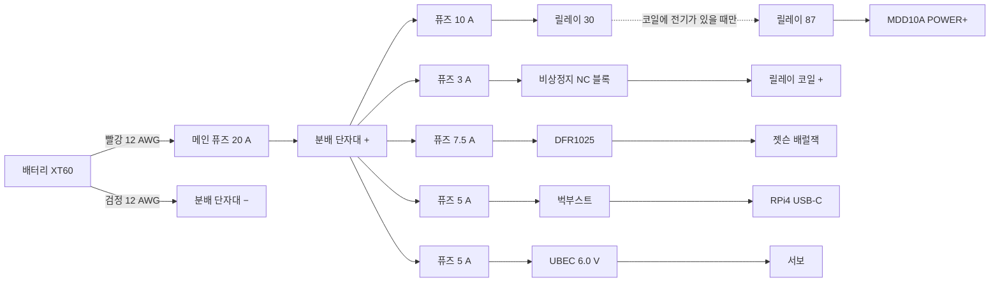

# RC카 조립·배선 따라하기

배선·조립을 처음 하는 사람이 위에서부터 순서대로 따라 할 수 있게 쓴 절차다. 단계마다 무엇과 무엇을 잇는지, 무엇으로 확인하는지, 통과 기준을 적었다.
설계 근거는 [차량 제어 상세 명세](../design/vehicle-control-spec.md)(이하 명세)다.

> 상태: 2026-11-05 실물 부품 기준. **[확인 필요]** 는 아직 자료가 없어 정하지 못한 것이고, [10장](#10-확인-필요-목록)에 확인 방법을 모았다.
> 퓨즈 값은 [5.3](#53-퓨즈-값-확정)에서 확정한다(입력 쪽은 2026-11-06 확정). 확정하기 전의 퓨즈는 끼우고 통전하지 않는다. 측정값은 [9장](#9-측정-기록)에 적는다.

## 0. 이 문서 쓰는 법

- 7장의 단계 A 부터 순서대로 한다. 단계 끝의 확인 항목을 모두 통과해야 다음 단계로 간다.
- 확인 항목이 하나라도 안 맞으면 거기서 멈춘다. 사진과 측정값을 팀에 공유하고, 추측으로 다음 단계를 하지 않는다.
- 연결은 5장(전원)과 6장(신호)의 번호(P01, S01 …)로 부른다. 선을 하나 이을 때마다 표에 체크한다.
- 선에는 마스킹 테이프로 번호를 붙인다(예: `P05`). 나중에 문제를 찾을 때 이 번호로 찾는다.

## 1. 안전 규칙

1. 배터리(XT60)는 문서가 "배터리를 연결한다"고 할 때만 꽂는다. 배선·납땜·나사를 조일 때는 항상 뽑혀 있어야 한다.
2. 차를 쓰지 않을 때도 XT60 을 뽑는다. 꽂아 두면 변환기와 전압 체커가 배터리를 조금씩 써서 과방전된다.
3. 빨간 선은 +, 검은 선은 − 다. 다른 색 선을 쓰면 테이프로 + / − 를 표시한다. 릴레이 소켓 선은 예외다. 색이 극성과 맞지 않으니(코일 + 인 86 이 검정, 쓰지 않는 87a 가 빨강) 번호 테이프로만 찾는다.
4. 전원을 넣기 전에 멀티미터로 + 와 − 사이가 이어져 있지 않은지(단락 없음) 본다.
5. 바퀴가 도는 시험은 차를 상자 위에 올려 바퀴가 공중에 뜬 상태에서 한다. 한 명은 비상정지 버튼에 손을 올리고 있는다.
6. 도는 바퀴나 기어를 손으로 잡지 않는다.
7. 배터리가 부풀거나, 뜨겁거나, 냄새가 나면 즉시 분리해 리포 백에 넣고 쓰지 않는다.
8. 퓨즈는 선이 타는 것을 막을 뿐 부품을 지켜 주지 않는다. 극성과 전압 확인이 먼저다.
9. 배터리 전압 경보가 울리면 즉시 멈추고(`s` 또는 비상정지), 보드가 켜져 있으면 11번대로 끈 뒤 XT60 을 뽑고, 그날 시험을 끝낸다. 경보장치는 소리만 낼 뿐 전원을 끊지 않는다.
10. MDD10A 의 모터 출력(M1A·M1B·M2A·M2B)과 모터 선은 GND 가 아니다. 어느 것도 배터리 − 나 GND 에 잇지 않는다.
11. 보드(RPi4·젯슨)가 켜져 있으면 XT60 을 바로 뽑지 않는다. 켜진 채 전원을 끊으면 SD 카드의 파일이 깨질 수 있다.
    - RPi4(Xenova 이미지)는 [`xenova-vm poweroff`](../platform/cli-manager-spec.md#cmd-poweroff), 젯슨은 `sudo poweroff` 로 끈다. 2분 기다린 뒤 뽑는다.
    - 명령이 오류로 끝나면 뽑지 말고 소프트웨어 담당과 확인한다.
    - 연기·냄새·과열처럼 위험할 때는 기다리지 않고 바로 뽑는다.
12. 지금은 ESP32 가 비상정지를 알지 못한다(S09 보류). 비상정지를 눌렀으면 풀기 전에 ESP32 를 리셋한다(EN 버튼을 누르거나 USB 를 다시 꽂는다). ESP32 는 켜지면 무장이 풀린 상태라 새 `a` 전까지 움직이지 않는다. 리셋하지 않고 풀면 하던 명령대로 바퀴가 다시 돌 수 있다.
13. 전원을 넣은 채로 선을 손으로 눌러 잇지 않는다. 연결은 손을 떼도 빠지지 않게 조인 뒤 전원을 넣는다. 불꽃이 보이면 바로 전원을 끊고, 탄 자국과 단락(선 끝이 옆 나사·금속 판에 닿았는지)을 먼저 본다.

## 2. 용어

| 말 | 뜻 |
| --- | --- |
| + / − (극성) | 전기가 나가는 쪽과 돌아오는 쪽. 바꿔 이으면 부품이 탈 수 있다 |
| GND | − 와 같은 뜻. 전원과 신호의 GND 는 서로 이어 기준을 맞춘다. **단, MDD10A 모터 출력 M1A·M1B·M2A·M2B 와 모터 선은 GND 가 아니다** |
| 단락(쇼트) | + 와 − 가 직접 닿는 것. 큰 전류가 흘러 불꽃이 튀고 불이 날 수 있다 |
| 통전 | 두 점이 전선처럼 이어져 있는 것. 멀티미터 통전 모드에서 '삐' 소리가 난다 |
| 퓨즈 | 전류가 너무 많이 흐르면 끊어지는 부품. 색으로 용량을 구분한다(3장) |
| 변환기 | 배터리 전압(약 12 V)을 5 V 같은 다른 전압으로 바꾸는 판. UBEC 은 서보용 변환기다 |
| 릴레이 | 작은 전기(코일)로 큰 전기(모터 전원)를 켜고 끄는 전기 스위치 |
| 코일 | 릴레이를 움직이는 부분. 85·86 핀이다 |
| NC / NO | NC 는 평소 붙어 있다가 누르면 떨어지는 접점, NO 는 평소 떨어져 있다가 누르면 붙는 접점 |
| PWM·듀티 | 빠르게 켰다 껐다 해서 세기를 조절하는 신호. 듀티 30 % 는 30 % 시간만 켜진다는 뜻 |
| 풀다운 저항 | 신호선이 아무 데도 안 이어졌을 때 0 V(Low)로 붙잡아 두는 저항 |
| AWG | 선 굵기 번호. 숫자가 작을수록 굵다(12 AWG 가 16 AWG 보다 굵다) |
| 페룰 | 꼬인 선 끝에 씌워 압착하는 금속 관. 나사 단자에 선을 넣을 때 쓴다 |

## 3. 준비물과 공구 쓰는 법

### 3.1 준비물

| 준비물 | 용도 | 상태 |
| --- | --- | --- |
| 멀티미터 | 통전·극성·전압 확인 | 없음. 교육장이나 다른 팀에서 빌린다 |
| 전류 제한 전원공급기 + 악어 클립 | 첫 통전, 변환기 전압 맞추기, 릴레이 확인 | 없음. 빌릴 수 없어 12 V SMPS 어댑터와 HW-688 로 대신한다(단계 F·H 의 '전원공급기가 없을 때') |
| 온도계(적외선 온도계 등) | 변환기 온도 | 없음. 빌린다. 없으면 온도 확인은 완료로 치지 않는다 |
| 와이어 스트리퍼, 니퍼 | 피복 벗기기, 선 자르기 | 빌린다 |
| 인두기(60 W 이상)·납·인두 받침 | XT60·DFR1025 단자대 납땜, 선 잇기 | 빌린다 |
| 열풍기(없으면 라이터) | 열수축 튜브 수축 | 빌린다 |
| 작은 일자·십자 드라이버 | 나사 단자, 가변저항, 서보 혼 나사 | 빌린다 |
| 마스킹 테이프·펜, 케이블 타이, 절연 테이프 | 선 번호, 정리 | 준비 |
| 1N4007 다이오드 1개 | 릴레이 코일 보호(P10) | 없음. 릴레이에 내장 다이오드가 없어(단계 F-6, 2026-11-06) 필요하다. 교육장에서 구하거나 구매. 없는 동안에도 릴레이는 동작한다(비상정지 접점 수명이 조금 준다) |
| PC817 포토커플러 1개(또는 비상정지 NC 접점 블록 1개) | 비상정지 상태 신호(S09) | 없음. 주문. 오면 S09 를 단다 |
| 점퍼선(듀폰 암-암, 암-수, 수-수) | ESP32 신호선, 단계 C·D 시험 배선 | 있음 |
| 브레드보드(830구멍), 저항 키트(1/4 W 1 %), 로직 분석기(24 MHz 8채널) | 단계 D 신호 확인, 단계 F-6 b 의 100 Ω | 있음 |
| ESP32 38핀 터미널 확장 보드(권장) | 신호선을 나사로 고정 | 없음. 사면 납땜이 줄어든다 |
| 만능기판 작은 것(권장) | 풀다운 저항 고정 | 없음 |
| 선: 12 AWG 빨강·검정 1 m 씩, 16 AWG 빨강·검정 1 m 씩, 22 AWG 6심 실드 | 주 전원, 분기, 엔코더 연장 | 있음. 16 AWG 는 단계 G 의 분기와 단계 H 의 전원 선에 같이 쓰니 자르기 전에 길이를 더해 본다 |
| XT60 암수 1세트(Amass) | 수는 하네스(P01·P03), 암은 단계 H 의 전원 선 | 구매 목록에 1세트. 여분이 없으니 납땜할 때 플라스틱이 녹지 않게 한다(3.3) |
| USB-C 2선 케이블(한쪽은 USB-C 수 커넥터, 다른 쪽은 선 두 가닥) | 벅부스트 → RPi4 전원(P16) | 주문함, 배송 대기(2026-11-06). 오면 E4 에서 − 선을 찾는다 |
| 페룰 세트와 압착기(HSC8), 열수축 튜브 | 단자 연결 | 있음 |
| 레버식 커넥터(2구 4개, 5구 2개) | 납땜 없이 선 잇기(퓨즈홀더 선과 분기 선 등, 3.3) | 있음. 라벨의 선 굵기·허용 전류 안에서 쓴다 |
| 인라인 퓨즈홀더(ATO)와 퓨즈 세트 | 분기 보호 | 있음. 퓨즈는 ATO 크기로 3·5·7.5·10·15·20·25·30·35·40 A 각 5개라 5.3 의 확정값이 모두 있다. 홀더 선은 고리로 이어져 오니 잘라 쓴다(5.2). 홀더는 새것 3개(12 AWG)와 전에 쓰던 것 3개(16 AWG)로 6개다. 전에 쓰던 홀더는 쓰기 전에 점검한다(5.2) |
| 충전기와 설명서 | 배터리 충전 | 있음. **[확인 필요]** 모델 |

퓨즈는 색으로 용량을 구분한다(ATO): 3 A 보라, 5 A 연갈색, 7.5 A 갈색, 10 A 빨강, 15 A 파랑, 20 A 노랑, 25 A 흰색(투명), 30 A 초록, 35 A 청록, 40 A 주황. 제조사마다 색이 조금 다를 수 있으니 퓨즈 위에 찍힌 숫자를 먼저 본다.

### 3.2 멀티미터

- 검정 프로브는 COM 구멍, 빨강 프로브는 V·Ω 구멍에 꽂는다. 10 A 구멍은 쓰지 않는다. 이 문서는 멀티미터로 전류를 재지 않는다(전류는 전원공급기 표시로 본다).
- **다이얼을 전류(mA·A) 위치에 두지 않는다.** 그 위치의 멀티미터는 전선과 같아서, 전원 단자에 대면 단락이 된다. 전압이 0 근처로 떨어지고 멀티미터 퓨즈나 장치가 상할 수 있다. 화면에 mA·A 가 보이면 잘못 둔 것이니 바로 전원을 끈다.
- **통전 모드**: 다이얼을 스피커(소리) 기호에 둔다. 두 프로브 끝을 서로 대서 '삐' 소리가 나는지 먼저 본다. 두 점에 대어 '삐' 하면 이어져 있다는 뜻이다. 전원이 들어간 회로에는 쓰지 않는다.
- **저항 모드(Ω)**: 릴레이 코일처럼 몇십 Ω 짜리를 잴 때 쓴다.
- **DC 전압 모드**: 다이얼을 V 옆에 직선(⎓)이 있는 곳의 20 V 범위에 둔다(자동 범위면 V⎓). 빨강을 +, 검정을 − 에 댄다. 숫자 앞에 '−' 가 붙으면 프로브를 반대로 댄 것, 즉 생각한 극성이 반대라는 뜻이다.
- 다 쓰면 OFF 로 돌린다.

### 3.3 선 끝 처리

- **페룰**: 선 굵기에 맞는 페룰을 고른다. 22 AWG → E0508, 18 AWG → E1008, 16 AWG → E1508, 12 AWG → E4012.
  1. 페룰 금속 부분 길이만큼 피복을 벗긴다(이름 끝 두 자리: 08 은 8 mm, 12 는 12 mm).
  2. 선 가닥을 손으로 꼬아 한 덩어리로 만든다.
  3. 페룰에 끝까지 넣는다. 금속 밖으로 가닥이 삐져나오지 않아야 한다.
  4. 압착기의 맞는 칸에 넣고 끝까지 눌러 압착한다.
  5. 세게 당겨 빠지지 않는지 본다.
- **나사 단자**: 나사를 풀고 페룰을 끝까지 넣은 뒤 조인다. 선을 당겨 빠지지 않는지 본다. 피복이 단자 안에 물리면 안 된다.
- **선끼리 잇기**: 열수축 튜브를 먼저 한쪽 선에 끼운다. 두 선 끝을 나란히 꼬아 납땜하고, 튜브를 접합부 위로 밀어 열풍기로 수축한다.
- **레버식 커넥터**(투명한 몸통에 레버가 달린 것): 납땜 없이 선을 잇는다. 라벨의 선 굵기 범위와 허용 전류 안에서만 쓴다. 피복을 11 mm 쯤 벗겨 끝까지 넣고 레버를 닫은 뒤 당겨 본다.
- **XT60 납땜**: 경험자가 있으면 같이 한다. 인두 팁은 있는 것 중 가장 굵은 끌 모양으로 바꾸고, 납을 대면 2\~3초 안에 녹아 퍼지는 온도로 둔다(유연 납 370 °C 쯤, 무연 납 400 °C 쯤). 온도가 낮으면 오래 대게 되어 오히려 플라스틱이 녹는다.
  1. 납땜할 XT60 을 짝 XT60 에 끼운 채로 집게에 물리거나 테이프로 책상에 고정한다. 짝에 끼워 두면 열에 플라스틱이 물러져도 핀이 비뚤어지지 않는다. 배터리에 끼운 채로는 하지 않는다.
  2. 열수축 튜브(지름 6 mm 쯤, 2 cm)를 선에 먼저 끼워 납땜할 곳에서 멀리 밀어 둔다. 납땜한 뒤에는 끼울 수 없다.
  3. 선 끝 피복을 금색 컵 높이만큼(4\~5 mm) 벗기고 가닥을 꼬아 한 덩어리로 만든다. 더 길게 벗기면 구리가 컵 밖으로 나와 옆 컵에 닿을 수 있다. 컵은 반쯤 열린 관이고 열린 쪽이 바깥을 향한다. 선은 컵 위에서 핀과 나란히 넣는다.
  4. 선 끝에 납을 입힌다. 인두를 선 아래에 대고 위에서 납을 대면 가닥 사이로 스며든다. 가닥이 모두 은색으로 덮이면 뗀다.
  5. 컵이 위를 보게 두고, 인두를 컵 바깥 면에 대어 컵 안에 납을 반쯤 채운다.
  6. 인두로 컵을 데워 납이 녹으면 선을 컵 바닥까지 넣는다. 인두를 떼고, 납이 굳을 때까지 5초쯤 선을 움직이지 않는다.
  7. 식은 뒤 본다. 납이 매끈하게 반짝이며 컵과 선 사이를 채웠으면 된다. 회색으로 푸석하거나 덩어리로 얹혀 있으면 다시 데워 고친다. 넘친 납이 옆 컵에 닿으면 안 된다.
  8. 다른 컵은 첫 컵이 식은 뒤에 같은 방법으로 한다.
  9. 열수축을 컵이 다 덮이게 밀어 올려 수축한다(열풍기, 없으면 라이터 불꽃 위쪽에서 돌려 가며). 선을 세게 당겨 본다.
  - 잘못 붙였으면 컵을 다시 데워 선을 빼고 3 부터 다시 한다. 플라스틱이 녹아 핀이 기울었으면 그 XT60 은 쓰지 않는다.

## 4. 부품과 단자 이름

| 부품 | 단자 이름(실물 인쇄) | 메모 |
| --- | --- | --- |
| 배터리 3S 11.1 V 7600 mAh | XT60 암(굵은 노란 커넥터, 구멍 2개), 밸런스 커넥터(작은 흰 4핀) | 완충 12.6 V(LiPo 기준). **[확인 필요]** 라벨로 LiPo 인지 LiHV 인지 |
| 충전기 YS POWER e4S | 주 전원 단자(XT60), 밸런스 단자 5칸(`4 3 2 1 ⊖`), 버튼 2개(`BATT`, 둥근 전류 버튼) | 앞면 배치가 SkyRC e4S 설명서와 같다(2026-11-06 사진). 주 전원 단자가 XT60 이라 배터리를 바로 꽂는다 |
| 모터 드라이버 Cytron MDD10A | 큰 단자대 6칸: M1B·M1A·POWER+·POWER−·M2A·M2B. 신호 핀 5개: GND·PWM2·DIR2·PWM1·DIR1. 테스트 버튼 M1A·M1B·M2A·M2B | 역극성 보호가 없다. 신호는 3.3 V 그대로 받는다(High 3\~5.5 V). M1A·M1B·M2A·M2B 는 GND 가 아니다 |
| 모터 JGB37-520R30-12 ×2 | 6핀 커넥터(PH2.0) | 정격 12 V, 엔코더 전원 3.3\~5 V. **[확인 필요]** 6핀 배열, 스톨 전류(섀시 표 3.2 A, PDF 2.3 A 로 다름) |
| 서보 LD-1501MG | 3핀: 흰(신호)·빨(+)·검(−) | 동작 6\~8.4 V. 혼이 이미 조향 링크에 붙어 있다 |
| 서보 전원 UBEC 10A 2-6S | 아래쪽: 입력 Input +·−(끝이 벗겨진 빨강·검정), SW(ON/OFF 스위치가 달린 빨강·검정, OFF 면 출력 0 V). 위쪽: 출력 Output(빨강·검정) | 주문명(Hobbywing 5A)과 다른 제품. 출력 6.0·7.4·8.4 V 점퍼(라벨 그림상 6.0 V 는 점퍼 없음). SW 도 빨강·검정이라 입력과 헷갈리지 않는다 |
| 젯슨 전원 DFR1025 | 입력 VIN+·GND, 출력 VOUT+·GND, DIP 스위치 5개 | 입력 9\~15 V. 단자대 2개를 납땜해야 한다 |
| RPi4 전원 벅부스트 5 A (CW-07…) | 아래 단자 IN, 위 단자 OUT, 파란 가변저항 | 지금 출력값을 모른다 |
| 보조 5 V HW-688 | 입력 VIN+·VIN−(배럴잭 쪽), 출력 5V·GND(USB 쪽), 출력이 나오면 켜지는 PWR LED | 지금은 연결하지 않아도 된다 |
| 릴레이 KKA A4F 012-1Z-22 + 소켓 | 바닥에 85·86(코일), 30(공통), 87(코일에 전기가 있을 때만 30 과 연결), 87a(평소 30 과 연결, 안 씀)이 새겨져 있다 | 내장 다이오드가 없어 코일 극성이 없다(단계 F-6). 86 을 +, 85 를 − 로 쓴다. 위에 초록 30 A 퓨즈가 꽂혀 온다(구입 때부터). 30↔87 길(모터 전원 길)에 있어서 빼면 모터에 전기가 가지 않으니 꽂아 둔다(F-7). 소켓 선 색(E2 실측): 85 흰, 86 검정, 30 파랑, 87 노랑, 87a 빨강. 굵기: 30·87·87a 14 AWG, 85·86 16 AWG |
| 비상정지 KGE-N4R1R | 접점 블록 2개, 블록마다 나사 2개. 블록은 레버를 옆으로 밀어 빼는 끼움식 | 위 블록 NO, 아래 블록 NC(단계 E1). NC 가 하나뿐이다 |
| ESP32 DevKitC V4 | 양쪽 핀 19개씩. 핀 옆에 `25`, `GND`, `3V3`, `5V` 처럼 인쇄(보드에 따라 `IO25`·`D25`) | 전원은 USB 하나만 |
| 분배 단자대 SZH-CP010 ×2 | 입력 1(큰 나사 M5, 10\~35 SQ 용), 출력 12(작은 나사, 1.5\~6 SQ 용) | 하나가 한 줄짜리(입력 하나에 출력이 모두 이어짐)라 2개를 + 용, − 용으로 하나씩 쓴다. 빨강·검정 테이프로 표시해 둔다. 회로당 30\~40 A, 660 V. 입력 큰 나사는 12 AWG(약 3.3 SQ)에 너무 커서 쓰지 않고, 메인 선도 출력 구멍 하나에 넣는다. 16 AWG(약 1.3 SQ)는 출력 구멍 최소 굵기보다 조금 가늘어 꼭 페룰(E1508)을 압착해 넣는다 |

이 문서는 부품을 실물에 인쇄된 이름으로 부른다. 구매 목록 이름과 다른 것은 아래로 찾는다.

| 문서 이름 | 구매 목록 이름 | 실물에서 찾는 표시 |
| --- | --- | --- |
| 비상정지 | [KGAUTO] 비상 정지용 푸쉬록턴 리셋 스위치 적색 [KGE-N4R1R] | 빨간 버튼, 뒤에 접점 블록 2개 |
| 릴레이 + 소켓 | [SMG] KKA-A4F 변환형 릴레이 12V 30A 5핀 (소켓 포함) [TYE-RL038] | 옆면 `KKA A4F 012-1Z-22`, 선 5가닥 달린 소켓 |
| 벅부스트 (RPi4 전원) | DC-DC Buck Boost Converter Module (5A) | 보드 인쇄 `CW-07…`, 파란 가변저항, 알루미늄 방열판 |
| DFR1025 (젯슨 전원) | [DFROBOT] 60W Adjustable DC-DC Buck Converter Module [DFR1025] | `20A Buck Module V1.0`, DIP 스위치 5개, 따로 든 단자대 2개 |
| HW-688 (보조 5 V) | [SMG] 5V 5A DC-DC 스텝다운 컨버터 모듈 [SZH-EK366] | 보드 인쇄 `HW-688`, 배럴잭, USB-A 단자 |
| UBEC (서보 전원) | 주문은 Hobbywing 고효율 2-8S 5A UBEC 이지만 다른 제품이 왔다 | 라벨 `UBEC 10A 2-6S`, 6.0·7.4·8.4 V 점퍼 |
| 젯슨용 DC 플러그 케이블 | DC전원 DC플러그 케이블 18AWG 외경 5.5mm 내경 2.1mm | 한쪽은 원통 플러그, 다른 쪽은 선 두 가닥 |
| (참고) 젯슨 전용 어댑터 | 젯슨 구성품. 5 V 4 A 직류전원장치(TY0500400K1…) | 벽 콘센트 플러그와 원통 플러그. 책상에서만 쓰고 차 배선에는 쓰지 않는다. 12 V 어댑터와 플러그가 같으니 `5 V`·`12 V` 테이프로 구분한다 |
| 모터 | 섀시 키트(듀얼 인코더 모터 … 4WD 금속 애커만 RC 섀시)의 뒤쪽 모터 2개 | 라벨 `JGB37-520R30-12` |
| 분배 단자대 | [SMG] 전원분배 단자대 / 터미널블럭 (입력1, 출력12) [SZH-CP010] | 입력 1칸, 출력 12칸 |

## 5. 전원 연결

### 5.1 그림

입력 쪽 퓨즈 값은 5.3 에서 확정했다(2026-11-06). 그림의 값이 확정값이다.



그림에 없는 − 쪽: MDD10A POWER−, 릴레이 코일 −, 각 변환기의 입력 − 는 모두 분배 단자대 − 로 간다(P06·P09·P12·P15·P18).
비상정지를 누르면 릴레이 코일 전기가 끊겨 87 이 떨어지고, MDD10A 전원이 꺼진다.
릴레이 코일에는 극성이 없다(내장 다이오드 없음, 단계 F-6, 2026-11-06). 이 문서는 86 을 +, 85 를 − 로 쓰고, P10 다이오드도 이 방향으로 단다.

### 5.2 연결표

퓨즈는 연결하는 동안 모두 빼 둔다. 값은 5.3 에서 확정했고(2026-11-06), 끼우는 때는 각 단계에 적었다(서보 퓨즈는 단계 K). 잇는 순서와 방법은 단계 G 에 있다.

| 번호 | 어디서 | 어디로 | 선 | 퓨즈(5.3 확정값) |
| --- | --- | --- | --- | --- |
| P01 | 배터리 짝 XT60 + 컵 | 메인 퓨즈홀더 짧은 선 | 퓨즈홀더 선(12 AWG)을 컵에 바로 납땜하고 열수축. 따로 빨강 선을 쓰지 않는다. 배터리와 퓨즈 사이 선은 보호되지 않으니 짧게 | — |
| P02 | 메인 퓨즈홀더 긴 선 | 분배 단자대 + 의 출력 구멍 하나(입력 큰 나사는 12 AWG 에 너무 크다) | 퓨즈홀더 선 + 페룰 E4012 | 20 A |
| P03 | 배터리 짝 XT60 − 컵 | 분배 단자대 − 의 출력 구멍 하나 | 12 AWG 검정, XT60 에 납땜, 다른 끝은 페룰 E4012 | — |
| P04 | 분배 + 출력 | 모터 퓨즈 → 릴레이 30 선(파랑) | 퓨즈홀더 선(12 AWG). 분배 쪽은 페룰 E4012, 릴레이 쪽은 30 선과 2구 레버식 커넥터 | 10 A (분배 단자대 쪽에 둔다) |
| P05 | 릴레이 87 선(노랑) | MDD10A POWER+ | 87 선과 16 AWG 빨강을 2구 레버식 커넥터로 잇고, 빨강 끝은 페룰 E1508 | — |
| P06 | MDD10A POWER− | 분배 − 출력 | 16 AWG 검정, 양 끝 페룰 E1508, 짧고 곧게 | — |
| P07 | 분배 + 출력 | 코일 퓨즈 → 비상정지 NC 블록(아래) 한쪽 나사 | 퓨즈홀더 선(16 AWG), 양 끝 페룰 E1508 | 3 A |
| P08 | 비상정지 NC 블록 다른쪽 나사 | 릴레이 코일 + 선(86, 검정) | 16 AWG 빨강. 비상정지 쪽은 페룰 E1508, 릴레이 쪽은 86 선과 2구 레버식 커넥터 | — |
| P09 | 릴레이 코일 − 선(85, 흰) | 분배 − 출력 | 85 선 끝 페룰 E1508 | — |
| P10 | 1N4007 띠(흰 줄) 쪽 다리 → 코일 + 선(86), 띠 없는 쪽 다리 → 코일 − 선(85) | (코일 양쪽) | 다리를 각 선에 납땜하고 열수축. 띠를 반대로 달면 전원을 넣는 순간 단락이 되니 띠가 86 쪽인지 두 번 본다. 다이오드가 없는 동안에는 비워 둔다 | — |
| P11 | 분배 + 출력 | 젯슨 퓨즈 → DFR1025 입력 VIN+ | 퓨즈홀더 선(12 AWG), 양 끝 페룰 E4012 | 7.5 A |
| P12 | DFR1025 입력 GND | 분배 − 출력 | 16 AWG 검정, 양 끝 페룰 E1508 | — |
| P13 | DFR1025 VOUT+ / 출력 GND | DC 플러그 케이블 빨강(+) / 검정(−) → 젯슨 배럴잭 | 케이블 선(18 AWG) 끝에 페룰 E1008(E4 에서 빨강이 + 임을 확인) | — |
| P14 | 분배 + 출력 | RPi4 퓨즈 → 벅부스트 IN+ | 퓨즈홀더 선(16 AWG), 양 끝 페룰 E1508 | 5 A |
| P15 | 벅부스트 IN− | 분배 − 출력 | 16 AWG 검정, 양 끝 페룰 E1508 | — |
| P16 | 벅부스트 OUT+ / OUT− | USB-C 2선 케이블 + 선 / − 선 → RPi4 USB-C | 케이블 그대로(단계 E 에서 − 선 확인) | — |
| P17 | 분배 + 출력 | 서보 퓨즈 → UBEC Input +(빨강) | 퓨즈홀더 선(16 AWG). 분배 쪽은 페룰 E1508, UBEC 쪽은 입력 빨강과 2구 레버식 커넥터 | 5 A |
| P18 | UBEC Input −(검정) | 분배 − 출력 | 입력 검정과 16 AWG 검정을 2구 레버식 커넥터로 잇고, 검정 끝은 페룰 E1508 | — |
| P19 | UBEC 출력 | 서보 커넥터 빨(+)·검(−) | UBEC 출력은 3핀 서보형 암 커넥터(검 −, 빨 +, 신호 칸은 비어 있음). 서보 커넥터도 암이면 바로 맞물리지 않으니 3핀 수 헤더로 중계한다. 서보는 멈출 때 2.4\~3 A 를 쓰니 브레드보드로는 잇지 않는다 **[확인 필요]** 서보 커넥터 모양과 중계 방법 | — |
| P20 | 분배 + / − 출력 | 보조 퓨즈 → HW-688 VIN+ / VIN− | 16 AWG | 3 A. 나중에 필요할 때 |

- 분배 단자대 출력 하나에는 선 하나만 넣는다.
- 장치 쪽 연결은 그 장치를 시험하는 단계에서 한다. 그 전에는 빼 둔다: P13·P16 의 보드 쪽 플러그는 단계 I(끝나면 빼고 단계 L 에서 다시 꽂는다), P19(서보)는 단계 K 에서 혼을 뺀 뒤, 모터(S12)는 단계 J.
- 선이 닿지 않으면 같은 색 16 AWG 를 레버식 커넥터로 이어 늘인다. 메인(P02)만은 12 AWG 빨강을 납땜으로 이어 열수축한다(3.3). 퓨즈홀더 선(12 AWG)이나 그 페룰이 장치 단자에 안 들어갈 때도 16 AWG 를 레버식 커넥터로 이어 그 끝을 넣는다.
- 퓨즈는 선이 시작하는 쪽(분배 단자대 쪽)에 둔다. 그래야 그 뒤의 선 전체가 보호된다.
- 인라인 퓨즈홀더는 선이 고리 모양으로 이어진 채 온다. 반드시 잘라 두 가닥으로 쓴다. 자르지 않으면 퓨즈 양쪽이 선으로 바로 이어져 전류가 퓨즈를 거치지 않는다. 퓨즈를 끼운 뒤에는 달린 뚜껑을 닫는다.
- 퓨즈홀더는 6개(메인·모터·코일·젯슨·RPi4·서보)가 필요하다. 보조를 쓰면 1개 더.
  - 새 12 AWG 홀더 3개는 전류가 큰 메인·모터·젯슨에, 전에 쓰던 16 AWG 홀더 3개는 코일·RPi4·서보에 쓴다. 메인은 12 AWG 선 위에 놓이니 꼭 12 AWG 홀더를 쓴다. 16 AWG 홀더는 분기 선과 굵기가 같다.
  - 전에 쓰던 홀더 점검: 접점이 타거나 녹슬지 않았는지, 플라스틱이 녹거나 변색되지 않았는지, 뚜껑이 닫히는지 본다. 퓨즈를 끼우면 양쪽 선 끝 사이 '삐', 빼면 조용해야 한다. 안에 있던 옛 퓨즈는 빼고 5.3 에서 정한 값의 새 퓨즈를 쓴다.

### 5.3 퓨즈 값 확정

위 표의 값은 명세 §7 의 후보에서 출발했다. 입력 쪽 표는 단계 G 전에(2026-11-06 확정), 변환기 출력 쪽 표는 그 출력을 장치에 잇기 전(단계 I·K)에 팀이 확정한다. 확정하기 전에는 그 퓨즈를 끼우고 통전하지 않는다.

- 참고 계산: 퓨즈 정격은 평소 최대 전류 ÷ 0.75 이상으로 잡는다. 퓨즈를 정격의 75 % 이하로 쓰는 [Littelfuse 기준](https://info.littelfuse.com/hubfs/Fuseology%20Design%20Guide.pdf)이다. 이 값은 출발점일 뿐이다.
- 실제 퓨즈 자료로 확인할 것: 주변 온도에 따른 감액 곡선, 모터·변환기를 켤 때의 돌입 전류를 견디는지(시간-전류 곡선), 과전류에서 끊어지기까지의 시간.
- 퓨즈 정격은 그 분기에서 가장 약한 부품(선, 릴레이 소켓 선, 분배 단자대, 퓨즈홀더, 장치 단자)의 허용 전류 이하여야 한다. 허용 전류는 표기·판매 페이지·설명서에서 찾아 적고, 찾지 못한 부품이 있으면 확정하지 않는다.
- 세트에 정한 값이 없으면 다른 값으로 바꿔 끼우지 않는다. 팀이 다시 정하거나 퓨즈를 구한다.

입력 쪽(배터리 쪽) 퓨즈

| 분기 | 평소 최대 전류 근거 | 후보 | 가장 약한 부품과 허용 전류 | 확정값 |
| --- | --- | --- | --- | --- |
| 메인 | 전 분기 합산 최악 약 12 A + 돌입(명세 §7) | 20 A | 12 AWG 퓨즈홀더(몸통 정격 표기 없음, 선은 UL1015 12 AWG 105 °C 600 V), XT60, 분배 단자대(회로당 30\~40 A) | 20 A |
| 모터 | 스톨 3.2 A × 2 = 6.4 A (PDF 값 2.3 A 면 4.6 A) | 10 A | 12 AWG 퓨즈홀더, 16 AWG 선, 릴레이 소켓 30·87 선 14 AWG | 10 A |
| 코일 | 12.6 V ÷ 코일 저항 78 Ω(E2 실측) ≈ 0.16 A | 3 A | 16 AWG 퓨즈홀더(전에 쓰던 것)와 16 AWG 선, 릴레이 소켓 85·86 선 16 AWG | 3 A |
| 젯슨 | 5.1 V × 4 A ÷ 0.9 ÷ 11.1 V ≈ 2 A + 돌입 | 7.5 A | 12 AWG 퓨즈홀더, 16 AWG 선 | 7.5 A |
| RPi4 | 5 V × 3 A ÷ 0.9 ÷ 11.1 V ≈ 1.5 A | 5 A | 16 AWG 퓨즈홀더(전에 쓰던 것)와 16 AWG 선 | 5 A |
| 서보 | 7.4 V × 3 A ÷ 0.9 ÷ 11.1 V ≈ 2.2 A | 5 A | 16 AWG 퓨즈홀더(전에 쓰던 것), 16 AWG 선, UBEC 입력선 | 5 A |
| 보조 | 약 1.3 A (명세 §7) | 3 A | 지금은 쓰지 않는다 | — |

확정 근거(2026-11-06): 분기마다 평소 최대 전류 ÷ 0.75 가 퓨즈 값보다 작고, 가장 약한 부품의 허용 전류는 퓨즈 값보다 크다. 퓨즈 세트에는 제조사 자료가 없어 일반 ATO 퓨즈 특성으로 본다.

변환기 출력 쪽

변환기는 전압을 낮추면서 전류를 키운다. 예를 들어 젯슨 쪽 5 V 4 A 는 배터리 쪽에서 약 2 A 다. 그래서 입력 퓨즈가 끊어지지 않아도 출력 케이블·커넥터에는 그보다 큰 전류가 흐를 수 있다. 입력 퓨즈만으로 출력 쪽 선이 보호된다고 보지 않고 따로 확인한다.

| 변환기 → 부하 | 출력 최대 전류(사양) | 출력 케이블·커넥터와 허용 전류 | 변환기 출력 보호의 작동 전류·시간 | 결정(출력 퓨즈 필요 여부) |
| --- | --- | --- | --- | --- |
| DFR1025 → 젯슨 | 18 A (능동 냉각 조건) | DC 플러그 케이블(18 AWG), 배럴잭 | **[확인 필요]** | |
| 벅부스트 → RPi4 | 5 A (제품명) | USB-C 2선 케이블 | **[확인 필요]** | |
| UBEC → 서보 | 10 A (라벨) | 서보 선과 커넥터 | **[확인 필요]** | |
| HW-688 → 보조 | 5 A (제품명) | 보조 부하 선 | **[확인 필요]** | |

- 출력 퓨즈를 생략하는 것은 변환기 출력 보호가 작동하는 전류와 시간을 확인해, 그 보호로 출력 케이블과 커넥터를 지킬 수 있을 때뿐이다. 보호 기능이 있어도 작동 전류가 케이블·커넥터 허용 전류보다 높으면 케이블이 먼저 뜨거워질 수 있다.
- 보호가 모자라거나 확인되지 않으면 출력 쪽에 보호(퓨즈)를 따로 둔다. 값은 위 참고 계산과 같은 방법으로 정하고, 출력 케이블·커넥터 허용 전류 이하로 한다.

## 6. 신호 연결 (ESP32)

모터 채널은 차 뒤에서 앞을 보고 왼쪽 뒷바퀴를 M1, 오른쪽 뒷바퀴를 M2 로 한다.
핀은 부팅 때 신호가 튀지 않는 것으로 골랐다(명세 §4.3 의 풀다운 규칙과 함께).

| 번호 | ESP32 핀 | 어디로 | 메모 |
| --- | --- | --- | --- |
| S01 | 25 | MDD10A PWM1 (왼쪽 속도) | S06 풀다운 |
| S02 | 32 | MDD10A DIR1 (왼쪽 방향) | |
| S03 | 26 | MDD10A PWM2 (오른쪽 속도) | S06 풀다운 |
| S04 | 33 | MDD10A DIR2 (오른쪽 방향) | |
| S05 | GND | MDD10A 신호 핀 GND | 신호 기준. 꼭 잇는다 |
| S06 | — | 10 kΩ 저항 3개: 25–GND, 26–GND, 27–GND | 띠 4개면 갈색·검정·주황, 5개면 갈색·검정·검정·빨강. ESP32 가 꺼지거나 리셋돼도 모터·서보 신호를 0 으로 붙잡는다 |
| S07 | 27 | 서보 흰 선(신호) | S06 풀다운 |
| S08 | GND | 서보 검 선(UBEC 출력 −) | 서보 신호 기준 |
| S09 | 13, GND | **보류**. 지금은 13 번과 GND 를 점퍼선으로 이어 둔다(풀림 상태) | 비상정지 NC 가 하나뿐이라 릴레이 코일(P07·P08)에만 쓴다. 상태 신호는 PC817(또는 NC 블록)이 오면 단다. 그동안 1장 12번대로 한다. 선택: 위 NO 블록을 ESP32 EN 과 GND 에 이으면 누를 때 ESP32 가 저절로 리셋된다(게이트웨이 동작은 단계 M 에서 확인) |
| S10 | 3V3, GND, 18, 19 | 왼쪽 엔코더 VCC, GND, A, B | **5V 에 잇지 않는다.** 6핀 배열 확인 뒤 |
| S11 | 3V3, GND, 22, 23 | 오른쪽 엔코더 VCC, GND, A, B | 같음 |
| S12 | — | 모터 전원 두 핀: 왼쪽 → MDD10A M1A·M1B, 오른쪽 → M2A·M2B | 6핀 배열 확인 뒤. GND 에 잇지 않는다 |
| S13 | 35 | 배터리 전압(선택): 분배 + → 47 kΩ → 35 → 10 kΩ → GND | 47 kΩ 는 분배 단자대에 바로 꽂아 긴 선이 저항 뒤에 오게 한다. 12.6 V 일 때 35 번 핀이 약 2.2 V |
| S14 | Micro USB | 책상 시험은 PC, 차에서는 RPi4 USB | ESP32 전원은 이것 하나만. 5V·3V3 핀에 다른 전원을 넣지 않는다 |

## 7. 따라하기

### 단계 A. 배터리 충전 (언제든, 다른 단계와 같이)

1. 충전기(YS POWER e4S)는 [SkyRC e4S 설명서](https://www.skyrc.com/files/347/7504-2044-02%20100229_Instruction%20manual_V.9.pdf)와 앞면 배치가 같다(2026-11-06 사진). 아래 버튼·LED 는 이 설명서를 따른다. 다른 충전기를 쓰면 그 설명서를 따르고 이 단계를 고친다.
2. 배터리 라벨에서 종류를 확인한다. 일반 LiPo 는 셀당 4.20 V, LiHV 는 4.35 V 까지 충전한다. 일반 LiPo 를 LiHV 로 충전하면 과충전되어 불이 날 수 있다. 라벨이 11.1 V 이고 `HV`·`4.35V` 표시가 없으면 일반 LiPo 다.
3. 배터리가 부풀거나 찍힌 곳이 없는지 본다. 리포 백 안에 넣고, 지퍼는 선이 나올 만큼만 열어 둔다. 주변의 탈 것을 치운다.
4. 충전기는 책상처럼 단단하고 바람이 통하는 곳에 둔다. 천이나 의자 위에 두면 아래 통풍구가 막힌다. 전원 코드를 콘센트에 꽂고, 배터리 XT60 을 충전기 XT60 단자에, 밸런스 커넥터(흰 4핀)를 밸런스 단자에 **둘 다** 꽂는다. 밸런스 단자는 5칸이고 3S 배터리 커넥터는 4칸이니, 검정 선을 `⊖` 칸에 맞추고 `4` 칸을 비운다.
5. `BATT` 버튼을 짧게 눌러 배터리 종류를 라벨대로(LiPo 면 `LiPo`) 맞추고, 둥근 전류 버튼을 짧게 눌러 `3A` 에 맞춘다(7600 mAh 에서 3 A 는 약 0.4C).
6. 둥근 전류 버튼을 2초 눌러 충전을 시작한다. 잔량 LED(25 %\~100 %)가 초록으로 깜빡이면 충전 중이고, 초록으로 계속 켜져 있으면 끝난 것이다. 중간에 멈추려면 둥근 버튼을 짧게 누른다.
   - `!` LED 가 빨강으로 빠르게 깜빡이면 주 전원(XT60), 느리게 깜빡이면 밸런스 커넥터 연결이 잘못된 것이다. 다시 꽂는다.
   - `!` LED 가 빨강으로 계속 켜져 있으면 셀끼리 전압 차이가 0.6 V 나 된다는 뜻이다. 충전하지 말고 팀에 공유한다.
7. 충전하는 동안 자리를 비우지 않는다.
8. 끝나면 전압 체커를 밸런스 커넥터에 꽂아 셀 전압을 본다. 경보는 셀당 3.5 V 로 맞춘다. 다 보면 뺀다.
9. 시험 중 경보가 울리면 1장 9번대로 멈추고 끝낸다.

확인

- [ ] 충전기 모델과 설명서를 확인함
- [ ] 배터리 종류(LiPo/LiHV)를 라벨로 확인하고 같은 종류로 충전함
- [ ] 셀마다 4.15\~4.20 V(LiPo), 셀끼리 차이 0.05 V 이하
- [ ] 부풂·열·냄새 없음

### 단계 B. 기구 점검과 실측 (전기 없음)

1. 바퀴 고정 나사(황동 커플러의 작은 나사), 모터 브래킷, 판 지지대 나사가 풀리지 않았는지 본다.
2. 바퀴를 손으로 천천히 돌린다. 뒷바퀴는 모터 기어 때문에 뻑뻑한 게 정상이지만 중간에 걸리는 곳이 있으면 안 된다.
3. 조향은 손으로 세게 꺾지 않는다. 서보 기어가 상한다. 조향 한계는 단계 K 에서 잰다.
4. 차체 길이 세 가지를 mm 로 두 번씩 재서 평균을 9장에 적는다.
   - 앞뒤 바퀴 거리(휠베이스): 옆에서 보고 앞바퀴 축 가운데부터 뒷바퀴 축 가운데까지
   - 좌우 바퀴 거리(윤거): 뒤에서 보고 왼쪽 뒷바퀴 타이어 가운데부터 오른쪽 뒷바퀴 타이어 가운데까지
   - 바퀴 지름: 타이어와 바닥에 표시를 하고 한 바퀴 굴려 간 거리를 잰 뒤 3.14 로 나눈다
5. 부품을 임시로 놓아 본다. 배터리는 하층 가운데에 스트랩으로 묶고, 나사 끝이 배터리를 향하지 않게 한다. 보드와 퓨즈는 상층, 비상정지는 손이 바로 닿는 위쪽에 둔다(명세 §7 배치).
6. 금속 판에 PCB 밑면이 닿지 않게 황동 지지대로 띄운다.

확인

- [ ] 걸림 없음
- [ ] 9장의 차체 길이 세 칸을 채움

### 단계 C. ESP32 를 PC 에 연결

1. Arduino IDE 와 ESP32 보드 패키지를 설치한다. [Arduino-ESP32 설치 안내](https://docs.espressif.com/projects/arduino-esp32/en/latest/installing.html)의 "Installing using Arduino IDE" 만 따르면 된다. 같은 페이지의 Windows (manual installation)·Linux·macOS 절과 Development release 링크는 쓰지 않는다.
   1. arduino.cc 에서 Arduino IDE(2.x)를 받아 설치한다.
   2. File > Preferences 의 Additional boards manager URLs 칸에 Stable 링크 `https://espressif.github.io/arduino-esp32/package_esp32_index.json` 을 넣는다.
   3. Tools > Board > Boards Manager 에서 `esp32` 를 검색해 **esp32 by Espressif Systems** 를 설치한다. 버전은 3.x 여야 한다(부록 A 는 2.x 에서 컴파일되지 않는다). 이름이 비슷한 "Arduino ESP32 Boards" 는 다른 보드용이다.
   4. IDE 를 다시 켜고, 설치한 버전을 9.1 에 적는다.
2. ESP32 핀에는 아무것도 꽂지 않고, Micro USB 케이블로 PC 에만 연결한다.
3. Windows 장치 관리자 → 포트(COM & LPT)에 `Silicon Labs CP210x USB to UART Bridge (COMx)` 가 나타나는지 본다.
   - 기타 장치에 `CP2102 USB to UART Bridge Controller` 로 보이면 보드와 케이블은 정상이고 드라이버만 없는 것이다. [CP210x 드라이버](https://www.silabs.com/developer-tools/usb-to-uart-bridge-vcp-drivers) 페이지에서 CP210x Universal Windows Driver 를 받아 압축을 푼다. 그 장치를 오른쪽 클릭 → 드라이버 업데이트 → 내 컴퓨터에서 드라이버 찾아보기 → 푼 폴더를 고른다.
   - 기타 장치에도 보이지 않으면 케이블이 충전 전용일 수 있으니 다른 케이블로 바꾼다.
4. Arduino IDE 에서 보드는 `ESP32 Dev Module`, 포트는 위의 COMx 로 고른다.
5. [부록 A](#부록-a-책상-시험용-esp32-스케치) 스케치를 붙여 넣고 ✓(Verify)로 먼저 컴파일한다. `Sketch uses … bytes` 가 나오면 성공이다. 그다음 업로드(→)한다. `Connecting....` 에서 멈추면 ESP32 의 BOOT 버튼을 누르고 있다가 업로드가 시작되면 뗀다.
6. 시리얼 모니터를 115200, 줄 끝 `New Line`(새 줄)으로 연다. `ready: disarmed` 가 안 보이면 ESP32 의 EN 버튼(리셋)을 한 번 누른다. 그 앞에 나오는 `rst:`·`boot:` 같은 부팅 메시지는 정상이다.
7. `i` 를 보낸다. 지금은 13 번 핀이 비어 있어서 스케치가 비상정지가 눌린 것(또는 선이 빠진 것)으로 본다. 명령을 버리고 `ESTOP: input dropped` 를 내는 것이 정상이다.
8. USB 를 뽑고, 13 번 핀과 GND 핀을 암-암 점퍼선으로 잇는다(비상정지가 풀린 상태). DevKitC V4 는 13 번 바로 옆이 GND 다. 꽂기 전에 보드 인쇄로 두 핀을 확인한다. 다시 연결하고 `i` 를 보내 나온 스케치 버전을 9장에 적는다.

확인

- [ ] ✓(Verify) 컴파일 성공
- [ ] 시리얼 모니터에 `ready: disarmed` 가 보인다
- [ ] 13 번이 비어 있을 때 `i` 에 `ESTOP: input dropped`
- [ ] 13 번–GND 를 이은 뒤 `i` 에 스케치 버전(`bench-3`)

### 단계 D. 모터 없이 신호 확인 (로직 분석기)

모터를 잇기 전에 ESP32 가 내는 신호와 멈추는 동작을 로직 분석기 화면으로 확인한다. 모터가 없으니 여기서 틀려도 다치거나 부서지는 것이 없다.

준비

- 브레드보드(830구멍), 10 kΩ 저항 3개(저항 키트), 로직 분석기(24 MHz 8채널)와 그 선
- 점퍼선: 암-수 4개(ESP32 핀 → 브레드보드), 수-수 4개(로직 분석기 선 → 브레드보드), 단계 C 의 13–GND 암-암 1개
- 두 사람: 한 명은 명령을 보내고, 한 명은 13 번 점퍼선을 뺐다 꽂는다

**D1. 배선 (ESP32 USB 를 뺀 상태)**

브레드보드 구멍은 가장자리에 인쇄된 글자(a\~j)와 숫자(1\~63)로 부른다. `a10` 은 a 줄의 10번 구멍이다.

- 같은 숫자의 a\~e 다섯 구멍은 속에서 서로 이어져 있다. f\~j 도 따로 이어져 있다.
- 긴 가장자리의 파란 선 옆 구멍줄은 길게 이어진 GND 줄이다. 가운데서 끊긴 제품도 있으니 1\~30번 사이만 쓴다.
- ESP32 는 브레드보드에 꽂지 않는다. 보드가 넓어서 한쪽 구멍이 모두 가려진다. 필요한 핀만 점퍼선으로 가져온다.

1. ESP32 를 PC 에서 뺀다. 단계 C 의 13–GND 점퍼선은 그대로 둔다. 이 선이 비상정지 대신이다. 이어져 있으면 '풀림', 13 번 쪽 끝을 빼면 '눌림'이다.
2. 10 kΩ 저항 3개를 고른다. 띠가 4개면 갈색·검정·주황, 5개면 갈색·검정·검정·빨강이다(마지막 띠는 오차). 헷갈리면 멀티미터 저항 모드로 9.9\~10.1 kΩ 인지 잰다.
3. 아래 표대로 꽂는다. 하나 꽂을 때마다 체크한다.

| 번호 | 무엇 | 한쪽 끝 | 다른 쪽 끝 |
| --- | --- | --- | --- |
| B1 | 암-수 점퍼선 | ESP32 GND(13 옆이 아닌 다른 GND 핀) | a 줄 쪽 가장자리의 파란 선 GND 줄, 5번 근처 |
| B2 | 암-수 점퍼선 | ESP32 25 | `e10` |
| B3 | 암-수 점퍼선 | ESP32 26 | `e15` |
| B4 | 암-수 점퍼선 | ESP32 27 | `e20` |
| B5 | 10 kΩ 저항 | `a10` | GND 줄 |
| B6 | 10 kΩ 저항 | `a15` | GND 줄 |
| B7 | 10 kΩ 저항 | `a20` | GND 줄 |
| B8 | 로직 분석기 GND 선 | 로직 분석기 GND | GND 줄, 25번 근처 |
| B9 | 로직 분석기 첫째 채널 선 | 로직 분석기 첫째 채널 | `c10`(25 번 신호, PulseView 의 D0) |
| B10 | 로직 분석기 둘째 채널 선 | 로직 분석기 둘째 채널 | `c15`(26 번, D1) |
| B11 | 로직 분석기 셋째 채널 선 | 로직 분석기 셋째 채널 | `c20`(27 번, D2) |

- 로직 분석기 선 끝이 구멍(암)이면 수-수 점퍼선을 끼워 브레드보드에 꽂는다.
- 로직 분석기에는 채널이 CH0\~CH7 이나 CH1\~CH8 로 인쇄돼 있다. 어느 쪽이든 가장 작은 번호가 첫째 채널이고, PulseView 에서는 D0 이다.
- ESP32 에는 GND 핀이 3개 있고 모두 같다.

4. 다 꽂으면 표와 하나씩 대조한다. ESP32 의 3V3·5V 핀에는 아무것도 꽂혀 있지 않아야 한다.

**D2. PulseView 준비 (처음 한 번)**

1. [PulseView](https://sigrok.org/wiki/Downloads) 의 Windows 설치 파일을 받아 설치한다. 같이 설치되는 Zadig 가 시작 메뉴에 생긴다([sigrok Windows 안내](https://sigrok.org/wiki/Windows)).
2. 로직 분석기를 PC USB 에 꽂는다. 드라이버가 없어서 장치 관리자의 기타 장치에 `알 수 없는 장치` 로 보이는 것이 정상이다.
3. 시작 메뉴에서 Zadig 를 연다(관리자 권한을 물으면 허용). 목록에서 로직 분석기를 고른다. 이름(`Unknown Device #1` 등) 대신 USB ID 칸으로 확인한다. 이 종류의 로직 분석기는 보통 `0925 3881` 이다.
   - 목록에 없을 때만 Options → List All Devices 를 켠다. 그때는 키보드·마우스 같은 다른 장치를 고르지 않도록 USB ID 를 꼭 확인한다. 다른 장치에 설치하면 그 장치가 안 될 수 있다.
4. 드라이버 칸을 `WinUSB` 로 두고 Install Driver(또는 Replace Driver)를 누른다. 끝나면 장치 관리자에서 로직 분석기가 기타 장치에서 빠져 범용 직렬 버스 장치로 옮겨 간다.
5. PulseView 를 연다. 위쪽 장치 칸에 `Saleae Logic` 이나 `fx2lafw` 가 보이면 된다.
   - 안 보이면 장치 칸 → Connect to Device → 드라이버 `fx2lafw` → Scan for devices → 고르고 OK.
   - 그래도 안 되거나 `LIBUSB_ERROR` 가 나오면 장치 관리자를 다시 본다. PulseView 가 펌웨어를 올린 뒤 로직 분석기가 다시 잡히면서 기타 장치에 또 나타나는 일이 있다. 그 장치에도 Zadig 로 4 를 한다.
6. 창을 최대화한다. 창이 좁으면 샘플 수·샘플 속도 칸이 장치 칸 오른쪽 끝의 `»` 안에 숨어 보이지 않는다.
7. 샘플 수 `20 M`, 샘플 속도 `2 MHz` 로 둔다. 왼쪽 위 Run 을 한 번 누르면 10초 동안 기록한다. 장치 칸 옆 빨간 탐침 아이콘(채널 설정)에서 D0·D1·D2 만 남기고 다른 채널을 끄면 보기 편하다.
   - 아무것도 잇지 않고 Run 하면 선이 평평하거나 들쭉날쭉하게 나오는 것이 정상이다. 신호는 D1 배선을 하고 ESP32 를 켠 뒤에 보인다.
8. 주파수와 듀티를 숫자로 보려면 디코더 추가(Add protocol decoder)에서 `PWM` 을 고르고 Data 를 D0 으로 정한다.

**D3. 시험**

ESP32 를 PC 에 연결하고 시리얼 모니터(또는 PuTTY)를 연다(단계 C-6). 시험마다 PulseView 에서 Run 을 누르고 10초 안에 그 시험을 한다. 기록이 끝나면 화면을 확대해 본다. 13 번 점퍼선은 13 번 쪽 끝만 뺐다 꽂는다.

- 직접 치는 것은 `a`, `f30`, `b30` 같은 짧은 명령뿐이다. 아래의 "`a` Enter" 는 a 를 치고 Enter 를 누르라는 뜻이다.
- → 뒤의 `armed`·`run f 30%`·`auto stop` 같은 글은 ESP32 가 보내 화면에 나오는 응답이다. 치지 않는다. 응답이 다르게 나오면 거기서 멈춘다.
- 한 COM 포트는 한 프로그램만 열 수 있다. Arduino IDE 시리얼 모니터, PuTTY, 시험 7 의 파이썬 중 하나만 연다. 포트가 안 열리면 다른 프로그램을 닫고, 장치 관리자에서 COM 번호가 바뀌지 않았는지 본다(다른 USB 포트에 꽂으면 바뀔 수 있다).
- PuTTY 를 써도 된다(Connection type `Serial`, COM 번호, Speed `115200`). PuTTY 는 글자를 치는 즉시 보내고 Enter 가 줄 끝이다. 친 글자를 보려면 Terminal → Local echo 를 `Force on` 으로 둔다(Local line editing 은 `Force off`).

1. 리셋: Run 을 누르고 바로 ESP32 의 EN 버튼을 누른다(칠 것 없음) → `ready: disarmed`
   - PulseView: D0·D1 은 처음부터 끝까지 Low 이고 튀는 곳이 없다. D2 는 리셋 뒤 20 ms 마다 1.5 ms 폭 펄스
2. 돌리기 (Run 을 누른 뒤)
   1. `a` Enter → `armed`
   2. `f30` Enter → `run f 30%`, 약 1초 뒤 `auto stop`
   - PulseView: D0·D1 에 20 kHz(주기 50 µs), 듀티 30 %(켜짐 15 µs) 신호가 약 1초 나오고 Low
3. 비상정지 (Run 을 누른 뒤)
   1. `a` Enter → `armed`
   2. `f30` Enter → `run f 30%`. 1초 안에 13 번 점퍼선을 뺀다 → `ESTOP: disarmed`
   3. 점퍼선을 다시 꽂고 `f30` Enter → `not armed`
   4. `a` Enter → `armed`. `f30` Enter → `run f 30%`, 약 1초 뒤 `auto stop`
   - PulseView: 2 의 신호는 점퍼선을 뺀 순간 끊긴다(1초가 안 됨). 3 에서는 신호가 없고, 4 에서 다시 약 1초 나온다
4. 짧게 눌림 (Run 을 누른 뒤)
   1. `a` Enter → `armed`
   2. `f30` Enter → `run f 30%`. 1초 안에 점퍼선을 뺐다가 바로 다시 꽂는다 → `ESTOP: disarmed`
   3. `f30` Enter → `not armed`
   - PulseView: 뺀 순간 끊기고, 3 에서도 신호가 없다
5. 줄 끝 없이 보낸 입력과 비상정지 전에 보낸 입력. Enter(줄 끝)가 오기 전의 명령은 실행되지 않고, 그 사이 비상정지가 오면 버려지는지 본다.
   - PuTTY: Enter 를 누르지 않으면 줄 끝이 가지 않는다. Local line editing 은 `Force off` 여야 한다. 켜져 있으면 Enter 전까지 아무것도 보내지 않아 이 시험이 안 된다.
   - Arduino 시리얼 모니터: 입력 칸 옆 줄 끝 설정을 `No Line Ending` 으로 바꾸고 보내면 같다.
   - PulseView 는 10초만 기록하니 2 와 6 을 할 때 각각 Run 을 누른다.
   1. `a` Enter → `armed`
   2. `f30` 을 치고 Enter 는 누르지 않는다(시리얼 모니터는 `No Line Ending` 으로 보낸다) → 응답 없음, 신호 없음
   3. 그대로 점퍼선을 뺀다 → `ESTOP: disarmed`, `ESTOP: input dropped`. 다시 꽂는다. `input dropped` 가 안 나오면 `f30` 이 ESP32 에 가지 않은 것이니 PuTTY 설정을 다시 본다
   4. `a` 를 치고 Enter 는 누르지 않는다 → 응답 없음. 점퍼선을 뺐다가 다시 꽂는다 → `ESTOP: input dropped`
   5. `f30` Enter(시리얼 모니터는 `New Line` 으로 되돌리고 보낸다) → `not armed`. 여기서 `armed` 가 나오면 4 의 `a` 가 남아 있던 것이니 멈추고 팀에 공유한다
   6. `a` Enter → `armed`. `f30` Enter → `run f 30%`, 신호 약 1초
6. 방향 바꾸기 (Run 을 누른 뒤)
   1. `a` Enter → `armed`. `f30` Enter → `run f 30%`
   2. 도는 동안(1초 안에) `b30` Enter → `stop first`
   3. `auto stop` 이 나온 직후(1초 안에) `b30` Enter → `wait`
   4. 1초 넘게 기다린 뒤 `b30` Enter → `run b 30%`, 약 1초 뒤 `auto stop`. 신호 약 1초
7. 조회 명령을 쉬지 않고 보내기: 시리얼 모니터를 닫는다(한 포트는 한 프로그램만 열 수 있다). 파이썬이 없으면 python.org 에서 설치하고 `pip install pyserial` 을 한 번 한다. 아래를 `spam.py` 로 저장하고 `COM5` 를 단계 C 의 포트로 바꾼다. PulseView 에서 Run 을 누르고 `python spam.py` 를 실행한다.

    ```python
    import serial, time
    s = serial.Serial("COM5", 115200, timeout=0)
    time.sleep(2)                  # 포트를 열 때 ESP32 가 리셋될 수 있어 기다린다
    s.write(b"a\n")
    time.sleep(0.2)
    s.write(b"f30\n")
    start = time.time()
    got = b""
    while time.time() - start < 2.0:   # 2초 동안 e 를 쉬지 않고 보낸다
        s.write(b"e\n")
        got += s.read(4096)
    s.close()
    print("auto stop 받음" if b"auto stop" in got else "auto stop 없음")
    ```

   - 직접 칠 것은 없다. 파이썬 창에 `auto stop 받음` 이 나와야 한다
   - PulseView: `e` 를 쉬지 않고 보내는 동안에도 D0·D1 신호가 약 1초 뒤 꺼진다

확인

- [ ] D1: 배선표 B1\~B11 을 대조함, 3V3·5V 핀은 비어 있음
- [ ] 1: 리셋하는 동안 D0·D1 이 계속 Low, D2 에 20 ms 마다 1.5 ms 폭 펄스
- [ ] 2: D0·D1 에 20 kHz, 듀티 30 % 신호가 약 1초 나오고 저절로 멈춤(`auto stop`)
- [ ] 3: 점퍼선을 빼면 즉시 멈추고 `ESTOP: disarmed`. 다시 꽂아도 `f30` 에 `not armed`. `a` 뒤에만 다시 나옴
- [ ] 4: 짧게 뺐다 꽂아도 멈추고 `ESTOP: disarmed`, `f30` 에 `not armed`
- [ ] 5-2·3: 줄바꿈 없는 `f30` 은 실행되지 않고, 입력이 남아 있어도 점퍼선을 빼는 즉시 `ESTOP: disarmed`, `ESTOP: input dropped`
- [ ] 5-4\~6: 비상정지 전에 보낸 `a` 로 재무장되지 않고, 비상정지를 푼 뒤 새로 보낸 완전한 `a` 뒤에만 신호가 나옴
- [ ] 6: 도는 중의 `b30` 은 `stop first`, 멈춘 직후의 `b30` 은 `wait` 로 거절되고, 1초 뒤에는 돎
- [ ] 7: `e` 를 쉬지 않고 보내는 동안에도 D0·D1 신호가 약 1초 뒤 꺼짐

### 단계 E. 부품 확인 측정 (멀티미터, 전원 없음)

모두 9장에 적는다.

**E1. 비상정지 NC/NO**

1. 멀티미터 통전 모드. 블록 1 의 두 나사에 프로브를 댄다.
2. 버튼이 풀린 상태에서 소리가 나는지, 눌러서 잠긴 상태에서 나는지 적는다. 버튼은 돌리면 풀린다.
3. 블록 2 도 같은 방법으로 본다.
4. 풀림에서 '삐', 누름에서 조용하면 NC 다. 반대면 NO 다.
5. NC 블록 하나를 릴레이 코일용(P07·P08)으로, 다른 NC 블록을 ESP32 상태용(S09)으로 정한다. NC 가 하나뿐이면 S09 메모대로 팀이 정한다.
6. 접점 블록을 바꾸거나 뺐다 다시 끼웠으면 1 부터 다시 한다. 덜 끼워진 블록은 버튼을 눌러도 접점이 떨어지지 않을 수 있다.

**E2. 릴레이 소켓 전선과 핀 번호 맞추기**

번호는 짐작으로 붙이지 않는다. 릴레이에 새겨진 번호를 기준으로 전선마다 직접 찾는다.

1. 릴레이를 소켓에서 뺀다. 릴레이 바닥에 새겨진 85·86·30·87·87a 를 본다.
2. 릴레이를 소켓에 끼우는 방향으로 소켓 위에 대 본다(한 방향으로만 들어간다). 소켓 구멍 다섯 개가 각각 어느 번호 핀을 받는지 종이에 그린다.
3. 통전 모드로 한 프로브를 소켓 구멍 안 금속에 대고, 다른 프로브를 전선 끝에 차례로 대어 '삐' 하는 전선을 찾는다. 그 전선에 구멍의 번호 테이프를 붙인다. 다섯 개 모두 한다.
4. 릴레이를 다시 끼우고 저항 모드(2 kΩ 범위)로 85 선과 86 선 사이를 잰다. 9장에 적는다(코일 저항, 수십\~수백 Ω 예상).
5. E2 는 여기까지다. 할 일은 없다. 코일 극성, 내장 보호회로, 30·87 연결, 초록 퓨즈의 위치는 코일에 전기를 넣어야 알 수 있어서 단계 F 의 6·7번에서 확인한다. 그 전에는 다이오드(P10)를 달지 않는다. 방향을 모르고 반대로 달면 전원을 넣는 순간 다이오드로 전류가 그대로 흘러 쇼트처럼 된다.

**E3. 변환기 − 단자 찾기**

입력 − 와 출력 − 는 서로 이어져 있고, + 끼리는 이어져 있지 않다.

1. 벅부스트: IN 단자 둘과 OUT 단자 둘 사이를 통전 모드로 잰다. '삐' 하는 쌍이 IN− 와 OUT− 다. 인쇄(IN+·OUT−)와 맞는지 본다.
2. 벅부스트 알루미늄 방열판·브래킷과 네 단자(IN+·IN−·OUT+·OUT−) 나사 사이를 하나씩 잰다. '삐' 가 없어야 한다. 브래킷과 그것을 고정한 은색 나사 사이의 '삐' 는 같은 금속이라 당연하니 단자 나사로만 잰다.
   - '삐' 가 나면 브래킷이 회로와 이어진 것이다. 어느 단자인지 9장에 적고, 차체 금속 판과 전기가 통하지 않게 설치한다. 황동 지지대는 전기가 통하니 플라스틱 판·절연 와셔·나일론 지지대·두꺼운 양면 폼테이프 중 하나로 떼어 놓는다 **[확인 필요]** 부품.
3. DFR1025: 입력 GND 와 출력 GND 사이 '삐'.
4. HW-688: VIN− 와 출력 GND 사이 '삐'. 뒷면 인쇄는 앞에서 보면 좌우가 뒤집힌다.
5. UBEC: 굵은 검정 입력선과 출력 − 사이 '삐'.

**E4. 케이블 + / −**

1. 젯슨용 DC 플러그 케이블(구매 목록의 한쪽 원통 플러그·한쪽 선 두 가닥짜리. 젯슨 전용 벽 어댑터와 다르다): 바깥 금속 통과 '삐' 하는 선이 − 다. 안쪽 구멍(가운데)과 '삐' 하는 선이 + 다. 안쪽 금속관은 깊어서 프로브가 잘 닿지 않으니, 벗긴 선의 심 한 가닥이나 가는 철사를 구멍에 넣어 안쪽 금속에 닿게 하고 그 철사에 프로브를 댄다. 한 선이 바깥 통과 안쪽 둘 다와 '삐' 하면 불량이다. 젯슨 배럴잭은 극성이 반대면 보드가 상할 수 있다.
2. RPi4 용 USB-C 2선 케이블: 플러그 금속 껍데기와 '삐' 하는 선이 −(GND)다. 나머지가 + 다.

**E5. 모터 6핀 배열** **[확인 필요]**

모터 뒤쪽 엔코더 기판의 커넥터 옆 인쇄나 키트 판매 페이지의 배선 그림으로 정한다. 보통 모터 전원 2핀, 엔코더 VCC·GND·A·B 4핀이다. 이 키트의 6핀 케이블은 여섯 선이 모두 검정이라 색으로는 가릴 수 없다. 케이블을 기판에서 뽑아 기판 쪽 인쇄를 보고, 정한 뒤에는 선마다 1\~6 번호 테이프를 붙인다. 저항 모드에서 몇 Ω\~수십 Ω 이 나오는 두 핀이 모터 전원이지만, 이것만으로 VCC 와 GND 를 가릴 수는 없다. 배열을 모르면 엔코더를 잇지 않는다.

단계 F 에 필요한 것은 E2(릴레이 선 번호)와 E3(변환기 − 단자)뿐이다. E4 는 단계 I 전, E5 는 단계 J 전까지 끝내면 되니 그 전에 F 를 시작해도 된다.

확인

- [ ] 9장의 E1\~E4 칸을 채움
- [ ] 릴레이 다섯 선에 실물 번호 테이프
- [ ] 6핀 배열을 자료로 확인함

### 단계 F. 변환기 전압 맞추기와 릴레이 확인 (전원공급기, 하나씩, 부하 없음)

시작 전에 DFR1025 에 따로 든 단자대 2개를 납땜한다(경험자와 같이). 단자대를 보드의 입력(VIN+·GND)과 출력(VOUT+·GND) 구멍에 끼우되 선 넣는 구멍이 보드 바깥을 향하게 하고, 뒷면에서 핀마다 납땜한다. 납땜하기 전에는 DFR1025 에 집게를 물리지 않는다.

준비: 전류 제한 전원공급기와 악어 클립(빨강·검정), 멀티미터, 작은 일자 드라이버, 변환기 4개(벅부스트 `CW-07…`, DFR1025, HW-688, UBEC `10A 2-6S`), 릴레이 + 소켓(E2 의 번호 테이프). 배터리로 대신하지 않는다.

전원공급기를 못 구하면 전압이 일정한 12 V DC 어댑터(라벨에 SMPS·직류전원장치, 12 V ⎓)로 아래 1\~5 만 할 수 있다.

- 라벨에서 출력이 DC(⎓)인지, 가운데 핀이 + 인지(⊖-◉-⊕ 그림) 보고, 멀티미터로 출력 전압과 극성을 먼저 잰다. 출력에 '\~' 표시가 있는 교류 어댑터는 쓰지 않는다.
- 부하 없이 12.0\~12.6 V 가 나오면 된다. 15 V 를 넘으면(무거운 변압기식 어댑터에서 흔하다. 라벨이 12 V 라도 18 V 가 나오기도 하고, 변환기가 제대로 켜지지 않기도 한다) 쓰지 않는다. DFR1025 입력 한계가 15 V 다. 벅부스트는 판매 페이지에서 입력 최대 전압도 확인한다 **[확인 필요]**.
- 전류가 큰 어댑터(예: 3.5 A)일수록 극성을 잘못 물렸을 때 흐르는 전류가 크다. 켜기 전에 극성을 두 번 본다.
- 변환기 나사 단자에는 수-수 점퍼선을 쓰지 않는다. 핀이 가늘어 잘 물리지 않고, 헐거운 채로 켜면 입력 콘덴서로 몰리는 전류에 불꽃이 튄다. 16 AWG 선을 짧게 잘라 끝을 벗겨 꼬거나 페룰(E1508)을 압착해 쓴다(빨강 +, 검정 −).
- 켜기 전에 모든 선을 당겨 보고, 손을 떼도 빠지지 않는지 본다. 켠 동안 보드에 닿는 것은 가변저항을 돌리는 드라이버뿐이다.
- 플러그 가운데가 구멍이어야 한다. 가운데에 핀이 있는 플러그(모니터용 등)는 맞지 않으니 억지로 넣지 않는다.
- DC 잭(암)–나사 단자 어댑터로 선을 뺀다(5.5×2.1 mm 가 흔하고, 헐거우면 5.5×2.5 mm). 배럴 플러그에 집게를 바로 물리지 않는다.
- HW-688 은 입력이 배럴잭이라 어댑터를 바로 꽂을 수 있다. 꽂기 전에 전원 없이 배럴잭 가운데 핀과 VIN+ 사이 '삐' 를 확인한다.
- 어댑터 플러그는 젯슨 배럴잭에도 들어간다. 젯슨은 5 V 로 동작해 12 V 를 넣으면 망가지니 절대 꽂지 않는다. 어댑터에 `12 V` 테이프를 붙여 둔다.
- 집게는 어댑터를 콘센트에서 뺀 상태에서 물린다. 켜고 끄는 것은 콘센트에 꽂고 빼는 것으로 하고, 뺀 뒤 몇 초 기다렸다가 연결을 바꾼다.
- 혼자라 프로브를 댄 채 콘센트에 꽂기 어려우면, 꽂은 뒤 출력 단자에만 프로브를 조심해서 댄다. 입력 쪽은 건드리지 않는다.
- 전류 표시가 없으니 3 대신, 켠 직후 냄새·소리·열이 있거나 출력이 0 V 면 바로 뺀다.
- 6·7(릴레이)은 6 의 b 방법으로, 단계 H 는 H 의 '전원공급기가 없을 때' 방법으로 한다.

전원공급기를 12.0 V, 전류 제한 0.5 A 로 맞추고 출력을 끈다. 1\~5 를 변환기마다 한 번씩 한다. DFR1025 는 단자대를 납땜한 뒤에 하고, 아직이면 건너뛰고 나머지부터 한다.

1. 전원공급기 빨강 집게를 변환기 입력 +, 검정 집게를 입력 − 에 문다(E3 에서 확인한 단자).
2. 출력 단자에는 아무것도 잇지 않는다. 멀티미터 DC 전압 모드(다이얼 V⎓, 빨강 프로브는 V·Ω 구멍)로 출력 + 와 − 에 프로브를 댄다. 아직 전원을 넣지 않았으니 이때는 0 V 가 정상이다. 미리 대 두면 켠 순간 값이 보이고, 전원이 들어간 보드에서 프로브를 더듬지 않아도 된다.
3. 전원공급기를 켠다. 전류가 0.1 A 를 넘거나 전류 제한 표시(CC)가 켜지면 바로 끄고 연결을 다시 본다.
4. 변환기별로 맞춘다.
   - 벅부스트(RPi4 용, `CW-07…`): 아래 초록 단자가 입력, 위 초록 단자가 출력이다. 인쇄는 `IN+` 와 `OUT−` 만 있으니 그 옆 나사가 각각 IN+·OUT− 이고 나머지가 IN−·OUT+ 다. 전원이 들어가면 빨간 LED1 이 켜진다. 파란 가변저항(`W503`) 위 황동 나사를 작은 일자 드라이버로 조금씩 돌려 5.10 V 로 맞춘다. 여러 바퀴 돌려야 바뀐다. 값이 반대로 가면 반대로 돌린다. 처음 값이 높아도 부하가 없으니 괜찮다.
   - DFR1025(젯슨 용): 입력은 납땜한 단자대의 VIN+·GND, 출력은 VOUT+·GND. 전원을 끄고 DIP 스위치를 [DFR1025 표](https://wiki.dfrobot.com/dfr1025/docs/18450)의 5.1 V 로 맞춘다. 켜서 잰다. 스위치는 꼭 전원을 끄고 바꾼다.
   - HW-688(보조 5 V): 입력 VIN+·VIN−(배럴잭 쪽), 출력 5V·GND(USB 쪽). 잰다(흔히 5.2 V). 지금은 쓰지 않으니 집게를 물리기 어려우면 나중에 한다.
   - UBEC(서보 용, `UBEC 10A 2-6S`): 아래쪽 인쇄 `SW` `Input + −` 에서 나오는 선을 따라가 구분한다. 빨강·검정이 두 쌍이다.
     - 끝이 벗겨진 쌍이 입력(빨강 +, 검정 −)이다. 전원은 여기에만 넣는다.
     - 끝에 ON/OFF 스위치가 달린 빨강·검정 쌍은 SW(켜고 끄는 선)다. 전원을 넣지 않는다.
     - 위쪽 `Output` 에서 나오는 빨강·검정 쌍이 출력이다. 끝이 커넥터면 구멍에 수 점퍼선을 꽂고 그 끝에 프로브를 댄다.
     - 점퍼: 라벨 그림에서 흰 바탕이 점퍼 캡이 덮는 자리다. 6.0 V 는 세 핀 모두 비운 그림이라 점퍼 캡이 있으면 전원을 끄고 뺀다(7.4 V 는 왼쪽 두 핀, 8.4 V 는 오른쪽 두 핀). 실제 값은 잰 값으로 확인한다.
     - SW 스위치를 ON 으로 두고 한 번, OFF 로 두고 한 번 잰다. OFF 에서 0 V 가 정상이다.
5. 전원공급기를 끄고 9장에 적는다.
6. 릴레이 코일. 전원공급기가 있으면 a, 없으면 b 로 한다.
   - a. 전원공급기가 있을 때: 전류 제한을 0.3 A 로 낮춘다. 릴레이를 소켓에 끼운 채 + 집게를 86 선(검정), − 집게를 85 선(흰)에 물리고 전원을 1초만 켜서 '딸깍' 소리와 전류 표시를 본다. 정상이면 전류는 12 V ÷ E2-4 의 코일 저항(78 Ω) 으로 약 0.15 A 다. 끄고, 집게를 바꿔(+ 를 85 흰, − 를 86 검정) 다시 1초 켜 본다.
     - 두 방향 모두 '딸깍' 하고 전류가 비슷하면: 코일 극성이 없다. 86 을 +, 85 를 − 로 쓰고 P10 다이오드를 단다.
     - 한 방향만 '딸깍' 하고 반대 방향에서 전류 제한(CC)에 걸리며 조용하면: 내장 다이오드가 있다. '딸깍' 한 방향의 + 쪽 선을 코일 + 로 쓴다. 85·86 의 +/− 가 이 문서와 반대면 P08·P09·P10 을 바꿔 읽는다. 외부 다이오드는 같은 방향(띠가 + 쪽)으로 단다.
     - 그 밖의 결과(두 방향 모두 '딸깍' 하지만 전류가 크게 다름, 둘 다 조용함)는 다이오드를 달지 말고 팀에 공유한다.
   - b. 전원공급기가 없을 때(12 V 어댑터, HW-688, 100 Ω 저항, 2구 레버식 커넥터 1개): 내장 다이오드가 있는 릴레이에 반대 방향으로 12 V 를 바로 넣으면 다이오드로 큰 전류가 흐른다. 그래서 방향은 5 V 와 저항으로 먼저 보고, 12 V 는 맞는 방향으로만 넣는다. 저항은 HW-688 출력 5V 와 코일 선 사이에 하나만 끼운다. 그러면 어느 방향이든 전류가 0.06 A 를 넘지 않는다.

     ```text
     HW-688 출력 5V ─ 100 Ω 저항 ─ 레버식 커넥터 ─ 86 선(검정) ─ 릴레이 코일 ─ 85 선(흰) ─ HW-688 출력 GND
     ```

     1. 어댑터를 콘센트에서 뺀 상태에서, 릴레이를 소켓에 끼운 채 위 그림처럼 잇는다.
        - 저항은 띠 4개면 갈색·검정·갈색, 5개면 갈색·검정·검정·검정이다. 멀티미터 저항 모드로 100 Ω 근처인지 먼저 잰다.
        - 저항 다리는 가늘어 그대로는 잘 안 물린다. 두 다리 끝을 5 mm 쯤 되접어 두 겹으로 만든다.
        - 한쪽 다리는 HW-688 출력 쪽(USB 쪽) 나사 단자 중 뒷면에 `5V` 라고 적힌 칸에 넣고 조인다. 단계 F 에서 5.3 V 를 잰 두 단자의 + 쪽이다. 입력 쪽 VIN+ 는 12 V 라 저항이 탈 수 있으니 물리지 않는다. 다른 다리와 86 선 끝은 2구 레버식 커넥터에 하나씩 넣고 레버를 닫는다. 85 선은 같은 출력 쪽의 `GND` 칸에 바로 물린다.
        - 모두 당겨 본다. 5V 단자에서 나온 저항 다리가 옆 GND 단자나 85 선에 닿으면 저항을 거치지 않고 단락되니, 저항을 바깥쪽으로 뻗어 둔다. 85 선 구리가 단자 밖으로 드러나 있으면 더 밀어 넣거나 드러난 부분을 절연 테이프로 감는다.
        - 쓰지 않는 30·87·87a 선 끝은 보드에서 떼어 둔다(릴레이가 떨어져 있으면 30 과 87a 가 이어져 있다).
     2. 어댑터를 켜고 전압을 잰다(다이얼 V⎓, 빨강 프로브는 V·Ω 구멍). 빨강 프로브는 저항과 레버식 커넥터 사이의 저항 다리, 검정 프로브는 HW-688 출력 GND 단자의 나사 머리에 댄다. 몇 초 안에 재고 끈다(반대 방향이면 저항이 따뜻해진다). 어댑터를 끈 채로 85 와 86 을 바꿔(85 를 레버식 커넥터에, 86 을 GND 단자에) 같은 자리에서 다시 잰다.
        - 두 방향 모두 2.3 V 근처: 내장 다이오드가 없다. 86 을 + 로 쓰고 P10 다이오드를 단다.
        - 한 방향만 1 V 아래(0.7 V 쯤): 내장 다이오드가 있다. 2.3 V 가 나온 방향에서 레버식 커넥터에 꽂혀 있던 선(저항 쪽)을 코일 + 로 쓴다. 85·86 의 +/− 가 이 문서와 반대면 P08·P09·P10 을 바꿔 읽는다.
        - 0 V 면 5 V 가 저항까지 오지 않는 것이다. HW-688 의 PWR LED 가 켜졌는지, 5V·GND 두 나사 머리 사이가 5 V 인지, 5V 단자 쪽 저항 다리와 GND 나사 머리 사이가 5 V 인지 차례로 본다. 마지막이 0 V 면 저항 다리가 단자 안 금속판 아래로 들어가지 않은 것이니, 어댑터를 끄고 나사를 푼 뒤 다리를 깊이 넣고 다시 조인다.
        - 5 V 가 그대로 나오면 저항과 86 선(또는 릴레이와 소켓)이 이어지지 않은 것이다.
        - 그 밖의 값은 멈추고 팀에 공유한다.
     3. 어댑터를 끈 채로 저항과 레버식 커넥터를 떼고, 2 에서 정한 + 선을 HW-688 입력 단자 위(VIN+, 12 V), − 선을 아래(VIN−)에 물린다. 어댑터를 1초 켜서 '딸깍' 을 듣는다. 반대 방향으로는 넣지 않는다.
7. 릴레이 접점. 코일은 6 처럼 이어 둔다(전원공급기가 없으면 6-b-3 처럼 86 을 HW-688 VIN+, 85 를 VIN− 에). 30·87·87a 선은 아무 데도 잇지 않고, 세 끝이 서로나 보드에 닿지 않게 벌려 둔다. 멀티미터는 통전 모드로 두고 두 프로브 끝을 맞대 '삐' 를 먼저 본다. 프로브는 30·87·87a 선 끝의 구리(피복 조각 틈이나 조각을 뺀 끝)에만 대고, 전원이 걸린 코일 선(85·86)과 HW-688 에는 대지 않는다.
   1. 전원을 끈 채로 30 선(파랑)↔87a 선(빨강) '삐', 30↔87 선(노랑) 조용.
   2. 전원을 켜서 '딸깍' 붙은 채로 30↔87 '삐', 30↔87a 조용.
   3. 켠 채로 초록 퓨즈를 뽑고 30↔87 을 다시 잰다.
      - 소리가 끊기면 이 퓨즈가 모터 전원 길에 있다. 반드시 다시 꽂아 둔다(빼 두면 모터에 전기가 가지 않는다). 30 A 라도 앞의 모터 퓨즈(P04, 10 A)가 먼저 끊어지니 바꾸지 않아도 된다.
      - 소리가 그대로면 모터 전원 길이 아니다. 이때도 원래 퓨즈를 다시 꽂아 둔다.
   4. 전원을 끈다. 1·2 가 반대로 나오거나 어디서도 소리가 나지 않으면 멈추고 팀에 공유한다.

확인

- [ ] 벅부스트 5.05\~5.15 V
- [ ] DFR1025 5.0\~5.2 V (벗어나면 팀에 공유)
- [ ] HW-688 5.0\~5.3 V
- [ ] UBEC 5.8\~6.2 V, SW 동작 확인
- [ ] 릴레이 코일 극성·내장 보호회로 결과, 30·87·87a 확인, 내장 퓨즈 위치를 9장에 적음

### 단계 G. 전원 배선 만들기 (배터리 연결 없음)

이 단계의 납땜은 XT60 두 컵(P01·P03)뿐이다(P02 를 늘려야 할 때만 하나 더). 나머지는 페룰을 압착해 나사 단자에 넣거나 레버식 커넥터로 이어서, 잘못 이어도 풀고 다시 할 수 있다. XT60 도 다시 녹이면 고칠 수 있지만, 오래 달궈 플라스틱이 녹으면 새 XT60 이 필요하다.

퓨즈 값은 5.3 에서 확정했다(2026-11-06). 이 단계 내내 퓨즈는 모두 빼 두고 배터리는 꽂지 않는다. 하나 이을 때마다 당겨 보고, 양 끝에 번호 테이프를 붙이고, 5.2 표에 체크한다. 선 끝을 벗기는 길이와 페룰 압착은 3.3 대로 한다.

**G1. 준비**

1. 배터리를 작업대에서 치운다(리포 백에 넣어 다른 곳에 둔다).
2. 퓨즈홀더 6개에 테이프로 이름을 붙인다. 새 12 AWG 홀더 3개는 `메인 20`·`모터 10`·`젯슨 7.5`, 전에 쓰던 16 AWG 홀더 3개는 `코일 3`·`RPi4 5`·`서보 5` 다.
3. 분배 단자대 2개에 빨강(+)·검정(−) 테이프를 붙인다.
4. 릴레이 소켓 선의 번호 테이프(E2)가 다 붙어 있는지 본다.
5. 레버식 커넥터는 P04·P05·P08·P17·P18 에 하나씩 5개를 쓴다. 선을 늘려야 하는 곳이 생기면 남은 1개를 쓰고(5구는 2구처럼 쓰고 빈 칸은 둔다), 그래도 모자라면 팀에 알린다.

**G2. 배치와 선 길이**

1. 부품을 차체 위 자리에 놓아 본다. 아직 고정하지 않아도 된다.
   - 큰 전류가 흐르는 배터리 → 메인 퓨즈 → 분배 단자대 → 모터 퓨즈 → 릴레이 → MDD10A 는 서로 가깝게 둔다.
   - MDD10A 는 뒷모터 가까이, 릴레이는 분배 단자대와 MDD10A 사이에 둔다.
   - 비상정지는 손이 바로 닿는 위쪽에 둔다.
   - 변환기는 각자의 장치 가까이 둔다(DFR1025 는 젯슨, 벅부스트는 RPi4, UBEC 는 앞쪽 서보).
   - ESP32·엔코더 신호선이 지나갈 길은 모터 전원선과 떨어지게 비워 둔다.
2. 선마다 실제로 지나갈 길을 따라 재고 3\~5 cm 를 더한다. 16 AWG 는 빨강·검정이 1 m 씩뿐이고 단계 H 의 전원 선도 여기서 나오니, 자르기 전에 필요한 길이를 모두 더해 본다.
3. 새 퓨즈홀더의 고리는 배치를 정한 뒤에 자른다. 한 번 자르면 되돌릴 수 없다. 가운데가 아니라 분배 단자대 쪽 선(메인은 XT60 쪽 선)이 5 cm 쯤 되게 자르면 장치 쪽 선이 길어져 이음이 줄어든다. 퓨즈가 선 시작 쪽에 와야 그 뒤의 선 전체가 보호된다.
4. 놓은 모습을 사진으로 찍어 팀에 공유하고 선 길이를 같이 본다.

**G3. XT60 납땜 (P01·P03)**

1. 하네스에는 금속 핀이 튀어나온 XT60(수)을 쓴다. 배터리 XT60 은 구멍이 있는 쪽(암)이다(2026-11-06 확인). 남은 암 XT60 은 단계 H 의 전원 선에 쓴다. 배터리에 끼워 보지 않는다. 선이 없는 컵에도 배터리 전압이 걸린다.
2. + 컵을 정한다. 왼쪽·오른쪽은 커넥터를 뒤집으면 바뀌니, 몸통의 D 모양으로 정한다. XT60 을 컵 쪽(또는 끼우는 쪽)에서 보면 한쪽 끝의 두 모서리만 비스듬히 깎여 있다.
   - 충전기 XT60 단자 옆에는 `⊕` 가 인쇄돼 있다. `⊕` 쪽 핀이 깎인 끝에 있는지 평평한 끝에 있는지 본다.
   - 배터리 XT60 에서 빨강 선이 들어간 쪽도 같은 끝인지 본다. 둘이 다르면 멈추고 팀에 공유한다.
   - 하네스용 XT60 에서 그 끝(깎인 끝 또는 평평한 끝)의 컵이 + 다. 그 컵 옆에 빨강 테이프를 붙이고 나서 납땜한다.
3. 3.3 의 XT60 납땜 순서로 붙인다.
   - P01: `메인 20` 퓨즈홀더의 짧은 선(12 AWG)을 + 컵에. 따로 빨강 선을 쓰지 않는다.
   - P03: G2 에서 자른 검정 12 AWG 를 − 컵에.
4. 다 식으면 멀티미터 통전 모드로 XT60 앞쪽 두 핀 사이가 조용한지 본다(넘친 납으로 두 컵이 이어지지 않았는지).

**G4. 분배 단자대에 주 전원 잇기 (P02·P03)**

1. 분배 단자대 2개를 G2 의 자리에 M3 나사나 케이블 타이로 고정한다.
2. P02: `메인 20` 퓨즈홀더의 긴 선 끝에 페룰 E4012 를 압착해 분배 + 의 출력 구멍 하나에 넣고 조인다. 입력 큰 나사는 쓰지 않는다. 선이 닿지 않으면 분배 단자대를 더 가까이 두고, 그래도 안 되면 12 AWG 빨강을 납땜으로 이어 늘인다.
3. P03: 검정 12 AWG 의 다른 끝에 페룰 E4012 를 압착해 분배 − 의 출력 구멍 하나에 넣고 조인다.

**G5. 모터 전원 길 (P04·P05·P06)**

1. P04: `모터 10` 퓨즈홀더의 짧은 선 끝에 페룰 E4012 를 압착해 분배 + 출력 구멍에 넣는다. 긴 선 끝과 릴레이 30 선(파랑) 끝을 2구 레버식 커넥터에 한 가닥씩 넣고 레버를 닫는다.
2. P05: 릴레이 87 선(노랑)과 16 AWG 빨강을 2구 레버식 커넥터로 잇는다. 빨강의 다른 끝에 페룰 E1508 을 압착해 MDD10A `POWER+` 에 넣고 조인다.
3. P06: 16 AWG 검정을 짧고 곧게 잘라 양 끝에 페룰 E1508 을 압착한다. 한쪽은 MDD10A `POWER−`, 다른 쪽은 분배 − 출력 구멍에 넣는다.
4. MDD10A 는 + / − 를 바꾸면 바로 망가진다(역극성 보호 없음). `POWER+` 에 빨강(P05), `POWER−` 에 검정(P06)이 들어갔는지 인쇄를 보며 두 번 확인한다. M1A·M1B·M2A·M2B 는 비워 둔다(모터는 단계 J).

**G6. 코일 길 (P07·P08·P09)**

1. 비상정지가 풀린 상태에서 통전 모드로 아래 블록(NC) 두 나사 사이 '삐', 누르면 조용함을 다시 본다(E1). 위 블록(NO)에는 아무것도 잇지 않는다.
2. P07: `코일 3` 퓨즈홀더의 한쪽 선 끝에 페룰 E1508 을 압착해 분배 + 출력 구멍에 넣는다. 다른 선 끝에도 페룰 E1508 을 압착해 비상정지 아래 블록의 한쪽 나사에 넣고 조인다.
3. P08: 16 AWG 빨강 한 끝에 페룰 E1508 을 압착해 아래 블록의 다른 쪽 나사에 넣는다. 다른 끝과 릴레이 86 선(검정, `86` 테이프)을 2구 레버식 커넥터로 잇는다.
4. P09: 릴레이 85 선(흰) 끝에 페룰 E1508 을 압착해 분배 − 출력 구멍에 넣는다.
5. P10 다이오드는 구했을 때만 단다(5.2). 없어도 릴레이는 동작한다.

**G7. 변환기 입력 (P11\~P18)**

입력과 출력을 바꿔 이으면 변환기가 망가진다. 이을 때마다 단자 인쇄를 읽고 입력 쪽인지 본다.

1. DFR1025(젯슨)
   - P11: `젯슨 7.5` 퓨즈홀더의 짧은 선 끝 페룰 E4012 를 분배 + 출력에, 긴 선 끝 페룰 E4012 를 DFR1025 입력 `VIN+` 에 넣는다. 페룰이 단자에 들어가지 않으면 16 AWG 빨강을 레버식 커넥터로 이어 그 끝에 E1508 을 쓴다.
   - P12: 16 AWG 검정 양 끝에 페룰 E1508 을 압착해 DFR1025 입력 `GND` 와 분배 − 출력에 넣는다.
   - P13: DC 플러그 케이블 빨강·검정 끝에 페룰 E1008 을 압착해 빨강을 `VOUT+`, 검정을 출력 쪽 `GND` 에 넣는다. 선 끝이 납으로 굳어 있으면 그 부분을 잘라 내고 쓴다. 원통 플러그는 젯슨에 꽂지 않는다(단계 I).
   - DIP 스위치는 단계 F 의 5.1 V 그대로 둔다.
2. 벅부스트(RPi4)
   - P14: `RPi4 5` 퓨즈홀더의 한쪽 선 끝 페룰 E1508 을 분배 + 출력에, 다른 선 끝 페룰 E1508 을 아래 초록 단자의 `IN+`(인쇄 옆 나사)에 넣는다.
   - P15: 16 AWG 검정 양 끝에 페룰 E1508 을 압착해 아래 단자의 나머지 나사(IN−)와 분배 − 출력에 넣는다.
   - 위 단자(OUT)는 비워 둔다. P16 은 USB-C 2선 케이블이 오면 E4 로 − 선을 확인한 뒤 잇는다.
3. UBEC(서보)
   - P17: `서보 5` 퓨즈홀더의 한쪽 선 끝 페룰 E1508 을 분배 + 출력에 넣는다. 다른 선과 UBEC 입력 빨강(끝이 벗겨진 쌍)을 2구 레버식 커넥터로 잇는다.
   - P18: UBEC 입력 검정과 16 AWG 검정을 2구 레버식 커넥터로 잇고, 검정의 다른 끝 페룰 E1508 을 분배 − 출력에 넣는다.
   - SW 쌍(스위치가 달린 빨강·검정)은 아무 데도 잇지 않고 스위치를 OFF 로 둔다. 출력 커넥터도 비워 둔다(P19 는 단계 K).

**G8. 마무리**

1. 릴레이 87a 선(빨강)은 쓰지 않지만, 릴레이가 떨어져 있는 동안 30 과 이어져 배터리 + 가 걸린다. 공장에서 남겨 둔 피복 조각이 있으면 끝까지 밀어 구리를 덮고, 열수축 튜브를 씌워 수축한 뒤 끝을 접어 한 번 더 열수축으로 덮는다. 다른 선에 닿지 않게 묶어 둔다.
2. 모든 선 양 끝에 번호 테이프가 있는지, 5.2 표의 P01\~P18 이 체크됐는지 본다(P10·P16 은 비어 있을 수 있다).
3. 퓨즈홀더·레버식 커넥터·선을 케이블 타이로 고정한다. 뒷바퀴를 손으로 돌려 보고 앞바퀴를 좌우 끝까지 꺾어 보아, 선이 바퀴·기어·조향 링크에 닿지 않는지 본다.

**G9. 검사**

1. 멀티미터 저항 모드(자동 또는 20 kΩ 범위)로 XT60 + 핀과 − 핀 사이를 잰다.
   - 퓨즈를 모두 뺀 상태: 아주 큰 값(`OL` 이나 `1` 표시)이어야 한다.
   - 메인 퓨즈를 끼우고 다시: 그대로 큰 값이어야 한다.
   - 분기 퓨즈를 하나씩 끼우면서 다시 잰다.
     - 젯슨·RPi4·서보 분기: 값이 잠깐 작았다가 점점 커지면 정상이다(변환기 커패시터 충전). 0\~몇 Ω 에 머물면 단락이니 그 퓨즈를 빼고 그 분기를 다시 본다.
     - 코일 분기: 비상정지가 풀린 상태에서 E2 의 코일 저항(78 Ω 근처)이 보이고, 누르면 큰 값으로 돌아가면 정상이다. 이 때문에 통전 모드로는 단락과 구분이 안 되니 꼭 저항 모드로 잰다.
     - 모터 분기: 릴레이가 떨어져 있어 값이 바뀌지 않아야 정상이다.
2. 통전 모드로 바꿔 극성을 본다. 분배 + 와 각 장치 입력 + 사이 '삐'(그 분기 퓨즈를 끼운 상태), 분배 − 와 각 장치 입력 − 사이 '삐'.
3. 눈으로 다시 본다. MDD10A `POWER+`·`POWER−` 가 바뀌지 않았는지, M1A·M1B·M2A·M2B 가 비었는지, DFR1025·벅부스트는 입력 단자에 이었는지, UBEC SW 가 OFF 인지.
4. 퓨즈를 다시 모두 뺀다.

확인

- [ ] XT60 + 컵이 배터리 빨강 선과 같은 쪽(G3)
- [ ] XT60 + 와 − 사이 단락 없음(퓨즈를 모두 끼운 상태 포함)
- [ ] 모든 분기의 + / − 가 맞고, 변환기는 입력 단자에 이었음
- [ ] MDD10A `POWER+` 빨강, `POWER−` 검정
- [ ] 87a 끝 막음, 모든 선 번호 테이프

### 단계 H. 첫 통전 (전원공급기, 모터·보드 없음)

1. 전원공급기용 선을 만든다. 배터리와 같은 모양의 XT60(암)에 16 AWG 빨강·검정 선을 납땜한다(3.3). 이렇게 하면 배터리 대신 하네스에 그대로 꽂을 수 있다.
2. 전원공급기를 12.0 V, 전류 제한 1 A 로 맞추고 끈다. 이 선의 빨강을 전원공급기 +, 검정을 − 에 물리고 하네스 XT60 에 꽂는다.
   - 전원공급기가 없을 때: 이 선의 빨강을 HW-688 입력 단자 위(VIN+), 검정을 아래(VIN−)에 물리고, 12 V SMPS 어댑터를 HW-688 배럴잭에 꽂는다. 켜고 끄는 것은 어댑터를 콘센트에 꽂고 빼는 것으로 한다. 어댑터는 과전류 보호가 있어 배터리보다 안전하지만 전류가 보이지 않는다. 그래서 아래 3 의 '전류가 거의 0' 은 '냄새·소리·열이 없고, 분배 단자대 + 와 − 사이가 12 V 근처' 로 본다. 이상하면 바로 콘센트에서 뺀다.
3. 메인 퓨즈만 끼우고 켠다. 전류가 거의 0 이어야 한다. 끈다.
4. 젯슨·RPi4 분기 퓨즈를 하나씩 끼우고 켜서 그 변환기 출력을 다시 잰다(단계 F 와 같은 값). 보드는 꽂지 않는다. 끄고 다음 분기로 간다. 서보 퓨즈는 끼우지 않는다(단계 K).
5. 코일 퓨즈와 모터 퓨즈를 끼운다. 비상정지가 풀린 상태에서 켜면 릴레이가 '딸깍' 붙고 MDD10A 의 초록 LED(전원)가 켜진다.
6. 비상정지를 누른다. 릴레이가 떨어지고 초록 LED 가 꺼지는지, MDD10A POWER+ 와 POWER− 사이가 0 V 인지 잰다.
7. 비상정지를 돌려 푼다. 다시 붙는다. 끈다.

확인

- [ ] 분기마다 출력이 단계 F 와 같음
- [ ] 비상정지를 누르면 MDD10A 전원 0 V, 풀면 돌아옴
- [ ] 냄새·열 없음

### 단계 I. 컴퓨터 보드 연결 (한 대씩)

여기부터는 전류가 커서 배터리를 쓴다. 단계 G 검사를 통과했어야 한다.

처음 배터리를 꽂을 때는 분기 퓨즈를 모두 빼고 메인 퓨즈만 끼운 채 꽂아, 분배 단자대 + 와 − 사이 전압을 잰다. + 부호로 11\~12.6 V 면 맞다. 숫자 앞에 − 가 붙으면 하네스 XT60 의 + / − 가 반대로 납땜된 것이니 바로 뽑고 고친다. 단계 H 의 전원 선도 같은 방향으로 잘못 납땜했다면 H 에서는 드러나지 않으니 이 확인을 건너뛰지 않는다. 보드 전압은 변환기 출력이 아니라 보드 쪽에서 잰다. 케이블과 커넥터에서 떨어지는 전압까지 봐야 하기 때문이다.

전압을 잴 때는 암 점퍼선을 보드 40핀 헤더의 2번(5V)과 6번(GND)에 꽂고 그 끝에서 잰다. 40핀 중 보드 가장자리 쪽 줄의 첫 핀이 2번, 세 번째가 6번이다. 프로브를 핀에 직접 대면 옆 핀과 닿아 5V 와 GND 가 단락될 수 있다.

서보 퓨즈는 이 단계에서도 빼 둔다(단계 K).

**I1. RPi4 만**

1. 젯슨 DC 플러그(P13)는 빼 둔 상태인지 본다.
2. 벅부스트 출력이 5.1 V 인지 다시 보고, USB-C 2선 케이블(P16)을 RPi4 에 꽂는다. GPIO 5V 핀에 다른 전원을 동시에 넣지 않는다.
3. XT60 을 연결하고 RPi4 가 켜지는지 본다. 켜진 직후와 부하를 건 뒤(부팅 완료, 프로그램 실행) 2번·6번 핀 전압을 잰다.
4. 온도계로 벅부스트 표면 온도를 잰다.
5. RPi4 를 1장 11번대로 끄고 XT60 을 뽑은 뒤, RPi4 에서 USB-C 를 뺀다.

**I2. 젯슨만**

1. RPi4 USB-C 가 빠져 있는지 본다.
2. 보드의 J48 점퍼를 끼운다. DC 플러그(P13)를 배럴잭에 꽂는다.
3. XT60 을 연결하고 젯슨이 켜지는지 본다. 켜진 직후와 부하를 건 뒤 젯슨 40핀 헤더 2번·6번 전압을 잰다(RPi4 와 같은 위치).
   - DFR1025 무부하 출력이 5.2 V 를 넘었으면(9.2), 켜진 직후(부하가 가벼울 때) 값이 5.25 V 를 넘는지 꼭 본다. 넘으면 XT60 을 뽑고 DIP 를 한 단계 낮은 4.8 V 설정으로 바꾼 뒤 다시 잰다. 부하를 건 뒤 4.9 V 아래로 떨어지면 다시 5.1 V 설정으로 돌리고 팀에 공유한다.
4. 온도계로 DFR1025 표면 온도를 잰다.
5. 젯슨을 1장 11번대로 끄고 XT60 을 뽑은 뒤, 젯슨에서 DC 플러그를 뺀다.

**I3. 둘 다**

1. 두 보드를 모두 꽂고 XT60 을 연결한다. I1·I2 의 측정을 다시 한다.
2. 두 보드를 1장 11번대로 끄고 XT60 을 뽑는다. 두 보드의 플러그(P13·P16)를 빼 둔다. 단계 J·K 는 보드 없이 하고, 단계 L 에서 다시 꽂는다.

확인

- [ ] RPi4 5V 핀 4.9\~5.25 V(부하 중 포함), 재부팅 없음
- [ ] 젯슨 5V 핀 4.9\~5.25 V(부하 중 포함), 재부팅 없음. 하한 4.9 V 는 명세 §7 목표, 상한은 5 V 전원 허용 범위(4.75\~5.25 V)의 위쪽 끝이다 **[확인 필요]** NVIDIA 사용자 가이드로 범위 확인
- [ ] DFR1025·벅부스트 표면 80 °C 미만(온도계로 잰 값). 온도계가 없으면 이 항목은 완료가 아니다
- [ ] I3 에서도 위 값이 유지됨

### 단계 J. 모터 한 채널 (바퀴 띄움, 배터리)

모터는 배터리로 돌린다. 전원공급기는 모터가 멈출 때 생기는 회생전류에 꺼질 수 있다(MDD10A 매뉴얼 1장 Note).

1. XT60 을 뽑는다. 두 보드 플러그(P13·P16)와 서보 퓨즈가 빠져 있는지 본다. 차를 상자 위에 올려 뒷바퀴를 띄운다. 한 명은 비상정지에 손을 올린다.
2. E5 에서 확인한 왼쪽 모터의 전원 두 핀을 MDD10A M1A·M1B 에 잇는다(S12). 엔코더 핀은 아직 잇지 않는다.
3. MDD10A 신호 핀에는 아직 아무것도 잇지 않는다. XT60 을 연결한다.
4. MDD10A 테스트 버튼 M1A 를 1초만 눌러 왼쪽 바퀴가 도는지 본다. 빨간 LED M1A 가 같이 켜진다. 바퀴가 멈출 때까지 기다린 뒤 M1B 로 반대 방향을 본다. XT60 을 뽑는다.
5. ESP32 USB 도 뽑은 상태에서 S01·S02·S05 와 풀다운(S06)을 잇는다. 13 번과 GND 는 점퍼선으로 이어 둔다(S09 보류). 다 이은 뒤 ESP32 를 PC USB 에 연결한다.
6. XT60 을 연결한다. 시리얼 모니터에서 `a`, `f20` 을 보낸다. 왼쪽 바퀴가 1초 돌고 멈춘다. 앞으로 가는 방향인지 본다.
7. 반대로 돌면 XT60 을 뽑고 M1A·M1B 선을 서로 바꾼다.
8. `f20` 을 보내고 도는 중에 `s` 를 보낸다. 즉시 멈추는지 본다. 멈춘 뒤 바퀴를 손으로 천천히 돌려 본다. XT60 을 뽑았을 때보다 무거우면 PWM 0 제동이 걸린 것이다.
9. `f20` 이 도는 중에 비상정지를 누른다. 바퀴가 관성으로 얼마나 더 도는지 본다. 이때는 드라이버 전원이 꺼지므로 제동이 없다.
10. 비상정지가 눌린(잠긴) 채로 ESP32 의 EN 버튼을 눌러 리셋한다(1장 12번). 시리얼에 `ready: disarmed` 가 나오면 비상정지를 돌려 푼다. 바퀴가 움직이지 않아야 한다. `f20` 에 `not armed` 가 나와야 한다. `a` 뒤 `f20` 으로만 다시 돈다.
11. S09 를 단 뒤에만 한다: `f20` 이 도는 중에 비상정지를 눌렀다가 바로 돌려 푼다. 바퀴가 다시 돌지 않고, `a` 전까지 `not armed` 여야 한다. S09 보류 중에는 ESP32 가 비상정지를 몰라 남은 명령 시간 동안 다시 돌 수 있으니 하지 않는다.
12. 오른쪽 모터로 2\~10 을 반복한다(M2A·M2B, S03·S04). S09 를 달았으면 11 도 한다.

확인

- [ ] 테스트 버튼으로 양방향 회전
- [ ] `f20` 이 1초 뒤 저절로 멈춤
- [ ] `s` 로 즉시 멈추고 PWM 0 에서 제동이 느껴짐
- [ ] 비상정지를 누르면 멈추고, ESP32 를 리셋한 뒤 풀면 재무장(`a`) 전에는 움직이지 않음. S09 를 단 뒤에는 리셋 없이(짧게 눌렀다 풀어도) 같음
- [ ] 9장에 방향(DIR)과 앞뒤 대응을 적음

### 단계 K. 엔코더와 서보

**엔코더** (6핀 배열을 확인한 뒤)

1. XT60 과 ESP32 USB 를 뽑는다. 왼쪽 엔코더 VCC 를 ESP32 3V3, GND 를 GND, A 를 18, B 를 19 에 잇는다(S10). 오른쪽은 3V3, GND, 22, 23(S11). 5V 에 잇지 않는다. 다 이은 뒤 ESP32 USB 를 다시 연결한다.
2. 시리얼 모니터에서 `z` 로 0 을 만든다. 바퀴를 손으로 정확히 10바퀴 돌린다. `e` 로 값을 본다. 이것을 3번 반복한다.
   - 계산상 예상값은 약 13200 이다(11선 × 감속 1:30 × A·B 4체배 × 10바퀴). 사양표의 감속비와 실제가 다를 수 있으므로 이 값은 기준이 아니라 참고다.
   - 3번의 값이 서로 1 % 안에 들면 그 평균 ÷ 10 을 바퀴 한 바퀴 카운트로 9장에 적는다.
   - 예상과 크게 달라도 바로 배선 불량으로 보지 않는다. 감속비, 세는 방식(4체배), 실제로 돌린 바퀴 수를 먼저 다시 확인하고 팀에 공유한다.
3. 앞으로 돌렸는데 값이 음수면 그 엔코더의 A·B 선을 서로 바꾼다.
4. XT60 을 연결하고 `f20` 동안 값이 늘고 튀지 않는지 본다. 실드선은 ESP32 쪽 한쪽만 GND 에 잇는다.

**서보** (UBEC 6.0 V 를 확인한 뒤)

혼과 링크가 붙은 채로 처음 전원을 넣으면, 혼이 어긋나 있을 때 첫 움직임에 조향 장치 끝에 걸릴 수 있다. 그래서 혼을 먼저 뺀다.

1. XT60 과 ESP32 USB 를 뽑는다.
2. 서보 혼 가운데 나사를 풀고 혼을 서보 축에서 뺀다. 링크는 혼에 붙은 채로 둔다. 서보 축이 아무것에도 이어지지 않은 상태가 된다.
3. 서보는 아직 잇지 않은 채 서보 퓨즈를 끼우고, UBEC 의 SW 스위치를 ON 으로 둔다(OFF 면 출력이 0 V 다). XT60 을 연결하고 UBEC 출력이 단계 F 의 값(6.0 V 근처)인지 잰다. XT60 을 뽑는다.
4. 서보 커넥터를 UBEC 출력에 잇는다(P19). 흰 선은 ESP32 27, 검 선 쪽 GND 는 ESP32 GND 에 잇는다(S07·S08).
5. ESP32 USB 를 연결하고 XT60 을 연결한다. 서보 축이 가운데(1500 µs)로 간다.
6. XT60 을 뽑는다(서보 전원을 끊는다).
7. 앞바퀴를 손으로 곧게 맞춘다. 링크가 곧은 자리에 오는 톱니로 혼을 서보 축에 끼우고 나사를 조인다. 남는 작은 차이는 나중에 펌웨어 중앙값으로 맞춘다.
8. XT60 을 연결하고 `c` 를 보낸다. 앞바퀴가 곧은지 본다.
9. `l` 을 한 번씩 보내며 바퀴가 왼쪽으로 꺾이는 것을 본다. 링크가 끝에 닿거나 서보에서 '지잉' 소리가 나면 `r` 로 한 칸 되돌린다. 그 값을 왼쪽 한계로 적는다. `r` 로 오른쪽도 같은 방법. 한계가 1300\~1700 µs 밖이면 부록 A 의 `SERVO_MIN`·`SERVO_MAX` 를 넓혀 다시 올린다. 9장에 µs 와 그때 바퀴 각도(각도기로)를 적는다.
10. 힘이 모자라 보여도 바로 전압을 올리지 않는다. 먼저 아래를 본다.
    - 기구 걸림: XT60 을 뽑고 혼을 뺀 상태에서 조향을 손으로 움직여 걸리는 곳이 없는지
    - 한계: 9 에서 정한 한계 안에서 움직였는지
    - 전압 강하: 서보가 움직일 때 UBEC 출력 전압이 얼마나 떨어지는지(멀티미터)
    - 그래도 필요하면 팀과 정해 UBEC 를 7.4 V 로 바꾼다. 서보를 뺀 채 출력을 먼저 잰 뒤(3), 8·9 를 다시 한다(한계 다시 측정). 8.4 V 는 서보 상한이라 쓰지 않는다.

확인

- [ ] 10바퀴 측정 3번이 서로 1 % 안, 앞으로 돌릴 때 양수
- [ ] 모터가 돌 때 엔코더 값이 튀지 않음
- [ ] 서보를 혼 없이 먼저 가운데로 보낸 뒤 혼을 다시 끼움
- [ ] 서보 좌우 한계 µs 를 적음

### 단계 L. 모두 같이 켜기

1. 두 보드 플러그(P13·P16)를 다시 꽂고, 모든 장치를 연결한 상태로 배터리로 켠다.
2. 방향 바꾸기를 먼저 확인한다. `f30` → 저절로 멈춤 → 바퀴가 완전히 멈춘 것을 눈으로 확인 → `b30` 순서로 한다. 멈춘 직후의 `b30` 이 `wait` 로 거절되는지도 본다.
3. 2 가 맞으면 `f30` 과 `b30` 을 2 의 순서로 여러 번 보내고, 사이에 `l`·`r` 로 서보를 움직인다. 젯슨·RPi4 도 켜 둔다.
4. 그동안 RPi4·젯슨 5V 핀 전압을 멀티미터로 본다. 끝나면 온도계로 변환기 온도를 잰다.

확인

- [ ] 방향을 바꿀 때 바퀴가 멈춘 뒤에만 반대로 돎
- [ ] RPi4·젯슨 재부팅 없음, 5V 핀 4.9\~5.25 V
- [ ] ESP32 시리얼에 `ready` 가 다시 뜨지 않음(뜨면 ESP32 가 리셋된 것)
- [ ] 변환기 표면 80 °C 미만(온도계로 잰 값), 선·보드 과열 없음
- [ ] 통과하면 케이블 타이로 선을 고정

### 단계 M. 통신 연결 (바퀴 띄움, 소프트웨어 담당과 같이)

- dom0 전제: 2026-11-03 이미지의 dom0 커널에는 usbserial·cp210x 드라이버가 없어 ESP32 를 꽂아도 `/dev/ttyUSB0` 이 생기지 않는다. 플랫폼 파트의 이미지 반영이 먼저다.
- 게이트웨이 기본 `serial_profile` 은 `write-only` 라 적용 확인이 없다. 통합 시험은 `--serial-profile feedback-1`(엔코더를 쓰면 `feedback-2`)로 한다([게이트웨이 README](../../platform/services/gateway/README.md)).
- 실제 펌웨어는 [gateway-provider-v1](../contracts/gateway-provider-v1.md)과 [virtual_esp32.py](../../platform/services/gateway/examples/virtual_esp32.py)의 프레임을 구현한다. 부록 A 스케치는 책상 시험용이라 이 단계에서 쓰지 않는다.
- 게이트웨이가 포트를 열 때 ESP32 가 리셋되거나 다운로드 모드로 빠지지 않는지 본다. DevKitC 의 자동 리셋 회로가 DTR/RTS 에 반응한다.
- 시각 네 개를 따로 적는다: 명령 전송, ESP32 적용 응답, PWM 꺼짐(로직 분석기), 바퀴 정지. 와치독 300 ms 는 "명령 끊김 → 출력 안전" 시간으로 검증하고, 실제 정지 시간·거리는 따로 잰다(명세 §4.4).

확인

- [ ] 수동주행 VM → 게이트웨이 → ESP32 로 저속 구동
- [ ] 게이트웨이를 강제 종료하면 와치독으로 멈춤, 비상정지를 누르면 멈춤([RC카 시나리오](../scenario-rc-car.md) §4.2 F5·F7)

### 단계 N. 바닥 주행

- VL53L5CX 가 없어 명세 §4.3 의 근거리 제동이 없다. 이 기능이 있다는 전제로 자율주행 단계로 넘어가지 않는다.
- 넓은 곳에서 비상정지 담당을 두고 속도 상한 0.3 m/s 부터 시작한다.
- 줄자로 직진 거리를 재 엔코더 값을 보정하고, 회전 반경을 잰다.
- 0.3·0.5 m/s 에서 제동 거리와 급제동 때 넘어지지 않는지 본다(명세 §4.3 정지 성능). 이 값이 게이트웨이 차량 한계 파일의 근거다.

## 8. 비상정지 시험 구분

전원을 끊는 것과 차가 멈추는 것은 다른 시험이다.

| 시험 | 조건 | 확인할 것 |
| --- | --- | --- |
| PWM 0 | 드라이버 전원 있음 | 드라이버의 제동(단계 J-8) |
| ESP32 전원 꺼짐 | USB 분리 | 풀다운으로 PWM 이 Low 로 남는지. 와치독 시험과 다르다 |
| 릴레이 차단 | 비상정지 누름 | 드라이버 전원이 같이 꺼져 제동이 없다. 관성으로 더 가는 거리 |
| 해제 | 비상정지 풀림 | 정지 유지, 재무장 뒤 새 명령으로만 움직임. 짧게 눌렀다 풀어도 같고, 비상정지 전·중에 받은 입력으로는 재무장되지 않아야 한다. S09 보류 중에는 풀기 전에 ESP32 를 리셋한다(1장 12번) |

## 9. 측정 기록

### 9.1 시험 조건

측정할 때마다 아래 조건을 함께 적는다. 조건이 없는 값은 근거로 쓰지 않는다.

| 항목 | 값 |
| --- | --- |
| 스케치 버전(`i` 출력) | bench-3 |
| Arduino-ESP32 버전(보드 매니저) | esp32 by Espressif Systems 3.3.12 |
| 멀티미터 모델 | |
| 전원공급기 모델 | 전류 제한 전원공급기 아직 없음. F-1\~F-7 은 12 V 3.5 A SMPS 어댑터(무부하 12.3 V)를 HW-688 배럴잭·입력 나사 단자를 거쳐 썼다(F-6 b 의 방향 확인은 HW-688 출력 5V 와 100 Ω 저항) |
| 온도계 모델 | |
| 충전기 모델 | YS POWER e4S(SkyRC e4S 설명서와 앞면 배치가 같음) |

### 9.2 측정값

| 항목 | 목표·사양 | 실측 | 날짜 | 배터리 전압 |
| --- | --- | --- | --- | --- |
| 셀 전압(충전 후) / 셀 차이 | 4.15\~4.20 V(LiPo) / 0.05 V 이하 | | | — |
| 앞뒤 바퀴 거리(휠베이스) / 좌우 바퀴 거리(윤거) / 바퀴 지름 (mm) | — | 167 / 174 / 69 | 2026-11-05 | — |
| 단계 C: 컴파일·업로드, `ready: disarmed`, 13 번이 비면 입력 버림, `i` 에 `bench-3` | 단계 C 확인 항목 | 통과 | 2026-11-05 | —(USB 전원) |
| 단계 D 시험 1\~7: 리셋 중 Low, PWM 20 kHz·30 %, 서보 1.5 ms, 비상정지·입력 버림·방향 바꾸기, 조회 연속 중 자동 정지 | 단계 D 확인 항목 | 모두 통과(수치는 따로 적지 않음) | 2026-11-05 | —(USB 전원) |
| 비상정지 블록 1 / 블록 2 (NC·NO) | — | 위 블록 NO / 아래 블록 NC | 2026-11-05 | — |
| 릴레이 소켓 선 색: 85 / 86 / 30 / 87 / 87a | — | 85 흰 / 86 검정 / 30 파랑 / 87 노랑 / 87a 빨강. 번호 테이프 붙임 | 2026-11-05 | — |
| 릴레이 코일 저항, 코일 극성·내장 보호회로 | — | 78 Ω, 프로브를 바꿔도 78 Ω(12 V 에서 약 0.15 A). F-6 b(HW-688 5.3 V + 100 Ω): 86 을 저항 쪽에 둘 때 2.3 V, 85 를 저항 쪽에 둘 때 2.3 V → 내장 다이오드 없음. 86 +, 85 − 로 쓰고 P10 을 단다 | 2026-11-05 / 2026-11-06 | — |
| F-7 릴레이 접점 / 내장 퓨즈 위치 | 끔: 30↔87a 통함, 30↔87 끊김. 켬: 반대 | 끔: 30↔87a '삐', 30↔87 조용 / 켬: 30↔87 '삐', 30↔87a 조용 / 켠 채 초록 30 A 퓨즈를 뽑으면 30↔87 조용 → 모터 전원 길에 있음. 다시 꽂아 둠 | 2026-11-06 | — |
| E3: 입력 − ↔ 출력 − 통전(벅부스트 / DFR1025 / HW-688 / UBEC), 벅부스트 방열판·브래킷 ↔ 단자 | 네 변환기 모두 '삐', 방열판은 조용 | 네 변환기 모두 '삐'. 벅부스트 브래킷 ↔ 네 단자 나사 조용(회로와 떨어져 있음) | 2026-11-05 | — |
| E4: 젯슨 DC 플러그 케이블 + 선 / RPi4 USB-C 2선 케이블 − 선 (색) | — | 젯슨 케이블: 빨강 +(플러그 안쪽), 검정 −(바깥 통) / USB-C 케이블은 배송 대기 | 2026-11-06 | — |
| 퓨즈 확정값: 메인 / 모터 / 코일 / 젯슨 / RPi4 / 서보 | 5.3 입력 쪽 표 | 20 / 10 / 3 / 7.5 / 5 / 5 A | 2026-11-06 | — |
| 변환기 출력 보호 결정: 젯슨 / RPi4 / 서보 / 보조 | 5.3 출력 쪽 표 | | | — |
| 벅부스트 출력 (무부하 / RPi4 5V 핀, 부하 중) | 5.1 V / 4.9\~5.25 V | 5.1 V(무부하, 12 V 어댑터로 맞춤) / 단계 I 에서 | 2026-11-05 | — |
| DFR1025 출력 (무부하) / 젯슨 5V 핀 (부하 중) | 5.1 V / 4.9\~5.25 V | 5.35 V(무부하, DIP 5.1 V 설정, 12 V 어댑터). 단계 F 기준 5.0\~5.2 V 보다 높지만 모듈 오차 ±10 % 안이다. 설정은 단계 I2 에서 젯슨 핀 전압을 보고 정한다 / 단계 I 에서 | 2026-11-06 | — |
| HW-688 출력 | 약 5.2 V | 5.3 V(무부하, 12 V 3.5 A 어댑터, PWR LED 켜짐). 12 V 표기 변압기식 어댑터(무부하 18 V)로는 출력 0 V 였다. USB 기기에 쓸 때는 USB 상한 5.25 V 보다 조금 높으니 부하 중 전압을 다시 본다 | 2026-11-05 | — |
| UBEC 출력 (6.0 / 7.4 설정), SW 동작 | 6.0 / 7.4 V | 6.0 V 설정에서 6.09 V(무부하, 12 V 어댑터). SW 스위치 ON 이면 출력, OFF 면 0 V. 7.4 V 설정은 재지 않음 | 2026-11-05 | — |
| 변환기 표면 온도 (DFR1025 / 벅부스트) | 80 °C 미만, 온도계 | | | |
| 모터 방향: 왼쪽·오른쪽 앞으로 가는 DIR 값 | — | | | |
| 엔코더 10바퀴 값 3회 (왼쪽 / 오른쪽), 바퀴 1회전 카운트 | 참고 약 13200 | | | |
| 서보 한계 (왼쪽 / 오른쪽 µs, 바퀴 각도), UBEC 설정 전압 | — | | | |
| 와치독: 명령 끊김 → PWM Low | 300 ms (설계값) | | | |
| 비상정지 관성 이동 거리 (0.5 m/s) | 10 cm 미만 (명세 §4.3) | | | |
| 제동 거리 (0.3 / 0.5 m/s) | 명세 §4.3 정지 성능 | | | |

### 9.3 부품 근거

실물 표기와 그 값을 가져온 자료를 적는다. 자료가 서로 다르면 둘 다 적고 10장에 올린다.

| 부품 | 실물 표기 | 자료(설명서·판매 페이지·사진) |
| --- | --- | --- |
| 모터 | JGB37-520R30-12 | 섀시 키트 사양표(스톨 3.2 A), PDF(스톨 2.3 A) |
| 서보 | LD-1501MG | 섀시 키트 사양표 |
| 모터 드라이버 | Cytron MDD10A | [MDD10A 매뉴얼](https://docs.google.com/document/d/1ol8nICCTTw5dAHHE_hju08cCVH2GN5_Y3cGC6B4Gbas/export?format=pdf) |
| 젯슨 전원 | DFRobot DFR1025 (20A Buck Module V1.0) | [DFR1025 위키](https://wiki.dfrobot.com/dfr1025/docs/18450) |
| 서보 전원 | UBEC 10A 2-6S | 라벨 |
| 릴레이 | KKA A4F 012-1Z-22 | 라벨, 단계 E·F 측정 |
| 분배 단자대 | SZH-CP010 | 판매 페이지 사양: 660 V, 회로당 30\~40 A, 입력 M5 10\~35 SQ, 출력 1.5\~6 SQ, 폴리카보네이트 −40\~+120 °C |
| 충전기 | YS POWER e4S | [SkyRC e4S 설명서](https://www.skyrc.com/files/347/7504-2044-02%20100229_Instruction%20manual_V.9.pdf)(앞면 배치가 같음, 2026-11-06 사진) |

## 10. 확인 필요 목록

| 항목 | 확인 방법 | 필요한 단계 |
| --- | --- | --- |
| 배터리 종류(LiPo/LiHV) | 배터리 라벨 | A |
| 모터 스톨 전류(섀시 표 3.2 A, PDF 2.3 A) | 판매처 문의 또는 사양서 | G(모터 퓨즈) |
| 변환기 출력 보호의 작동 전류·시간, 출력 케이블·커넥터 허용 전류 | 설명서·판매 페이지 → 5.3 출력 쪽 표(팀 결정) | I·K(그 출력을 장치에 잇기 전) |
| 퓨즈의 온도 감액·시간-전류 특성 | 퓨즈 제조사 자료 | G |
| 모터 6핀 배열 | 엔코더 기판 인쇄 사진 또는 판매 페이지 | J·K |
| 1N4007 다이오드(P10). 릴레이에 내장 다이오드가 없다(단계 F-6) | 교육장에서 구하거나 구매 | G(없어도 릴레이는 동작하니 늦어지면 구한 뒤에 단다) |
| 비상정지 상태 신호(S09). NC 가 아래 블록 하나뿐이다 | 2026-11-05 결정: 지금은 보류하고 NC 는 릴레이 코일에만 쓴다. 그동안 1장 12번 규칙으로 대신한다. PC817(또는 같은 계열 NC 블록)을 주문해 오면 단다. NC 블록으로 바꾸면 E1 을 다시 한다 | J(11번 시험 전) |
| 서보와 UBEC 출력을 잇는 방법. UBEC 출력은 3핀 서보형 암(2026-11-06 사진), 서보 쪽 커넥터 모양은 아직 | 서보 커넥터 사진, 3핀 수 헤더·만능기판 준비 | K |
| 젯슨 입력 전압 허용 범위 | NVIDIA 젯슨 나노 개발자 키트 사용자 가이드 | I |
| 온도계 | 보유·대여 확인 | I |
| RPi4 용 USB-C 2선 케이블 | 주문함, 배송 대기. 오면 E4 | E·I |
| VL53L5CX 구매 여부 | 팀 결정 | N |

## 11. 참고 문서

저장소

- [차량 제어 상세 명세](../design/vehicle-control-spec.md): §4.2 무장 조건, §4.3 ESP32 안전 규칙·정지 성능, §4.4 시간 측정, §7 전원·배치
- [ESP32 요청서](../requests/20261029-request-esp32.md): DEC-02 실측 항목, 펌웨어 회신 항목
- [RC카 시나리오](../scenario-rc-car.md): §4.2 장애 흐름, §6 시연 순서
- [게이트웨이 README](../../platform/services/gateway/README.md), [gateway-provider-v1](../contracts/gateway-provider-v1.md)

제조사·도구

- [MDD10A User's Manual](https://docs.google.com/document/d/1ol8nICCTTw5dAHHE_hju08cCVH2GN5_Y3cGC6B4Gbas/export?format=pdf): 1장 Note(배터리 사용), 3장 사양, 5장 Board Layout·진리표
- [SkyRC e4S 설명서](https://www.skyrc.com/files/347/7504-2044-02%20100229_Instruction%20manual_V.9.pdf): 연결(주 전원·밸런스), 전류 선택, LiPo/LiHV
- [Littelfuse Fuseology Design Guide](https://info.littelfuse.com/hubfs/Fuseology%20Design%20Guide.pdf): 퓨즈 선정(정격의 75 % 이하 사용, 온도 감액, 시간-전류 곡선)
- [ESP32-DevKitC V4](https://docs.espressif.com/projects/esp-dev-kits/en/latest/esp32/esp32-devkitc/user_guide.html), [ESP-IDF GPIO](https://docs.espressif.com/projects/esp-idf/en/stable/esp32/api-reference/peripherals/gpio.html)
- [Arduino-ESP32 설치](https://docs.espressif.com/projects/arduino-esp32/en/latest/installing.html), [LEDC](https://docs.espressif.com/projects/arduino-esp32/en/latest/api/ledc.html)
- [DFR1025 DIP 표·방열](https://wiki.dfrobot.com/dfr1025/docs/18450)
- [CP210x 드라이버](https://www.silabs.com/developer-tools/usb-to-uart-bridge-vcp-drivers), [PulseView](https://sigrok.org/wiki/Downloads), [sigrok Windows 드라이버](https://sigrok.org/wiki/Windows)
- 모터 JGB37-520R30-12, 서보 LD-1501MG: 섀시 키트 판매 페이지 사양표

## 부록 A. 책상 시험용 ESP32 스케치

단계 C·D·J·K·L 에서 쓴다. 실제 차량 펌웨어가 아니다. 핀은 6장 표와 같다. Arduino-ESP32 3.x 기준이다.
시리얼 입력을 기다리지 않는다. 한 번에 16 글자까지만 처리하고, 명령 하나를 처리할 때마다 비상정지와 자동 정지 검사로 돌아간다. 그래서 줄바꿈이 오지 않거나 입력이 계속 들어와도 검사가 밀리지 않는다.
비상정지가 한 번이라도 눌리면(짧게 눌렀다 풀어도) 인터럽트로 기억한다. 출력을 먼저 끄고, 그때까지 받은 입력을 버린 뒤 재무장 전까지 멈춰 있다. 풀린 뒤 새로 보낸 완전한 명령만 처리한다.
13 번이 GND 와 이어져 있지 않으면(비상정지 눌림, 선 빠짐) 비상정지로 보고 `i` 같은 조회 명령까지 모두 버린다. 책상에서는 13 번과 GND 를 점퍼선으로 이어 둔다. S09 를 달기 전에는 차에서도 이어 둔다.

| 명령 | 동작 |
| --- | --- |
| `a` | 재무장. 비상정지가 풀려 있을 때만 된다 |
| `f20` / `b20` | 앞 / 뒤로 듀티 20 %(최대 30). 1초 뒤 저절로 멈춘다. 도는 중이거나 멈춘 지 1초가 안 됐으면 반대 방향은 거절(`stop first`, `wait`) |
| `s` | 즉시 정지 |
| `c` / `l` / `r` | 서보 가운데 1500 µs / 왼쪽·오른쪽으로 20 µs |
| `e` / `z` | 엔코더 값 출력 / 0 으로 |
| `v` | 배터리 전압(S13 을 이었을 때만) |
| `i` | 스케치 버전 |

```cpp
// 책상 시험용. 실제 차량 펌웨어가 아니다 (Arduino-ESP32 3.x)
const char *SKETCH_VERSION = "bench-3";

const int PWM1 = 25, DIR1 = 32, PWM2 = 26, DIR2 = 33;
const int SERVO = 27, ESTOP = 13, BATT = 35;
const int ENC_LA = 18, ENC_LB = 19, ENC_RA = 22, ENC_RB = 23;

const uint32_t MOTOR_HZ = 20000;         // MDD10A 최대 20 kHz
const uint8_t MOTOR_BITS = 10;
const int MAX_DUTY = 30;                 // %
const uint32_t RUN_MS = 1000;            // 명령 하나로 도는 최대 시간
const uint32_t REVERSE_WAIT_MS = 1000;   // 멈춘 뒤 반대 방향을 받기까지 기다리는 시간
const int SERVO_MIN = 1300, SERVO_MAX = 1700;  // 단계 K 에서 찾은 한계로 바꾼다
const unsigned MAX_LINE = 16;

bool armed = false;
bool running = false;
bool lastForward = true;
uint32_t stopAt = 0, stoppedAt = 0;
int servoUs = 1500;
String line;

volatile bool estopTripped = false;
void IRAM_ATTR onEstop() { estopTripped = true; }

const int8_t QDEC[16] = {0, -1, 1, 0, 1, 0, 0, -1, -1, 0, 0, 1, 0, 1, -1, 0};
volatile long countL = 0, countR = 0;
volatile uint8_t stateL = 0, stateR = 0;

void IRAM_ATTR onLeft() {
  stateL = ((stateL << 2) | (digitalRead(ENC_LA) << 1) | digitalRead(ENC_LB)) & 0x0F;
  countL += QDEC[stateL];
}

void IRAM_ATTR onRight() {
  stateR = ((stateR << 2) | (digitalRead(ENC_RA) << 1) | digitalRead(ENC_RB)) & 0x0F;
  countR += QDEC[stateR];
}

// NC 접점을 13번과 GND 사이에 잇는다. 누르거나 선이 빠지면 HIGH
bool estopPressed() { return digitalRead(ESTOP) == HIGH; }

void stopMotors() {
  ledcWrite(PWM1, 0);
  ledcWrite(PWM2, 0);
  if (running) stoppedAt = millis();
  running = false;
  stopAt = 0;
}

// 비상정지가 한 번이라도 눌렸으면 출력을 먼저 끄고, 그때까지 받은 입력을 버린다.
// 재무장(a) 전까지 멈춰 있다
void checkEstop() {
  if (!estopTripped && !estopPressed()) return;
  bool wasActive = armed || running;
  stopMotors();
  armed = false;
  estopTripped = false;
  bool dropped = line.length() > 0 || Serial.available() > 0;
  line = "";
  while (Serial.available()) Serial.read();
  if (wasActive) Serial.println("ESTOP: disarmed");
  if (dropped) Serial.println("ESTOP: input dropped");
}

void checkAutoStop() {
  if (stopAt && (int32_t)(millis() - stopAt) >= 0) {
    stopMotors();
    Serial.println("auto stop");
  }
}

void drive(bool forward, int pct) {
  if (running && forward != lastForward) {
    Serial.println("stop first");
    return;
  }
  if (!running && forward != lastForward && millis() - stoppedAt < REVERSE_WAIT_MS) {
    Serial.println("wait");
    return;
  }
  uint32_t duty = ((1u << MOTOR_BITS) - 1) * pct / 100;
  digitalWrite(DIR1, forward ? LOW : HIGH);
  digitalWrite(DIR2, forward ? HIGH : LOW);  // 마주 보고 달린 모터라 반대. 단계 J 에서 실제 방향에 맞춘다
  ledcWrite(PWM1, duty);
  ledcWrite(PWM2, duty);
  running = true;
  lastForward = forward;
  stopAt = millis() + RUN_MS;
  Serial.printf("run %c %d%%\n", forward ? 'f' : 'b', pct);
}

void setServo(int us) {
  servoUs = constrain(us, SERVO_MIN, SERVO_MAX);
  ledcWrite(SERVO, (uint32_t)servoUs * 16383 / 20000);  // 50 Hz, 14비트
}

void handle(const String &cmd) {
  if (estopTripped || estopPressed()) {  // 처리 직전에 눌렸으면 이 명령도 버린다
    checkEstop();
    Serial.println("ESTOP: command dropped");
    return;
  }
  char c = cmd[0];
  if (c == 's') {
    stopMotors();
    Serial.println("stop");
  } else if (c == 'a') {
    armed = true;
    Serial.println("armed");
  } else if (c == 'f' || c == 'b') {
    if (!armed) {
      Serial.println("not armed");
      return;
    }
    int pct = constrain(cmd.substring(1).toInt(), 0, MAX_DUTY);
    if (pct == 0) {
      stopMotors();
      Serial.println("stop");
      return;
    }
    drive(c == 'f', pct);
  } else if (c == 'c') {
    setServo(1500);
    Serial.println(servoUs);
  } else if (c == 'l') {
    setServo(servoUs - 20);
    Serial.println(servoUs);
  } else if (c == 'r') {
    setServo(servoUs + 20);
    Serial.println(servoUs);
  } else if (c == 'e') {
    Serial.printf("L=%ld R=%ld\n", countL, countR);
  } else if (c == 'z') {
    countL = 0;
    countR = 0;
    Serial.println("zero");
  } else if (c == 'v') {
    Serial.printf("batt=%.2f V\n", analogReadMilliVolts(BATT) * 57.0 / 10.0 / 1000.0);
  } else if (c == 'i') {
    Serial.println(SKETCH_VERSION);
  } else {
    Serial.println("unknown");
  }
}

void setup() {
  Serial.setTxBufferSize(1024);  // 응답 출력이 밀려도 loop 가 오래 기다리지 않게 한다
  Serial.begin(115200);
  pinMode(DIR1, OUTPUT);
  pinMode(DIR2, OUTPUT);
  pinMode(ESTOP, INPUT_PULLUP);
  ledcAttach(PWM1, MOTOR_HZ, MOTOR_BITS);
  ledcAttach(PWM2, MOTOR_HZ, MOTOR_BITS);
  ledcAttach(SERVO, 50, 14);
  stopMotors();
  setServo(1500);
  attachInterrupt(digitalPinToInterrupt(ESTOP), onEstop, RISING);
  for (int pin : {ENC_LA, ENC_LB, ENC_RA, ENC_RB}) pinMode(pin, INPUT_PULLUP);
  attachInterrupt(digitalPinToInterrupt(ENC_LA), onLeft, CHANGE);
  attachInterrupt(digitalPinToInterrupt(ENC_LB), onLeft, CHANGE);
  attachInterrupt(digitalPinToInterrupt(ENC_RA), onRight, CHANGE);
  attachInterrupt(digitalPinToInterrupt(ENC_RB), onRight, CHANGE);
  Serial.println("ready: disarmed");
}

void loop() {
  checkEstop();
  checkAutoStop();
  // 줄바꿈을 기다리지 않는다. 한 번에 MAX_LINE 글자까지만 처리하고,
  // 명령 하나를 처리할 때마다 안전 검사를 다시 한다
  for (unsigned n = 0; n < MAX_LINE && Serial.available(); n++) {
    char ch = Serial.read();
    if (ch == '\n' || ch == '\r') {
      String cmd = line;
      line = "";
      cmd.trim();
      if (cmd.length() > 0) handle(cmd);
      checkEstop();
      checkAutoStop();
    } else if (line.length() < MAX_LINE) {
      line += ch;
    }
  }
}
```
