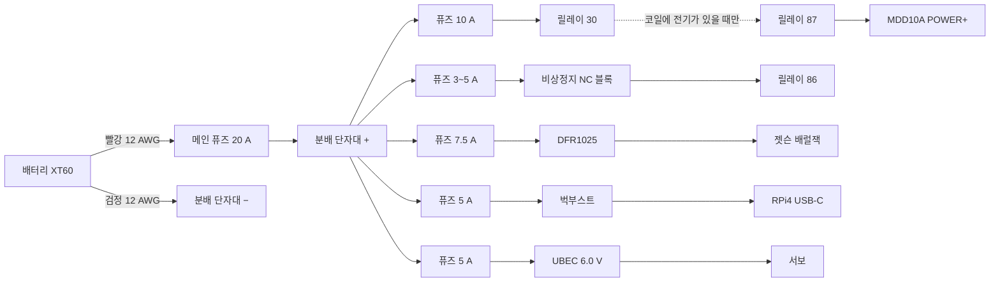

# RC카 조립·배선 따라하기

배선·조립을 처음 하는 사람이 위에서부터 순서대로 따라 할 수 있게 쓴 절차다. 단계마다 무엇과 무엇을 잇는지, 무엇으로 확인하는지, 통과 기준을 적었다.
설계 근거는 [차량 제어 상세 명세](../design/vehicle-control-spec.md)(이하 명세)다.

> 상태: 2026-11-05 실물 부품 기준. **[확인 필요]** 는 아직 자료가 없어 정하지 못한 것이고, [10장](#10-확인-필요-목록)에 확인 방법을 모았다.
> 측정값은 [9장](#9-측정-기록)에 적는다.

## 0. 이 문서 쓰는 법

- 7장의 단계 A 부터 순서대로 한다. 단계 끝의 확인 항목을 모두 통과해야 다음 단계로 간다.
- 확인 항목이 하나라도 안 맞으면 거기서 멈춘다. 사진과 측정값을 팀에 공유하고, 추측으로 다음 단계를 하지 않는다.
- 연결은 5장(전원)과 6장(신호)의 번호(P01, S01 …)로 부른다. 선을 하나 이을 때마다 표에 체크한다.
- 선에는 마스킹 테이프로 번호를 붙인다(예: `P05`). 나중에 문제를 찾을 때 이 번호로 찾는다.

## 1. 안전 규칙

1. 배터리(XT60)는 문서가 "배터리를 연결한다"고 할 때만 꽂는다. 배선·납땜·나사를 조일 때는 항상 뽑혀 있어야 한다.
2. 차를 쓰지 않을 때도 XT60 을 뽑는다. 꽂아 두면 변환기와 전압 체커가 배터리를 조금씩 써서 과방전된다.
3. 빨간 선은 +, 검은 선은 − 다. 다른 색 선을 쓰면 테이프로 + / − 를 표시한다.
4. 전원을 넣기 전에 멀티미터로 + 와 − 사이가 이어져 있지 않은지(단락 없음) 본다.
5. 바퀴가 도는 시험은 차를 상자 위에 올려 바퀴가 공중에 뜬 상태에서 한다. 한 명은 비상정지 버튼에 손을 올리고 있는다.
6. 도는 바퀴나 기어를 손으로 잡지 않는다.
7. 배터리가 부풀거나, 뜨겁거나, 냄새가 나면 즉시 분리해 리포 백에 넣고 쓰지 않는다.
8. 퓨즈는 선이 타는 것을 막을 뿐 부품을 지켜 주지 않는다. 극성과 전압 확인이 먼저다.

## 2. 용어

| 말 | 뜻 |
| --- | --- |
| + / − (극성) | 전기가 나가는 쪽과 돌아오는 쪽. 바꿔 이으면 부품이 탈 수 있다 |
| GND | − 와 같은 뜻. 모든 부품의 GND 를 서로 이어 기준을 맞춘다 |
| 단락(쇼트) | + 와 − 가 직접 닿는 것. 큰 전류가 흘러 불꽃이 튀고 불이 날 수 있다 |
| 통전 | 두 점이 전선처럼 이어져 있는 것. 멀티미터 통전 모드에서 '삐' 소리가 난다 |
| 퓨즈 | 전류가 너무 많이 흐르면 끊어지는 부품. 색으로 용량을 구분한다(3장) |
| 변환기 | 배터리 전압(약 12 V)을 5 V 같은 다른 전압으로 바꾸는 판. UBEC 은 서보용 변환기다 |
| 릴레이 | 작은 전기(코일)로 큰 전기(모터 전원)를 켜고 끄는 전기 스위치 |
| 코일 | 릴레이를 움직이는 부분. 85·86 핀이다 |
| NC / NO | NC 는 평소 붙어 있다가 누르면 떨어지는 접점, NO 는 평소 떨어져 있다가 누르면 붙는 접점 |
| PWM·듀티 | 빠르게 켰다 껐다 해서 세기를 조절하는 신호. 듀티 30 % 는 30 % 시간만 켜진다는 뜻 |
| 풀다운 저항 | 신호선이 아무 데도 안 이어졌을 때 0 V(Low)로 붙잡아 두는 저항 |
| AWG | 선 굵기 번호. 숫자가 작을수록 굵다(12 AWG 가 16 AWG 보다 굵다) |
| 페룰 | 꼬인 선 끝에 씌워 압착하는 금속 관. 나사 단자에 선을 넣을 때 쓴다 |

## 3. 준비물과 공구 쓰는 법

### 3.1 준비물

| 준비물 | 용도 | 상태 |
| --- | --- | --- |
| 멀티미터 | 통전·극성·전압 확인 | 없음. 교육장이나 다른 팀에서 빌린다 |
| 전류 제한 전원공급기 + 악어 클립 | 첫 통전, 변환기 전압 맞추기 | 없음. 빌린다 |
| 와이어 스트리퍼, 니퍼 | 피복 벗기기, 선 자르기 | 빌린다 |
| 인두기(60 W 이상)·납·인두 받침 | XT60·DFR1025 단자대 납땜, 선 잇기 | 빌린다 |
| 열풍기(없으면 라이터) | 열수축 튜브 수축 | 빌린다 |
| 작은 일자·십자 드라이버 | 나사 단자, 가변저항 | 빌린다 |
| 마스킹 테이프·펜, 케이블 타이, 절연 테이프 | 선 번호, 정리 | 준비 |
| 1N4007 다이오드 1개 | 릴레이 코일 보호 | 없음. 구매 |
| 점퍼선(듀폰 암-암, 암-수) | ESP32 신호선 | **[확인 필요]** 보유 여부 |
| ESP32 38핀 터미널 확장 보드(권장) | 신호선을 나사로 고정 | 없음. 사면 납땜이 줄어든다 |
| 만능기판 작은 것(권장) | 풀다운 저항 고정 | 없음 |
| 선: 12 AWG 빨강·검정 1 m, 16 AWG 빨강·검정 세트, 22 AWG 6심 실드 | 주 전원, 분기, 엔코더 연장 | 있음 |
| 페룰 세트와 압착기(HSC8), 열수축 튜브 | 단자 연결 | 있음 |
| 인라인 퓨즈홀더(ATO)와 퓨즈 세트 | 분기 보호 | 있음. **[확인 필요]** 홀더 개수와 퓨즈 용량 |

퓨즈는 색으로 용량을 구분한다(ATO): 3 A 보라, 5 A 연갈색, 7.5 A 갈색, 10 A 빨강, 15 A 파랑, 20 A 노랑, 30 A 초록.

### 3.2 멀티미터

- 검정 프로브는 COM 구멍, 빨강 프로브는 V·Ω 구멍에 꽂는다. 10 A 구멍은 쓰지 않는다. 이 문서는 전류를 재지 않는다.
- **통전 모드**: 다이얼을 스피커(소리) 기호에 둔다. 두 프로브 끝을 서로 대서 '삐' 소리가 나는지 먼저 본다. 두 점에 대어 '삐' 하면 이어져 있다는 뜻이다. 전원이 들어간 회로에는 쓰지 않는다.
- **저항 모드(Ω)**: 릴레이 코일처럼 몇십 Ω 짜리를 잴 때 쓴다.
- **DC 전압 모드**: 다이얼을 V 옆에 직선(⎓)이 있는 곳의 20 V 범위에 둔다(자동 범위면 V⎓). 빨강을 +, 검정을 − 에 댄다. 숫자 앞에 '−' 가 붙으면 프로브를 반대로 댄 것, 즉 생각한 극성이 반대라는 뜻이다.
- 다 쓰면 OFF 로 돌린다.

### 3.3 선 끝 처리

- **페룰**: 선 굵기에 맞는 페룰을 고른다. 22 AWG → E0508, 18 AWG → E1008, 16 AWG → E1508, 12 AWG → E4012.
  1. 페룰 금속 부분 길이만큼 피복을 벗긴다(이름 끝 두 자리: 08 은 8 mm, 12 는 12 mm).
  2. 선 가닥을 손으로 꼬아 한 덩어리로 만든다.
  3. 페룰에 끝까지 넣는다. 금속 밖으로 가닥이 삐져나오지 않아야 한다.
  4. 압착기의 맞는 칸에 넣고 끝까지 눌러 압착한다.
  5. 세게 당겨 빠지지 않는지 본다.
- **나사 단자**: 나사를 풀고 페룰을 끝까지 넣은 뒤 조인다. 선을 당겨 빠지지 않는지 본다. 피복이 단자 안에 물리면 안 된다.
- **선끼리 잇기**: 열수축 튜브를 먼저 한쪽 선에 끼운다. 두 선 끝을 나란히 꼬아 납땜하고, 튜브를 접합부 위로 밀어 열풍기로 수축한다.
- **XT60 납땜**: 경험자와 같이 한다. 선과 XT60 컵에 먼저 납을 입히고, 컵에 선을 넣어 녹여 붙인다. 열수축을 덮는다. XT60 은 플라스틱이 녹기 쉬우니 짧게 가열한다.

## 4. 부품과 단자 이름

| 부품 | 단자 이름(실물 인쇄) | 메모 |
| --- | --- | --- |
| 배터리 3S LiPo 11.1 V 7600 mAh | XT60(굵은 노란 커넥터), 밸런스 커넥터(작은 흰 4핀) | 완충 12.6 V. 밸런스 커넥터는 충전기·전압 체커용 |
| 모터 드라이버 Cytron MDD10A | 큰 단자대 6칸: M1B·M1A·POWER+·POWER−·M2A·M2B. 신호 핀 5개: GND·PWM2·DIR2·PWM1·DIR1. 테스트 버튼 M1A·M1B·M2A·M2B | 역극성 보호가 없다. 신호는 3.3 V 그대로 받는다(High 3~5.5 V) |
| 모터 JGB37-520R30-12 ×2 | 6핀 커넥터(PH2.0) | 정격 12 V, 스톨 3.2 A, 엔코더 전원 3.3~5 V. **[확인 필요]** 6핀 배열 |
| 서보 LD-1501MG | 3핀: 흰(신호)·빨(+)·검(−) | 동작 6~8.4 V. 혼이 이미 조향 링크에 붙어 있다 |
| 서보 전원 UBEC 10A 2-6S | 굵은 입력선 Input +·−, 가는 두 선 SW, 출력 Output | 주문명(Hobbywing 5A)과 다른 제품. 출력 6.0·7.4·8.4 V 점퍼 |
| 젯슨 전원 DFR1025 | 입력 VIN+·GND, 출력 VOUT+·GND, DIP 스위치 5개 | 입력 9~15 V. 단자대 2개를 납땜해야 한다 |
| RPi4 전원 벅부스트 5 A (CW-07…) | 아래 단자 IN, 위 단자 OUT, 파란 가변저항 | 지금 출력값을 모른다 |
| 보조 5 V HW-688 | 입력 VIN+·VIN−(배럴잭 쪽), 출력 5V·GND(USB 쪽) | 지금은 연결하지 않아도 된다 |
| 릴레이 KKA A4F 012-1Z-22 + 소켓 | 85·86(코일), 30(공통), 87(코일에 전기가 있을 때만 30 과 연결), 87a(평소 30 과 연결, 안 씀) | 위에 초록 부품(30 A 퓨즈로 보임)이 꽂혀 있다. 소켓 전선 색과 이 퓨즈의 위치는 단계 E·F 에서 찾는다 |
| 비상정지 KGE-N4R1R | 접점 블록 2개, 블록마다 나사 2개 | NC/NO 는 단계 E 에서 찾는다 |
| ESP32 DevKitC V4 | 양쪽 핀 19개씩. 핀 옆에 `25`, `GND`, `3V3`, `5V` 처럼 인쇄(보드에 따라 `IO25`·`D25`) | 전원은 USB 하나만 |
| 분배 단자대 SZH-CP010 | 입력 1, 출력 12 | **[확인 필요]** + 줄과 − 줄이 따로 있는지 |

## 5. 전원 연결

### 5.1 그림



그림에 없는 − 쪽: MDD10A POWER−, 릴레이 85, 각 변환기의 입력 − 는 모두 분배 단자대 − 로 간다(P06·P09·P12·P15·P18).
비상정지를 누르면 릴레이 코일 전기가 끊겨 87 이 떨어지고, MDD10A 전원이 꺼진다.

### 5.2 연결표

퓨즈는 연결하는 동안 모두 빼 둔다. 단계 G 에서 하나씩 끼운다.

| 번호 | 어디서 | 어디로 | 선 | 퓨즈 |
| --- | --- | --- | --- | --- |
| P01 | 배터리 짝 XT60 + 컵 | 메인 퓨즈홀더 한쪽 선 | 12 AWG 빨강, XT60 에 납땜 | — |
| P02 | 메인 퓨즈홀더 다른쪽 선 | 분배 단자대 + 입력 | 퓨즈홀더 선 + 페룰 E4012 | 20 A |
| P03 | 배터리 짝 XT60 − 컵 | 분배 단자대 − 입력 | 12 AWG 검정, XT60 에 납땜 | — |
| P04 | 분배 + 출력 | 모터 퓨즈 → 릴레이 30 선 | 16 AWG 빨강 | 10 A (분배 단자대 쪽에 둔다) |
| P05 | 릴레이 87 선 | MDD10A POWER+ | 16 AWG 빨강 | — |
| P06 | MDD10A POWER− | 분배 − 출력 | 16 AWG 검정, 짧고 곧게 | — |
| P07 | 분배 + 출력 | 코일 퓨즈 → 비상정지 NC 블록 한쪽 나사 | 16 AWG 빨강 | 3 A(없으면 5 A) |
| P08 | 비상정지 NC 블록 다른쪽 나사 | 릴레이 86 선 | 16 AWG 빨강 | — |
| P09 | 릴레이 85 선 | 분배 − 출력 | 16 AWG 검정 | — |
| P10 | 1N4007 띠(흰 줄) 쪽 다리 → 릴레이 86 선, 띠 없는 쪽 다리 → 릴레이 85 선 | (코일 양쪽) | 다리를 각 선에 납땜하고 열수축 | — |
| P11 | 분배 + 출력 | 젯슨 퓨즈 → DFR1025 VIN+ | 16 AWG 빨강 | 7.5 A |
| P12 | DFR1025 입력 GND | 분배 − 출력 | 16 AWG 검정 | — |
| P13 | DFR1025 VOUT+ / GND | DC 플러그 케이블 + 선 / − 선 → 젯슨 배럴잭 | 케이블 그대로(단계 E 에서 + 선 확인) | — |
| P14 | 분배 + 출력 | RPi4 퓨즈 → 벅부스트 IN+ | 16 AWG 빨강 | 5 A |
| P15 | 벅부스트 IN− | 분배 − 출력 | 16 AWG 검정 | — |
| P16 | 벅부스트 OUT+ / OUT− | USB-C 2선 케이블 + 선 / − 선 → RPi4 USB-C | 케이블 그대로(단계 E 에서 − 선 확인) | — |
| P17 | 분배 + 출력 | 서보 퓨즈 → UBEC Input + | 16 AWG 빨강 + UBEC 입력선 | 5 A |
| P18 | UBEC Input − | 분배 − 출력 | 16 AWG 검정 | — |
| P19 | UBEC 출력 | 서보 커넥터 빨(+)·검(−) | **[확인 필요]** UBEC 출력 커넥터 모양 | — |
| P20 | 분배 + / − 출력 | 보조 퓨즈 → HW-688 VIN+ / VIN− | 16 AWG | 3 A. 나중에 필요할 때 |

- 분배 단자대 출력 하나에는 선 하나만 넣는다.
- 퓨즈홀더 선(12 AWG)이 장치 단자에 안 들어가면 16 AWG 선을 납땜으로 이어 붙이고 열수축한다(3.3).
- 퓨즈는 선이 시작하는 쪽(분배 단자대 쪽)에 둔다. 그래야 그 뒤의 선 전체가 보호된다.
- 퓨즈홀더는 6개(메인·모터·코일·젯슨·RPi4·서보)가 필요하다. 보조를 쓰면 1개 더.

## 6. 신호 연결 (ESP32)

모터 채널은 차 뒤에서 앞을 보고 왼쪽 뒷바퀴를 M1, 오른쪽 뒷바퀴를 M2 로 한다.
핀은 부팅 때 신호가 튀지 않는 것으로 골랐다(명세 §4.3 의 풀다운 규칙과 함께).

| 번호 | ESP32 핀 | 어디로 | 메모 |
| --- | --- | --- | --- |
| S01 | 25 | MDD10A PWM1 (왼쪽 속도) | S06 풀다운 |
| S02 | 32 | MDD10A DIR1 (왼쪽 방향) | |
| S03 | 26 | MDD10A PWM2 (오른쪽 속도) | S06 풀다운 |
| S04 | 33 | MDD10A DIR2 (오른쪽 방향) | |
| S05 | GND | MDD10A 신호 핀 GND | 신호 기준. 꼭 잇는다 |
| S06 | — | 10 kΩ 저항 3개: 25–GND, 26–GND, 27–GND | 갈색·검정·주황 띠 저항. ESP32 가 꺼지거나 리셋돼도 모터·서보 신호를 0 으로 붙잡는다 |
| S07 | 27 | 서보 흰 선(신호) | S06 풀다운 |
| S08 | GND | 서보 검 선(UBEC 출력 −) | 서보 신호 기준 |
| S09 | 13, GND | 비상정지 상태용 블록의 두 나사 | NC 블록이면 그대로 쓴다(단계 E) |
| S10 | 3V3, GND, 18, 19 | 왼쪽 엔코더 VCC, GND, A, B | **5V 에 잇지 않는다.** 6핀 배열 확인 뒤 |
| S11 | 3V3, GND, 22, 23 | 오른쪽 엔코더 VCC, GND, A, B | 같음 |
| S12 | — | 모터 전원 두 핀: 왼쪽 → MDD10A M1A·M1B, 오른쪽 → M2A·M2B | 6핀 배열 확인 뒤 |
| S13 | 35 | 배터리 전압(선택): 분배 + → 47 kΩ → 35 → 10 kΩ → GND | 47 kΩ 는 분배 단자대에 바로 꽂아 긴 선이 저항 뒤에 오게 한다. 12.6 V 일 때 35 번 핀이 약 2.2 V |
| S14 | Micro USB | 책상 시험은 PC, 차에서는 RPi4 USB | ESP32 전원은 이것 하나만. 5V·3V3 핀에 다른 전원을 넣지 않는다 |

## 7. 따라하기

### 단계 A. 배터리 충전 (언제든, 다른 단계와 같이)

1. 배터리를 리포 백 안에 넣고 주변의 탈 것을 치운다.
2. 배터리 밸런스 커넥터(흰 4핀)를 충전기 3S 자리에 꽂는다. 충전기 설명서대로 LiPo, 3S, 전류 3~4 A 로 맞춘다.
3. 충전하는 동안 자리를 비우지 않는다.
4. 끝나면 전압 체커를 밸런스 커넥터에 꽂아 셀 전압을 본다. 경보는 셀당 3.5 V 로 맞춘다. 다 보면 뺀다.

확인

- [ ] 셀마다 4.15~4.20 V, 셀끼리 차이 0.05 V 이하
- [ ] 부풂·열·냄새 없음

### 단계 B. 기구 점검과 실측 (전기 없음)

1. 바퀴 고정 나사(황동 커플러의 작은 나사), 모터 브래킷, 판 지지대 나사가 풀리지 않았는지 본다.
2. 바퀴를 손으로 천천히 돌린다. 뒷바퀴는 모터 기어 때문에 뻑뻑한 게 정상이지만 중간에 걸리는 곳이 있으면 안 된다.
3. 조향은 손으로 세게 꺾지 않는다. 서보 기어가 상한다. 조향 한계는 단계 K 에서 잰다.
4. 차체 길이 세 가지를 mm 로 두 번씩 재서 평균을 9장에 적는다.
   - 앞뒤 바퀴 거리(휠베이스): 옆에서 보고 앞바퀴 축 가운데부터 뒷바퀴 축 가운데까지
   - 좌우 바퀴 거리(윤거): 뒤에서 보고 왼쪽 뒷바퀴 타이어 가운데부터 오른쪽 뒷바퀴 타이어 가운데까지
   - 바퀴 지름: 타이어와 바닥에 표시를 하고 한 바퀴 굴려 간 거리를 잰 뒤 3.14 로 나눈다
5. 부품을 임시로 놓아 본다. 배터리는 하층 가운데에 스트랩으로 묶고, 나사 끝이 배터리를 향하지 않게 한다. 보드와 퓨즈는 상층, 비상정지는 손이 바로 닿는 위쪽에 둔다(명세 §7 배치).
6. 금속 판에 PCB 밑면이 닿지 않게 황동 지지대로 띄운다.

확인

- [ ] 걸림 없음
- [ ] 9장의 차체 길이 세 칸을 채움

### 단계 C. ESP32 를 PC 에 연결

1. [Arduino IDE](https://docs.espressif.com/projects/arduino-esp32/en/latest/installing.html) 를 설치하고, 보드 매니저에서 `esp32 by Espressif Systems`(3.x)를 설치한다.
2. ESP32 핀에는 아무것도 꽂지 않고, Micro USB 케이블로 PC 에만 연결한다.
3. Windows 장치 관리자 → 포트(COM & LPT)에 `Silicon Labs CP210x … (COMx)` 가 나타나는지 본다.
   - 없으면 [CP210x 드라이버](https://www.silabs.com/developer-tools/usb-to-uart-bridge-vcp-drivers)를 설치한다.
   - 그래도 없으면 케이블이 충전 전용일 수 있으니 다른 케이블로 바꾼다.
4. Arduino IDE 에서 보드는 `ESP32 Dev Module`, 포트는 위의 COMx 로 고른다.
5. [부록 A](#부록-a-책상-시험용-esp32-스케치) 스케치를 붙여 넣고 업로드한다. `Connecting....` 에서 멈추면 ESP32 의 BOOT 버튼을 누르고 있다가 업로드가 시작되면 뗀다.
6. 시리얼 모니터를 115200, 줄 끝 "새 줄(Newline)" 로 연다.

확인

- [ ] 시리얼 모니터에 `ready: disarmed` 가 보인다

### 단계 D. 모터 없이 신호 확인 (로직 분석기)

준비: 브레드보드, 10 kΩ 저항 3개, 점퍼선, 로직 분석기.

1. ESP32 를 PC 에서 뺀다.
2. 점퍼선으로 ESP32 핀을 브레드보드로 빼고, 10 kΩ 를 25–GND, 26–GND, 27–GND 에 하나씩 단다(S06).
3. 비상정지 대신 13 번 핀과 GND 를 점퍼선으로 잇는다. 이어져 있으면 '풀림', 빼면 '눌림'이다.
4. 로직 분석기 GND 를 ESP32 GND 에, CH0 을 25, CH1 을 26, CH2 를 27 에 잇는다.
5. [PulseView](https://sigrok.org/wiki/Downloads) 를 설치한다. Windows 는 [Zadig 로 드라이버](https://sigrok.org/wiki/Windows)를 잡는다. 장치는 보통 fx2lafw 로 보인다. 샘플 2 MHz, 길이 2 s 로 둔다.
6. ESP32 를 PC 에 다시 연결하고, PulseView 기록을 시작한 직후 ESP32 의 EN 버튼(리셋)을 누른다.
7. 시리얼 모니터에서 `a`, 이어서 `f30` 을 보낸다.
8. `f30` 이 도는 동안 13 번 점퍼선을 뺀다. 다시 꽂는다. `f30` 을 보낸다. `a` 를 보내고 `f30` 을 보낸다.

확인

- [ ] 6: 리셋하는 동안 CH0·CH1 이 계속 Low
- [ ] 7: CH0·CH1 에 20 kHz, 켜진 시간 30 % 의 신호가 약 1초 나오고 저절로 멈춤(`auto stop`)
- [ ] CH2 에 20 ms 마다 1.5 ms 폭 신호
- [ ] 8: 점퍼선을 빼면 즉시 멈추고 `ESTOP: disarmed`. 다시 꽂아도 `f30` 에 `not armed`. `a` 뒤에만 다시 나옴

### 단계 E. 부품 확인 측정 (멀티미터, 전원 없음)

모두 9장에 적는다.

**E1. 비상정지 NC/NO**

1. 멀티미터 통전 모드. 블록 1 의 두 나사에 프로브를 댄다.
2. 버튼이 풀린 상태에서 소리가 나는지, 눌러서 잠긴 상태에서 나는지 적는다. 버튼은 돌리면 풀린다.
3. 블록 2 도 같은 방법으로 본다.
4. 풀림에서 '삐', 누름에서 조용하면 NC 다. 반대면 NO 다.
5. NC 블록 하나를 릴레이 코일용(P07·P08)으로, 나머지를 ESP32 상태용(S09)으로 정한다. 둘 다 NC 면 어느 쪽이든 된다. 상태용이 NO 면 부록 A 의 `estopPressed()` 를 `== LOW` 로 바꿔야 하고, 선이 빠져도 알 수 없으니 팀에 공유한다.

**E2. 릴레이 소켓 전선 색**

1. 릴레이를 소켓에 끼운다.
2. 저항 모드(2 kΩ 범위)로 전선 끝 두 개씩 잰다. 50~200 Ω 사이가 나오는 두 선이 코일(85·86)이다. 다이오드가 없으니 둘 중 어느 쪽을 86 으로 해도 된다. 테이프로 `85`, `86` 을 붙인다.
3. 통전 모드로 남은 세 선 중 '삐' 하는 두 선을 찾는다. 이 둘이 30 과 87a 다. 남은 한 선이 87 이다.
4. 30 과 87a 를 가리는 일과 위에 꽂힌 초록 부품(퓨즈로 보임)의 위치 확인은 단계 F 의 6·7번에서 전원공급기로 한다.

**E3. 변환기 − 단자 찾기**

입력 − 와 출력 − 는 서로 이어져 있고, + 끼리는 이어져 있지 않다.

1. 벅부스트: IN 단자 둘과 OUT 단자 둘 사이를 통전 모드로 잰다. '삐' 하는 쌍이 IN− 와 OUT− 다. 인쇄(IN+·OUT−)와 맞는지 본다.
2. 벅부스트 알루미늄 방열판·브래킷과 네 단자 사이에 '삐' 가 없어야 한다. '삐' 가 나면 금속 판에 닿지 않게 지지대로 띄운다.
3. DFR1025: 입력 GND 와 출력 GND 사이 '삐'.
4. HW-688: VIN− 와 출력 GND 사이 '삐'. 뒷면 인쇄는 앞에서 보면 좌우가 뒤집힌다.
5. UBEC: 굵은 검정 입력선과 출력 − 사이 '삐'.

**E4. 케이블 + / −**

1. 젯슨용 DC 플러그 케이블: 플러그 안쪽 구멍(가운데)과 '삐' 하는 선이 + 다. 바깥 통과 '삐' 하는 선이 − 다.
2. RPi4 용 USB-C 2선 케이블: 플러그 금속 껍데기와 '삐' 하는 선이 −(GND)다. 나머지가 + 다.

**E5. 모터 6핀 배열** **[확인 필요]**

모터 뒤쪽 엔코더 기판의 커넥터 옆 인쇄나 키트 판매 페이지의 배선 그림으로 정한다. 보통 모터 전원 2핀, 엔코더 VCC·GND·A·B 4핀이다. 저항 모드에서 몇 Ω~수십 Ω 이 나오는 두 핀이 모터 전원이지만, 이것만으로 VCC 와 GND 를 가릴 수는 없다. 배열을 모르면 엔코더를 잇지 않는다.

확인

- [ ] 9장의 E1~E4 칸을 채움
- [ ] 6핀 배열을 자료로 확인함

### 단계 F. 변환기 전압 맞추기 (전원공급기, 하나씩, 부하 없음)

전원공급기를 12.0 V, 전류 제한 0.5 A 로 맞추고 출력을 끈다. 아래를 변환기마다 한 번씩 한다.

1. 전원공급기 빨강 집게를 변환기 입력 +, 검정 집게를 입력 − 에 문다(E3 에서 확인한 단자).
2. 출력 단자에는 아무것도 잇지 않는다. 멀티미터 DC 전압 모드로 출력 + 와 − 에 프로브를 댄다.
3. 전원공급기를 켠다. 전류가 0.1 A 를 넘거나 전류 제한 표시(CC)가 켜지면 바로 끄고 연결을 다시 본다.
4. 변환기별로 맞춘다.
   - 벅부스트: 파란 가변저항을 작은 일자 드라이버로 조금씩 돌려 5.10 V 로 맞춘다. 여러 바퀴 돌려야 바뀐다. 값이 반대로 가면 반대로 돌린다.
   - DFR1025: 전원을 끄고 DIP 스위치를 [DFR1025 표](https://wiki.dfrobot.com/dfr1025/docs/18450)의 5.1 V 로 맞춘다. 켜서 잰다. 스위치는 꼭 전원을 끄고 바꾼다.
   - HW-688: 잰다(흔히 5.2 V).
   - UBEC: 점퍼를 라벨 표의 6.0 V 자리로 두고 잰다. SW 두 선을 뗀 상태와 서로 붙인 상태에서 각각 출력이 나오는지 적는다.
5. 전원공급기를 끄고 9장에 적는다.
6. 릴레이: 전원공급기 12 V 를 코일 85·86 선에 댄다. '딸깍' 소리가 나면 통전 모드로 '삐' 하는 두 선을 다시 찾는다. 이번 쌍은 30 과 87 이다. E2 에서도 '삐' 했던 선이 30 이고, E2 쌍의 다른 선이 87a 다.
7. 코일에 12 V 를 댄 채로 초록 부품을 뽑고 30↔87 을 다시 잰다.
   - 소리가 끊기면 퓨즈가 모터 전원 길에 있다. 퓨즈 세트의 10 A(빨강)로 바꿔 끼워 한 번 더 막게 한다. P04 의 모터 퓨즈는 그대로 둔다.
   - 소리가 그대로면 모터 전원 길이 아니다. 원래 퓨즈를 다시 끼워 둔다.

확인

- [ ] 벅부스트 5.05~5.15 V
- [ ] DFR1025 5.0~5.2 V (벗어나면 팀에 공유)
- [ ] HW-688 5.0~5.3 V
- [ ] UBEC 5.8~6.2 V, SW 동작 확인
- [ ] 릴레이 85·86·30·87·87a 선에 테이프 표시, 내장 퓨즈 위치를 9장에 적음

### 단계 G. 전원 배선 만들기 (배터리 연결 없음)

1. 배터리에서 뺀 상태로, 배터리 XT60 과 맞물리는 짝 XT60 을 골라 끼워 본다. 빼고 나서 P01·P03 을 납땜한다.
2. 5.2 표 순서대로 P02 부터 P19 까지 잇는다. 퓨즈는 모두 빼 둔다. 하나 이을 때마다 당겨 보고, 번호 테이프를 붙이고, 표에 체크한다.
3. 다 이으면 멀티미터 저항 모드(자동 또는 20 kΩ 범위)로 XT60 + 핀과 − 핀 사이를 잰다.
   - 퓨즈를 모두 뺀 상태: 아주 큰 값(`OL` 이나 `1` 표시)이어야 한다.
   - 메인 퓨즈(20 A)를 끼우고 다시: 그대로 큰 값이어야 한다.
   - 분기 퓨즈를 하나씩 끼우면서 다시 잰다.
     - 젯슨·RPi4·서보 분기: 값이 잠깐 작았다가 점점 커지면 정상이다(변환기 커패시터 충전). 0~몇 Ω 에 머물면 단락이니 그 퓨즈를 빼고 그 분기를 다시 본다.
     - 코일 분기: E2 에서 잰 코일 저항(50~200 Ω)이 보이면 정상이다. 이 때문에 통전 모드로는 단락과 구분이 안 되니 꼭 저항 모드로 잰다.
     - 모터 분기: 릴레이가 떨어져 있어 값이 바뀌지 않아야 정상이다.
4. 통전 모드로 바꿔 극성을 본다. 분배 + 와 각 장치 입력 + 사이 '삐'(그 분기 퓨즈를 끼운 상태), 분배 − 와 각 장치 입력 − 사이 '삐'.
5. MDD10A POWER+ 와 POWER− 가 바뀌지 않았는지 눈으로 다시 본다.
6. 퓨즈를 다시 모두 뺀다.

확인

- [ ] XT60 + 와 − 사이 단락 없음(퓨즈를 모두 끼운 상태 포함)
- [ ] 모든 분기의 + / − 가 맞음

### 단계 H. 첫 통전 (전원공급기, 모터·보드 없음)

1. 전원공급기용 선을 만든다. 배터리와 같은 모양의 XT60 에 16 AWG 빨강·검정 선을 납땜한다. 이렇게 하면 배터리 대신 하네스에 그대로 꽂을 수 있다.
2. 전원공급기를 12.0 V, 전류 제한 1 A 로 맞추고 끈다. 이 선의 빨강을 전원공급기 +, 검정을 − 에 물리고 하네스 XT60 에 꽂는다.
3. 메인 퓨즈만 끼우고 켠다. 전류가 거의 0 이어야 한다. 끈다.
4. 분기 퓨즈를 하나 끼우고 켜서 그 변환기 출력을 다시 잰다(단계 F 와 같은 값). 끄고 다음 분기로 간다.
5. 코일 퓨즈와 모터 퓨즈를 끼운다. 비상정지가 풀린 상태에서 켜면 릴레이가 '딸깍' 붙고 MDD10A 의 초록 LED(전원)가 켜진다.
6. 비상정지를 누른다. 릴레이가 떨어지고 초록 LED 가 꺼지는지, MDD10A POWER+ 와 POWER− 사이가 0 V 인지 잰다.
7. 비상정지를 돌려 푼다. 다시 붙는다. 끈다.

확인

- [ ] 분기마다 출력이 단계 F 와 같음
- [ ] 비상정지를 누르면 MDD10A 전원 0 V, 풀면 돌아옴
- [ ] 냄새·열 없음

### 단계 I. 컴퓨터 보드 연결

여기부터는 전류가 커서 배터리를 쓴다. 단계 G 검사를 통과했어야 한다.

1. RPi4: 벅부스트 출력이 5.1 V 인지 다시 보고, USB-C 2선 케이블(P16)을 RPi4 에 꽂는다. GPIO 5V 핀에 다른 전원을 동시에 넣지 않는다.
2. 젯슨: 보드의 J48 점퍼를 끼운다. DC 플러그(P13)를 배럴잭에 꽂는다.
3. XT60 을 연결한다. 두 보드가 켜지는지 본다.
4. RPi4 동작 중 GPIO 2번 핀(5V)과 6번 핀(GND) 사이 전압을 잰다. 40핀 중 보드 가장자리 쪽 줄의 첫 핀이 2번, 세 번째가 6번이다. 프로브를 핀에 직접 대면 옆 핀과 닿아 5V 와 GND 가 단락될 수 있으니, 암 점퍼선을 두 핀에 꽂고 그 끝에서 잰다. 젯슨은 DFR1025 출력 단자에서 잰다.
5. 두 보드에 부하를 걸고(부팅, 프로그램 실행) 다시 잰다.

확인

- [ ] RPi4 5V 핀 4.9~5.25 V(부하 중 포함), 재부팅 없음
- [ ] 젯슨 쪽 4.9 V 이상, 재부팅 없음
- [ ] DFR1025 가 손대기 힘들 만큼 뜨겁지 않음(80 °C 미만)

### 단계 J. 모터 한 채널 (바퀴 띄움, 배터리)

모터는 배터리로 돌린다. 전원공급기는 모터가 멈출 때 생기는 회생전류에 꺼질 수 있다(MDD10A 매뉴얼 1장 Note).

1. XT60 을 뽑는다. 차를 상자 위에 올려 뒷바퀴를 띄운다. 한 명은 비상정지에 손을 올린다.
2. E5 에서 확인한 왼쪽 모터의 전원 두 핀을 MDD10A M1A·M1B 에 잇는다(S12). 엔코더 핀은 아직 잇지 않는다.
3. MDD10A 신호 핀에는 아직 아무것도 잇지 않는다. XT60 을 연결한다.
4. MDD10A 테스트 버튼 M1A 를 1초만 눌러 왼쪽 바퀴가 도는지 본다. 빨간 LED M1A 가 같이 켜진다. M1B 로 반대 방향을 본다. XT60 을 뽑는다.
5. ESP32 USB 도 뽑은 상태에서 S01·S02·S05 와 풀다운(S06)을 잇고, 13 번을 비상정지 상태 블록(S09)에 잇는다. 다 이은 뒤 ESP32 를 PC USB 에 연결한다.
6. XT60 을 연결한다. 시리얼 모니터에서 `a`, `f20` 을 보낸다. 왼쪽 바퀴가 1초 돌고 멈춘다. 앞으로 가는 방향인지 본다.
7. 반대로 돌면 XT60 을 뽑고 M1A·M1B 선을 서로 바꾼다.
8. `f20` 을 보내고 도는 중에 `s` 를 보낸다. 즉시 멈추는지 본다. 멈춘 뒤 바퀴를 손으로 천천히 돌려 본다. XT60 을 뽑았을 때보다 무거우면 PWM 0 제동이 걸린 것이다.
9. `f20` 이 도는 중에 비상정지를 누른다. 바퀴가 관성으로 얼마나 더 도는지 본다. 이때는 드라이버 전원이 꺼지므로 제동이 없다.
10. 비상정지를 푼다. 바퀴가 움직이지 않아야 한다. `f20` 에 `not armed` 가 나와야 한다. `a` 뒤 `f20` 으로만 다시 돈다.
11. 오른쪽 모터로 2~10 을 반복한다(M2A·M2B, S03·S04).

확인

- [ ] 테스트 버튼으로 양방향 회전
- [ ] `f20` 이 1초 뒤 저절로 멈춤
- [ ] `s` 로 즉시 멈추고 PWM 0 에서 제동이 느껴짐
- [ ] 비상정지를 누르면 멈추고, 풀어도 재무장(`a`) 전에는 움직이지 않음
- [ ] 9장에 방향(DIR)과 앞뒤 대응을 적음

### 단계 K. 엔코더와 서보

**엔코더** (6핀 배열을 확인한 뒤)

1. XT60 과 ESP32 USB 를 뽑는다. 왼쪽 엔코더 VCC 를 ESP32 3V3, GND 를 GND, A 를 18, B 를 19 에 잇는다(S10). 오른쪽은 3V3, GND, 22, 23(S11). 5V 에 잇지 않는다. 다 이은 뒤 ESP32 USB 를 다시 연결한다.
2. 시리얼 모니터에서 `z` 로 0 을 만든다. 바퀴를 손으로 정확히 10바퀴 돌린다. `e` 로 값을 본다. 13000~13400 이 나와야 한다. 바퀴 한 바퀴에 채널당 330펄스, A·B 를 다 세서 1320 이다.
3. 앞으로 돌렸는데 값이 음수면 그 엔코더의 A·B 선을 서로 바꾼다.
4. XT60 을 연결하고 `f20` 동안 값이 늘고 튀지 않는지 본다. 실드선은 ESP32 쪽 한쪽만 GND 에 잇는다.

**서보** (UBEC 6.0 V 를 확인한 뒤)

1. XT60 을 뽑는다. 서보 커넥터를 UBEC 출력에 잇는다(P19). 흰 선은 ESP32 27, 검 선 쪽 GND 는 ESP32 GND 에 잇는다(S07·S08).
2. XT60 을 연결한다. 서보가 가운데(1500 µs)로 간다. 이때 앞바퀴가 곧지 않으면 XT60 을 뽑고 혼 나사를 풀어, 곧은 자리에 가장 가까운 톱니로 혼을 다시 끼운다. 남는 작은 차이는 나중에 펌웨어 중앙값으로 맞춘다.
3. `l` 을 한 번씩 보내며 바퀴가 왼쪽으로 꺾이는 것을 본다. 링크가 끝에 닿거나 서보에서 '지잉' 소리가 나면 `r` 로 한 칸 되돌린다. 그 값을 왼쪽 한계로 적는다. `r` 로 오른쪽도 같은 방법.
4. 한계가 1300~1700 µs 밖이면 부록 A 의 `SERVO_MIN`·`SERVO_MAX` 를 넓혀 다시 올린다. 9장에 µs 와 그때 바퀴 각도(각도기로)를 적는다.
5. 힘이 모자라 끝까지 못 꺾으면 UBEC 를 7.4 V 로 바꾼다. 8.4 V 는 서보 상한이라 쓰지 않는다.

확인

- [ ] 10바퀴 13000~13400, 앞으로 돌릴 때 양수
- [ ] 모터가 돌 때 엔코더 값이 튀지 않음
- [ ] 서보 좌우 한계 µs 를 적음

### 단계 L. 모두 같이 켜기

1. 모든 장치를 연결하고 배터리로 켠다.
2. `f30` 과 `b30` 을 번갈아 여러 번 보내고, 사이에 `l`·`r` 로 서보를 움직인다. 젯슨·RPi4 도 켜 둔다.
3. 그동안 RPi4 5V 핀 전압을 멀티미터로 본다.

확인

- [ ] RPi4 재부팅 없음, 5V 핀 4.9 V 이상
- [ ] ESP32 시리얼에 `ready` 가 다시 뜨지 않음(뜨면 ESP32 가 리셋된 것)
- [ ] 변환기·선·보드 과열 없음
- [ ] 통과하면 케이블 타이로 선을 고정

### 단계 M. 통신 연결 (바퀴 띄움, 소프트웨어 담당과 같이)

- dom0 전제: 2026-11-03 이미지의 dom0 커널에는 usbserial·cp210x 드라이버가 없어 ESP32 를 꽂아도 `/dev/ttyUSB0` 이 생기지 않는다. 플랫폼 파트의 이미지 반영이 먼저다.
- 게이트웨이 기본 `serial_profile` 은 `write-only` 라 적용 확인이 없다. 통합 시험은 `--serial-profile feedback-1`(엔코더를 쓰면 `feedback-2`)로 한다([게이트웨이 README](../../platform/services/gateway/README.md)).
- 실제 펌웨어는 [gateway-provider-v1](../contracts/gateway-provider-v1.md)과 [virtual_esp32.py](../../platform/services/gateway/examples/virtual_esp32.py)의 프레임을 구현한다. 부록 A 스케치는 책상 시험용이라 이 단계에서 쓰지 않는다.
- 게이트웨이가 포트를 열 때 ESP32 가 리셋되거나 다운로드 모드로 빠지지 않는지 본다. DevKitC 의 자동 리셋 회로가 DTR/RTS 에 반응한다.
- 시각 네 개를 따로 적는다: 명령 전송, ESP32 적용 응답, PWM 꺼짐(로직 분석기), 바퀴 정지. 와치독 300 ms 는 "명령 끊김 → 출력 안전" 시간으로 검증하고, 실제 정지 시간·거리는 따로 잰다(명세 §4.4).

확인

- [ ] 수동주행 VM → 게이트웨이 → ESP32 로 저속 구동
- [ ] 게이트웨이를 강제 종료하면 와치독으로 멈춤, 비상정지를 누르면 멈춤([RC카 시나리오](../scenario-rc-car.md) §4.2 F5·F7)

### 단계 N. 바닥 주행

- VL53L5CX 가 없어 명세 §4.3 의 근거리 제동이 없다. 이 기능이 있다는 전제로 자율주행 단계로 넘어가지 않는다.
- 넓은 곳에서 비상정지 담당을 두고 속도 상한 0.3 m/s 부터 시작한다.
- 줄자로 직진 거리를 재 엔코더 값을 보정하고, 회전 반경을 잰다.
- 0.3·0.5 m/s 에서 제동 거리와 급제동 때 넘어지지 않는지 본다(명세 §4.3 정지 성능). 이 값이 게이트웨이 차량 한계 파일의 근거다.

## 8. 비상정지 시험 구분

전원을 끊는 것과 차가 멈추는 것은 다른 시험이다.

| 시험 | 조건 | 확인할 것 |
| --- | --- | --- |
| PWM 0 | 드라이버 전원 있음 | 드라이버의 제동(단계 J-8) |
| ESP32 전원 꺼짐 | USB 분리 | 풀다운으로 PWM 이 Low 로 남는지. 와치독 시험과 다르다 |
| 릴레이 차단 | 비상정지 누름 | 드라이버 전원이 같이 꺼져 제동이 없다. 관성으로 더 가는 거리 |
| 해제 | 비상정지 풀림 | 정지 유지, 재무장 뒤 새 명령으로만 움직임 |

## 9. 측정 기록

| 항목 | 목표·사양 | 실측 | 날짜 |
| --- | --- | --- | --- |
| 셀 전압(충전 후) / 셀 차이 | 4.15~4.20 V / 0.05 V 이하 | | |
| 앞뒤 바퀴 거리(휠베이스) / 좌우 바퀴 거리(윤거) / 바퀴 지름 (mm) | — | | |
| 비상정지 블록 1 / 블록 2 (NC·NO) | — | | |
| 릴레이 소켓 선 색: 85 / 86 / 30 / 87 / 87a | — | | |
| 릴레이 내장 퓨즈 위치 | — | | |
| 벅부스트 출력 (무부하 / RPi4 부하) | 5.1 V / 4.9~5.25 V | | |
| DFR1025 출력 (무부하 / 젯슨 부하) | 5.1 V / 4.9 V 이상 | | |
| HW-688 출력 | 약 5.2 V | | |
| UBEC 출력 (6.0 / 7.4 설정), SW 동작 | 6.0 / 7.4 V | | |
| 모터 방향: 왼쪽·오른쪽 앞으로 가는 DIR 값 | — | | |
| 엔코더 10바퀴 값 (왼쪽 / 오른쪽) | 13000~13400 | | |
| 서보 한계 (왼쪽 / 오른쪽 µs, 바퀴 각도) | — | | |
| 와치독: 명령 끊김 → PWM Low | 300 ms (설계값) | | |
| 비상정지 관성 이동 거리 (0.5 m/s) | 10 cm 미만 (명세 §4.3) | | |
| 제동 거리 (0.3 / 0.5 m/s) | 명세 §4.3 정지 성능 | | |

## 10. 확인 필요 목록

| 항목 | 확인 방법 | 필요한 단계 |
| --- | --- | --- |
| 분배 단자대 SZH-CP010 이 + / − 두 줄인지 | 사진. 한 줄짜리면 − 용 단자대가 하나 더 필요 | G |
| 퓨즈홀더 개수, 퓨즈 세트 용량 | 사진·개수 | G |
| 모터 6핀 배열 | 엔코더 기판 인쇄 사진 또는 판매 페이지 | J·K |
| UBEC 출력 커넥터 모양 | 사진 | K |
| 점퍼선 보유 여부 | 확인 | D |
| 비상정지 NC/NO, 릴레이 소켓 선 색·내장 퓨즈 위치 | 단계 E 측정 | G |
| VL53L5CX 구매 여부 | 팀 결정 | N |

## 11. 참고 문서

저장소

- [차량 제어 상세 명세](../design/vehicle-control-spec.md): §4.2 무장 조건, §4.3 ESP32 안전 규칙·정지 성능, §4.4 시간 측정, §7 전원·배치
- [ESP32 요청서](../requests/20261029-request-esp32.md): DEC-02 실측 항목, 펌웨어 회신 항목
- [RC카 시나리오](../scenario-rc-car.md): §4.2 장애 흐름, §6 시연 순서
- [게이트웨이 README](../../platform/services/gateway/README.md), [gateway-provider-v1](../contracts/gateway-provider-v1.md)

제조사·도구

- [MDD10A User's Manual](https://docs.google.com/document/d/1ol8nICCTTw5dAHHE_hju08cCVH2GN5_Y3cGC6B4Gbas/export?format=pdf): 1장 Note(배터리 사용), 3장 사양, 5장 Board Layout·진리표
- [ESP32-DevKitC V4](https://docs.espressif.com/projects/esp-dev-kits/en/latest/esp32/esp32-devkitc/user_guide.html), [ESP-IDF GPIO](https://docs.espressif.com/projects/esp-idf/en/stable/esp32/api-reference/peripherals/gpio.html)
- [Arduino-ESP32 설치](https://docs.espressif.com/projects/arduino-esp32/en/latest/installing.html), [LEDC](https://docs.espressif.com/projects/arduino-esp32/en/latest/api/ledc.html)
- [DFR1025 DIP 표·방열](https://wiki.dfrobot.com/dfr1025/docs/18450)
- [CP210x 드라이버](https://www.silabs.com/developer-tools/usb-to-uart-bridge-vcp-drivers), [PulseView](https://sigrok.org/wiki/Downloads), [sigrok Windows 드라이버](https://sigrok.org/wiki/Windows)
- 모터 JGB37-520R30-12, 서보 LD-1501MG: 섀시 키트 판매 페이지 사양표

## 부록 A. 책상 시험용 ESP32 스케치

단계 C·D·J·K 에서 쓴다. 실제 차량 펌웨어가 아니다. 핀은 6장 표와 같다. Arduino-ESP32 3.x 기준이다.

| 명령 | 동작 |
| --- | --- |
| `a` | 재무장. 비상정지가 풀려 있을 때만 된다 |
| `f20` / `b20` | 앞 / 뒤로 듀티 20 %(최대 30). 1초 뒤 저절로 멈춘다 |
| `s` | 즉시 정지 |
| `c` / `l` / `r` | 서보 가운데 1500 µs / 왼쪽·오른쪽으로 20 µs |
| `e` / `z` | 엔코더 값 출력 / 0 으로 |
| `v` | 배터리 전압(S13 을 이었을 때만) |

```cpp
// 책상 시험용. 실제 차량 펌웨어가 아니다 (Arduino-ESP32 3.x)
const int PWM1 = 25, DIR1 = 32, PWM2 = 26, DIR2 = 33;
const int SERVO = 27, ESTOP = 13, BATT = 35;
const int ENC_LA = 18, ENC_LB = 19, ENC_RA = 22, ENC_RB = 23;

const uint32_t MOTOR_HZ = 20000;  // MDD10A 최대 20 kHz
const uint8_t MOTOR_BITS = 10;
const int MAX_DUTY = 30;          // %
const uint32_t RUN_MS = 1000;     // 명령 하나로 도는 최대 시간
const int SERVO_MIN = 1300, SERVO_MAX = 1700;  // 단계 K 에서 찾은 한계로 바꾼다

bool armed = false;
uint32_t stopAt = 0;
int servoUs = 1500;

const int8_t QDEC[16] = {0, -1, 1, 0, 1, 0, 0, -1, -1, 0, 0, 1, 0, 1, -1, 0};
volatile long countL = 0, countR = 0;
volatile uint8_t stateL = 0, stateR = 0;

void IRAM_ATTR onLeft() {
  stateL = ((stateL << 2) | (digitalRead(ENC_LA) << 1) | digitalRead(ENC_LB)) & 0x0F;
  countL += QDEC[stateL];
}

void IRAM_ATTR onRight() {
  stateR = ((stateR << 2) | (digitalRead(ENC_RA) << 1) | digitalRead(ENC_RB)) & 0x0F;
  countR += QDEC[stateR];
}

// NC 접점을 13번과 GND 사이에 잇는다. 누르거나 선이 빠지면 HIGH
bool estopPressed() { return digitalRead(ESTOP) == HIGH; }

void stopMotors() {
  ledcWrite(PWM1, 0);
  ledcWrite(PWM2, 0);
  stopAt = 0;
}

void drive(bool forward, int pct) {
  uint32_t duty = ((1u << MOTOR_BITS) - 1) * pct / 100;
  digitalWrite(DIR1, forward ? LOW : HIGH);
  digitalWrite(DIR2, forward ? HIGH : LOW);  // 마주 보고 달린 모터라 반대. 단계 J 에서 실제 방향에 맞춘다
  ledcWrite(PWM1, duty);
  ledcWrite(PWM2, duty);
  stopAt = millis() + RUN_MS;
}

void setServo(int us) {
  servoUs = constrain(us, SERVO_MIN, SERVO_MAX);
  ledcWrite(SERVO, (uint32_t)servoUs * 16383 / 20000);  // 50 Hz, 14비트
}

void setup() {
  Serial.begin(115200);
  pinMode(DIR1, OUTPUT);
  pinMode(DIR2, OUTPUT);
  pinMode(ESTOP, INPUT_PULLUP);
  ledcAttach(PWM1, MOTOR_HZ, MOTOR_BITS);
  ledcAttach(PWM2, MOTOR_HZ, MOTOR_BITS);
  ledcAttach(SERVO, 50, 14);
  stopMotors();
  setServo(1500);
  for (int pin : {ENC_LA, ENC_LB, ENC_RA, ENC_RB}) pinMode(pin, INPUT_PULLUP);
  attachInterrupt(digitalPinToInterrupt(ENC_LA), onLeft, CHANGE);
  attachInterrupt(digitalPinToInterrupt(ENC_LB), onLeft, CHANGE);
  attachInterrupt(digitalPinToInterrupt(ENC_RA), onRight, CHANGE);
  attachInterrupt(digitalPinToInterrupt(ENC_RB), onRight, CHANGE);
  Serial.println("ready: disarmed");
}

void loop() {
  if (armed && estopPressed()) {
    armed = false;
    stopMotors();
    Serial.println("ESTOP: disarmed");
  }
  if (stopAt && (int32_t)(millis() - stopAt) >= 0) {
    stopMotors();
    Serial.println("auto stop");
  }
  if (!Serial.available()) return;
  String cmd = Serial.readStringUntil('\n');
  cmd.trim();
  if (cmd.length() == 0) return;
  char c = cmd[0];
  if (c == 's') {
    stopMotors();
    Serial.println("stop");
  } else if (c == 'a') {
    if (estopPressed()) {
      Serial.println("release ESTOP first");
    } else {
      armed = true;
      Serial.println("armed");
    }
  } else if (c == 'f' || c == 'b') {
    if (!armed) {
      Serial.println("not armed");
      return;
    }
    int pct = constrain(cmd.substring(1).toInt(), 0, MAX_DUTY);
    drive(c == 'f', pct);
    Serial.printf("run %c %d%%\n", c, pct);
  } else if (c == 'c') {
    setServo(1500);
    Serial.println(servoUs);
  } else if (c == 'l') {
    setServo(servoUs - 20);
    Serial.println(servoUs);
  } else if (c == 'r') {
    setServo(servoUs + 20);
    Serial.println(servoUs);
  } else if (c == 'e') {
    Serial.printf("L=%ld R=%ld\n", countL, countR);
  } else if (c == 'z') {
    countL = 0;
    countR = 0;
    Serial.println("zero");
  } else if (c == 'v') {
    Serial.printf("batt=%.2f V\n", analogReadMilliVolts(BATT) * 57.0 / 10.0 / 1000.0);
  } else {
    Serial.println("unknown");
  }
}
```
