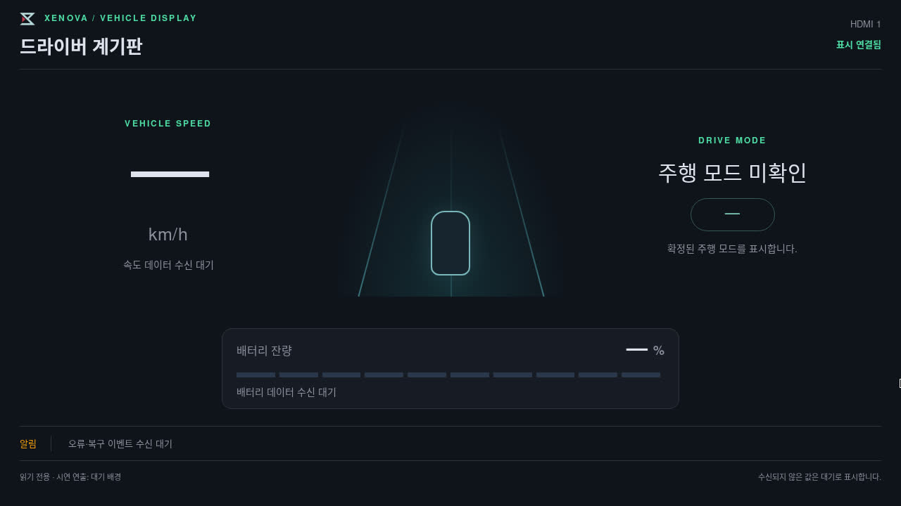
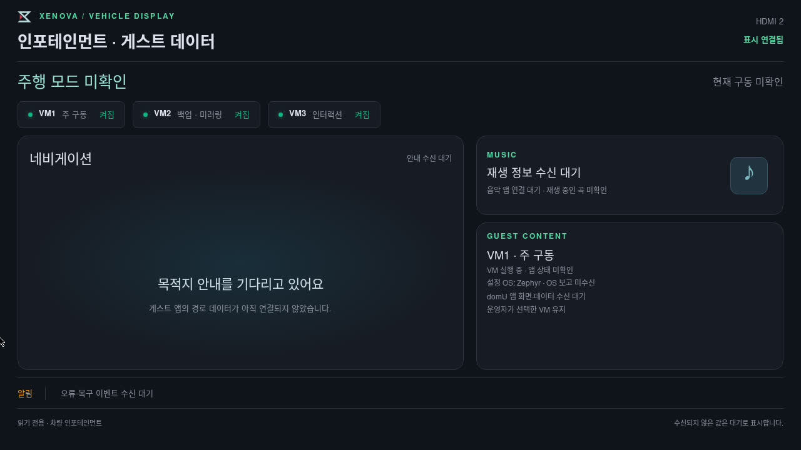

# 256 실보드 HDMI 두 화면 동시 배치 시험 — 2026-10-28

## 결과와 범위

실제 Raspberry Pi dom0와 서로 다른 EDID의 HDMI 모니터 두 대에서 계기판과 인포테인먼트를 동시에 표시했다. X11 실제 출력 영역 캡처와 Chromium 창 경계·DOM으로 확인했다. 10초 재표시 시험(06:49:30 UTC 실행)을 추가했고, 사용자가 두 화면이 잘 뜨는 것을 직접 확인했다고 답했다. 이 기록만으로 256 전체나 다른 지라를 완료 처리하지 않는다.

| 확인 | 결과 |
|---|---|
| HDMI-1 계기판 | 1280×720, 좌표 0,0, 전체화면 |
| HDMI-2 인포테인먼트·게스트 데이터 | 1280×720, 좌표 1280,0, 전체화면 |
| 전체 데스크톱 | 2560×720, 서로 다른 두 물리 커넥터·EDID 매핑 |
| HDMI2 새로고침 | 계기판 제목·창 좌표 유지, 두 창 전체화면 유지 |
| HDMI2 VM3 선택 | Debian 설정 OS 표시로 변경, 계기판 유지, 두 창 전체화면 유지 |
| 마지막 확인 | 두 DOM 1280×720, scrollHeight 720, 브라우저 주소창 없는 실제 출력 캡처 |
| 정리 | 시험 프로세스·임시 feed 종료, private mount 없음, VT1 복귀, 원래 framebuffer와 다른 바이트 0 |
| 종료 후 상태 | VM3/VM1/VM2 domid 1/2/3 유지, 실패 systemd unit 0, 기존 22·8081 listener 유지 |

VM 실행 상태는 실제 Xen 조회값이다. 속도·배터리·주행 모드·앱·OS 보고는 이 시험에서 MQTT 연결하지 않았고, 미수신·미확인으로 표시했다. 지도·음악 실데이터나 게스트 앱 영상 표시의 통합 완료를 뜻하지 않는다. 게스트 명령과 주행 명령을 보내지 않았다.

## 실행 구성과 의존성

- 작업 브랜치: `feat/platform/S15P31E110-256-dual-hdmi-bringup`, 기준 platform `ef79127`.
- 웹은 별도 252 worktree의 미커밋 renderer 변경을 빌드한 산출물을 사용했다. 해당 소스 변경은 252 worktree에 그대로 남아 있으며 이번 256 문서에 소스가 편입된 것은 아니다. web bundle SHA-256: `dd2d25c2ca17f5926e6aa0e99a56c17a7b49cb20b6cd497536fbeec5df8796ed`.
- 보드의 격리된 ARM64 graphics rootfs에서 modesetting `/dev/dri/card0`, Xorg :5/VT2, Openbox, 샌드박스를 유지한 Chromium 두 프로세스를 실행했다. 각 창은 별도 profile과 `--app`·`--kiosk`를 사용했다.
- 실제 제품 X11Layout·EDID 매핑과 idle guard를 사용했다. `physical_verified`는 이 코드의 EDID·출력 좌표 검증 결과이며 사용자 육안 확인을 대신하지 않는다.
- 실행 감독은 별도 시험 스크립트다. 정식 Playwright 키오스크 및 systemd 자동 시작 전체 경로를 통합 시험한 것은 아니다. 시스템 패키지나 자동 시작 서비스를 추가하지 않았다.
- 새로고침·VM3 선택은 시험용 private feed에만 적용했다. 공용 API·VM 설정·펌웨어는 변경하지 않았다.

## 실패 기록과 수정

1. 06:29:53 UTC: 페이지 이동 뒤 창이 일반 창으로 돌아와 1271×628 viewport로 실패했다.
2. 06:32:31 UTC: 초기 경계 검사 직후에는 전체화면이었으나 실제 캡처에 주소창이 나타났다. 당시 helper의 completed=true만으로 통과시키지 않고 시각 검사 실패로 정정했다. 실패 캡처와 원본 JSON을 보존했다.
3. 06:37:43 UTC: app+kiosk 방식 변경 후, 인증 전 로딩 중 생략된 title 필드를 시험기가 직접 읽어 KeyError가 났다. 제품 결함으로 분류하지 않았다.
4. 06:39:38 UTC: app+kiosk·독립 profile·정확한 CDP target 선택을 적용하고, 전체화면을 초기 안정화 후·새로고침 후·선택 후·종료 전에 반복 확인했다. 약 90초 표시 구간과 실제 캡처 검사를 통과했다.

## 남은 검증

- 물리 케이블 분리·재연결, 프로세스 종료 후 자동 복귀.
- 기본 설정으로 정상/콜드 부팅 반복 및 정식 자동 시작 통합. 이번 시험은 앞선 tryboot boot_id를 유지했다.
- 두 실제 출력 동시 인코딩 CPU·전송 지연 시험. 앞선 257 성능 목표 미달을 이번 기능 시험으로 해소했다고 판단하지 않는다.
- 실제 domU·주행/복구 데이터, 외부 서버 웹 연결은 각각 별도 연동 범위다.
- KMS overlay·설정의 Yocto 이미지 패키징과 V3D 경고는 앞선 bringup 문서의 미해결 항목을 유지한다.

## 증거

[evidence/summary.json](evidence/display-256-dual-screen-20261028/summary.json), [시험 전](evidence/display-256-dual-screen-20261028/kms-preflight-20261028.json), [시험 후](evidence/display-256-dual-screen-20261028/kms-postflight-20261028.json).

같은 evidence 디렉터리에 네 차례의 원본 결과·실제 원격 실행 소스 gzip, 최종 시험 helper, 실패 캡처, VM3 선택 캡처와 SHA-256 목록을 보관했다. 커밋·푸시·MR 생성·지라 상태 변경은 하지 않았다.

## HDMI0 케이블 분리·재연결 추가 시험

06:54:19 UTC 시작한 별도 bounded 시험에서 사용자가 계기판 쪽 HDMI0(USB-C 전원 옆)를 분리하고 같은 포트에 재연결했다. 보드가 card0-HDMI-A-1 disconnected → connected를 감지했고, 두 이벤트 사이 관측 간격은 11.17초였다. HDMI-A-2는 두 이벤트 모두 connected였다.

사용자는 다시 꽂은 뒤 두 화면 모두 정상이라고 확인했다. 양쪽 창 좌표·전체화면은 초기와 일치했다(계기판 0,0 / 인포테인먼트 1280,0; 각각 1280×720). 재연결 10초 후 실제 두 출력 캡처를 보관했다. 분리 이후 수동 xrandr 재적용·창 재배치나 브라우저 재시작은 하지 않았다. 이 환경에서의 자연 복귀를 확인한 것이며, 정식 키오스크 supervisor 재기동 경로나 HDMI1/양쪽 동시 분리까지 검증한 것은 아니다.

시험 종료 후 graphics 프로세스와 feed를 종료했고 VT1 및 원래 framebuffer를 복원했다(다른 바이트 0). completed_dual_display_checks=false는 이번 실행에서 앞선 독립 새로고침·VM 선택 시나리오를 생략했다는 표시다. completed_hotplug_observation=true와 실제 접속 전환·창 경계·사용자 확인을 이번 시험의 근거로 사용한다.

증거: [HDMI0 hotplug summary](evidence/display-256-hotplug-20261028/summary.json). 위 남은 범위 중 HDMI0 한 포트의 물리 재연결은 수행했고, HDMI1 및 정식 자동 시작 통합은 남아 있다. 커밋·푸시는 하지 않았다.

## HDMI1 케이블 분리·재연결 추가 시험

06:57:44 UTC 시작한 후속 시험에서 사용자가 인포테인먼트 쪽 HDMI1(USB-C 전원에서 먼 쪽)을 분리하고 같은 포트에 재연결했다. 보드가 card0-HDMI-A-2 disconnected → connected를 감지했고 HDMI-A-1은 두 이벤트 모두 connected였다. 사용자는 재연결 후 두 화면 모두 정상이라고 확인했다.

마지막 두 창은 초기와 동일한 1280×720 전체화면·좌표를 유지했다. 이 시험에서도 분리 이후 수동 xrandr 재적용·창 재배치·브라우저 재시작 없이 복귀했다. 종료 후 graphics 프로세스·feed 정리, VT1 복귀, framebuffer 원본 복원(다른 바이트 0)을 확인했다.

이로써 HDMI0와 HDMI1을 각각 한 번씩 분리·재연결하는 시험을 수행했다. 양쪽 동시 분리·포트 교환·다른 EDID 모니터 교체·자동 시작/콜드 부팅 통합·장시간 전송 성능은 이 결과에 포함하지 않는다. 앞선 문단의 HDMI1 미시험 항목은 이번 결과로 해소했다. [HDMI1 시험 요약](evidence/display-256-hotplug-hdmi1-20261028/summary.json)에 수치와 증거를 보관했다. 커밋·푸시는 하지 않았다.
